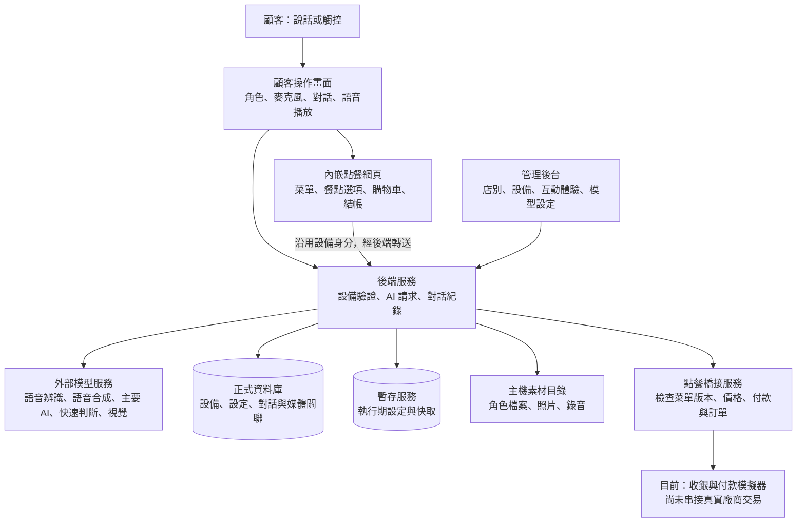
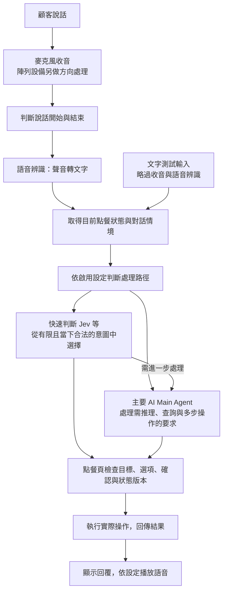

# Webnavior 專案交接手冊

整理日期：2026 年 11 月 9 日。

這份手冊讓接手者了解產品目的、系統分工、啟動方式、測試方法與後續工作。必要操作直接寫在本文件內，不需要先閱讀其他文件。英文僅保留程式名稱、設定名稱、指令及錯誤訊息，並附上中文說明。

本次依目前工作目錄中的程式、設定規則、啟動腳本及使用者確認的方向整理。本次沒有重新啟動整套服務、操作硬體或確認線上部署版本。程式已有功能、測試通過、已部署和現場可用是不同狀態，以下會分開說明。

## 一、產品目的與下一階段體驗

Webnavior 是以 AI 協助顧客操作點餐網頁的系統。顧客可以說出想吃什麼、詢問餐點或調整數量，由 AI 協助操作。點餐頁仍保有觸控功能。

產品精神有兩點：

1. **讓顧客看見 AI 幫忙操作網頁。** AI 像旁邊協助點餐的服務人員，顧客能看見滑鼠移動、畫面捲動與實際操作，知道 AI 正在找哪道菜、處理哪個步驟。畫面動作必須對應實際操作。
2. **讓盲人也能用語音操作網頁。** 顧客不必看畫面或自己找到按鈕，就能透過語音表達需求。系統也要用語音說明餐點資訊、進度、待確認事項與結果。這是產品目標，尚不能宣稱完整盲人使用流程已通過驗證。

**下一階段要改善餐點詢問的呈現：** 顧客詢問特定餐點時，不應使用推薦欄位跳出結果。AI 念到哪道菜，就應像人一樣操作網頁，捲動到該餐點的位置，並讓餐點亮起來。介紹多道餐點時，畫面應跟著介紹順序移動。

例如顧客問「牛肉麵有什麼」，AI 應找出真實菜單中的對應餐點，移到它的位置、讓它亮起來，再根據實際資料介紹。這是待實作與驗證的要求，不能把目前已有查詢或推薦功能寫成這項體驗已完成。

## 二、架構圖：各部分怎麼合作

箭頭表示請求或資料流向，回覆會沿原路回來。



點餐頁是放在顧客畫面裡的獨立網頁，兩者不是同一個程式。它們交換經過驗證的操作請求與結果；程式中的 WebMCP 指點餐操作工具，Eventa 是兩個網頁間傳遞訊息的機制。AI 不能只說「已加入」就算完成，必須取得點餐頁實際執行的結果。

| 部分 | 白話用途 | 程式位置 |
| --- | --- | --- |
| 顧客操作畫面 Kiosk | 收音、顯示角色、播放語音、安排對話與操作 | `apps/stage-kiosk` |
| 點餐網頁 | 顯示餐點、選項、購物車與結帳 | `apps/order-menu` |
| 管理後台 | 管理設備、店別、互動體驗與模型 | `apps/stage-web` |
| 後端服務 | 驗證身分、呼叫模型、保存紀錄及轉送點餐請求 | `apps/server` |
| 點餐橋接服務 | 連接菜單、付款與收銀系統；目前附模擬器 | `apps/order-menu-server` |
| 共用規則 | 訊息格式、對話規則與互動服務契約 | `packages/stage-shared` |
| 共用畫面與功能 | 角色、服務連線與共用畫面邏輯 | `packages/stage-ui` |
| 共用文字 | 點餐提示與多語言訊息 | `packages/i18n` |

### 顧客說一句話之後



這是責任分工示意，不代表每句話都會執行點餐操作。背景語音、未說完的話、釐清與故障各有處理方式；說話被辨識成文字，也不代表已同意下單。VAD 是說話起訖判斷、ASR 是語音轉文字、TTS 是文字轉語音。

## 三、目前狀態與限制

| 項目 | 目前交接判斷 |
| --- | --- |
| 顧客畫面、點餐頁、管理後台 | 已有程式與分開的啟動入口，接手機器仍需實際啟動驗收 |
| 語音辨識、語音回覆、主要 AI | 已有連線流程，必須提供可用的模型服務與設定 |
| Main Agent 是否堪用 | 初步有潛力，理解、速度、連續對話及操作穩定性仍需更多測試 |
| 是否移除 Jev | 可評估，尚未決定；不能宣稱主要 AI 已可取代它 |
| 餐點詢問時滑鼠移動、捲動定位及亮起 | 下一階段完整體驗目標，尚待實作與驗收 |
| 盲人完整語音操作 | 產品目標，需實際使用者與完整流程驗證 |
| 麥克風陣列收音 | 已有處理流程，現場收音仍需繼續改善 |
| 收銀、付款與另一商家測試菜單 | 目前執行入口使用模擬器，不代表真實收款或正式送單 |
| 呼叫工作人員 | 目前有模擬通知呈現，不能宣稱真的通知到人 |
| 真實掃碼設備、發票與交易對帳 | 仍需廠商契約、設備串接與驗收 |

本次整理沒有重新確認線上版本，正式交接時要補上實際網址、畫面載入版本及現場測試結果。

## 四、接手前要取得的資料

帳密透過團隊指定的安全管道交付，不放在文件或程式庫。未取得的內容明確寫「待交付」，不要照抄歷史值或自行猜測。

| 要交付的東西 | 用途與目前待確認事項 |
| --- | --- |
| 程式庫權限及交接版本 | 整理手冊時有多項未提交修改；交付時核對已提交範圍與剩餘修改，不能漏交必要程式 |
| 主機、登入方式與維護人 | 待交付實際位置、權限及聯絡窗口 |
| 資料庫與暫存服務連線 | 由受保護設定檔交付，分清楚開發與正式資料 |
| 後端設定及加密金鑰 | 保留既有登入與已儲存模型憑證的可用性 |
| 模型網址、名稱、金鑰及負責人 | 由後台與模型服務維護人核對，不在文件中寫出祕密 |
| 管理帳號、設備歸屬及現場 PIN | 待交付，確認每個角色可操作的範圍 |
| 麥克風、喇叭、攝影機及擺位 | 待逐台記錄型號、連接方式、方向與距離 |
| 上一版程式、網站及資料備份 | 待確認保存位置、維護人及可行的還原程序 |

`BETTER_AUTH_SECRET` 是登入簽章祕密，`LLM_ROUTER_MASTER_KEY` 是模型憑證的加密主金鑰。接手既有資料庫時保留原值，不能為了方便重新產生，否則會造成登入或解密問題。

## 五、如何在開發機跑起來

以下是同一台電腦的本機開發流程。所有 `pnpm` 指令都在專案根目錄執行。各常駐服務使用獨立終端機，成功啟動後保持開啟。瀏覽器統一用 `localhost`，避免任意混用 IP 與 `127.0.0.1` 導致設備憑證或來源驗證對不上。

### 5.1 工具與相依套件

準備 Git、Node.js、Corepack、PostgreSQL 與 Redis。現有部署腳本指定 Node.js `24.22.1`，根套件指定 pnpm `10.33.0`，接手機器先對齊版本。

```bash
node --version
corepack enable
corepack prepare pnpm@10.33.0 --activate
pnpm --version
pnpm install --frozen-lockfile
```

版本應顯示 `v24.22.1` 與 `10.33.0`。套件安裝會自動建置共用套件，首次可能下載角色資源，需要網路。成功應以結束碼 0 完成。不同作業系統要各自安裝，不直接複製別台的 `node_modules`。

### 5.2 資料庫與後端設定

優先使用交付的開發資料庫及 Redis，先確認不是正式資料。全新空白環境，可由有權限的人建立專用 PostgreSQL 帳號與資料庫，例如：

```bash
sudo -u postgres createuser --pwprompt webnavior_dev
sudo -u postgres createdb --owner=webnavior_dev webnavior_dev
```

已安裝 Ubuntu Redis 服務的開發機可檢查：

```bash
systemctl status redis-server --no-pager
redis-cli ping
```

未設定密碼的本機 Redis 應回覆 `PONG`；有密碼時使用交付的驗證方式。上述指令假設資料庫與 Redis 已安裝，不是安裝程序。在已有正式服務的主機上，不要重建資料庫或直接啟動專案整份 Docker Compose，以免開出重複服務及衝突的連接埠。

建立或安全取得 `apps/server/.env.local`。新環境至少需要下列內容；尖括號要換成實際值，不能原樣執行：

```dotenv
NODE_ENV=development
HOST=127.0.0.1
PORT=5168
API_SERVER_URL=http://localhost:5168
WEB_APP_URL=http://localhost:5167
AUTH_UI_URL=http://localhost:5167
ADMIN_UI_URL=http://localhost:5167
ADDITIONAL_TRUSTED_ORIGINS=http://localhost:5169,http://localhost:5166
DATABASE_URL=postgresql://webnavior_dev:<資料庫密碼>@127.0.0.1:5432/webnavior_dev
REDIS_URL=redis://127.0.0.1:6379/0
BETTER_AUTH_SECRET=<交付的登入簽章祕密>
AUTH_GOOGLE_CLIENT_ID=<Google 登入應用識別>
AUTH_GOOGLE_CLIENT_SECRET=<Google 登入應用金鑰>
AUTH_GITHUB_CLIENT_ID=<GitHub 登入應用識別>
AUTH_GITHUB_CLIENT_SECRET=<GitHub 登入應用金鑰>
LLM_ROUTER_MASTER_KEY=<交付的 base64 編碼 32 位元組主金鑰>
KIOSK_POS_BRIDGE_URL=http://127.0.0.1:5170/
KIOSK_ADMIN_PIN=<現場設定用的 4 至 12 位數字>
KIOSK_DEVELOPMENT_REGISTRATION_ENABLED=true
WEBNAVIOR_TEST_AUTH_ENABLED=true
```

OAuth 是第三方登入設定；目前後端啟動仍要求 Google、GitHub 的四個欄位有值。兩個開發開關只用於本機，正式環境必須關閉。資料庫密碼有網址特殊符號時須先編碼；有密碼的 Redis 格式為 `redis://:<編碼後密碼>@127.0.0.1:6379/0`。

### 5.3 三個前端與橋接服務設定

顧客畫面 `apps/stage-kiosk/.env.local`：

```dotenv
VITE_SERVER_URL=http://localhost:5168
VITE_API_SERVER_URL=http://localhost:5168
VITE_ORDERING_SCENARIO_URL=http://localhost:5166
```

管理後台 `apps/stage-web/.env.local`：

```dotenv
VITE_SERVER_URL=http://localhost:5168
```

點餐頁 `apps/order-menu/.env.local`：

```dotenv
VITE_AIRI_ORIGIN=http://localhost:5169
VITE_ORDER_MENU_SERVER_URL=http://localhost:5168/api/kiosk/pos
VITE_ORDER_MENU_PUBLIC_URL=http://localhost:5166
```

菜單透過後端轉送至橋接服務，保留設備驗證。`VITE_AIRI_ORIGIN` 是允許操作點餐頁的顧客畫面來源，不是模型網址。前端 `VITE_` 設定會送到瀏覽器，不放密碼或模型金鑰。

橋接服務 `apps/order-menu-server/.env.local`：

```dotenv
ORDER_MENU_SERVER_PORT=5170
ORDER_MENU_POS_SIMULATOR_PORT=5171
ORDER_MENU_ALLOWED_ORIGIN=http://localhost:5166
ORDER_MENU_POS_UPSTREAM_URL=http://127.0.0.1:5171
ORDER_MENU_KIOSK_API_URL=http://127.0.0.1:5168
ORDER_MENU_POS_TIMEOUT_MS=3000
```

### 5.4 依序啟動

先建置資料表套件，再啟動後端：

```bash
pnpm -F @proj-airi/server-schema build
pnpm -F @proj-airi/server dev
```

後端啟動會套用內嵌的資料庫遷移，也就是把資料表調整成程式需要的結構。看到 `Applied schema` 和 `Server started` 後，在另一個終端機檢查：

```bash
curl -fsS http://localhost:5168/livez
curl -fsS http://localhost:5168/readyz
```

兩個請求都應成功。前者檢查程式存活，後者檢查資料庫與 Redis 就緒；不代表外部模型也可用，模型需另外驗證。

全新本機資料庫可在此時建立測試帳號：

```bash
pnpm -F @proj-airi/server seed:test-accounts
```

會建立測試店，以及系統管理員 `admin@webnavior.local`、店別管理員 `manager@webnavior.local`、內容管理員 `content@webnavior.local`。搭配開發帳號辨識使用，不是正式帳號建立流程，也沒有正式環境通用密碼。

開啟管理後台後，登入頁應顯示「測試模式：輸入已建立的帳號即可登入」。輸入上面的帳號即可；若仍要求密碼，先確認後端的 `WEBNAVIOR_TEST_AUTH_ENABLED=true` 已生效並重新啟動，不要猜測測試密碼。

接著各開一個終端機執行：

| 順序 | 指令 | 成功後用途與入口 |
| --- | --- | --- |
| 1 | `pnpm -F @proj-airi/order-menu-server dev` | 橋接服務 `127.0.0.1:5170`、模擬器 `127.0.0.1:5171` |
| 2 | `pnpm -F @proj-airi/order-menu dev` | 點餐頁 `http://localhost:5166/` |
| 3 | `pnpm -F @proj-airi/stage-web dev` | 管理後台 `http://localhost:5167/admin` |
| 4 | `pnpm -F @proj-airi/stage-kiosk dev` | 顧客畫面 `http://localhost:5169/kiosk/` |

每個前端應顯示啟動網址，並能在瀏覽器開啟。確認橋接服務和公開菜單：

```bash
curl -fsS http://localhost:5168/api/kiosk/pos/v1/catalog
```

應回傳包含餐點的 JSON 資料。獨立點餐頁可以瀏覽，完整交易仍需要顧客畫面的設備身分。另一商家測試入口是 `http://localhost:5166/supplier.html`，有獨立測試菜單與交易狀態。

### 5.5 註冊、發布體驗與設定模型

1. 開啟顧客畫面，新環境會顯示「建立測試設備」。本機開發註冊開關啟用後才可使用。
2. 建立設備後，到管理後台「Kiosk 設備」確認店別與設備歸屬。
3. 在「互動體驗」設定角色、歡迎詞與服務場景。儲存草稿後要發布，並確認設備已指派該版本；只存草稿不會更新顧客體驗。
4. 確認互動服務的點餐網址是 `http://localhost:5166`，允許的顧客畫面來源是 `http://localhost:5169`。已儲存網址可能優先於前端初始設定。
5. 在「Kiosk AI 能力」分別設定對話、視覺、語音辨識 ASR 與語音合成 TTS。輸入服務網址、金鑰、模型及逾時，測試連線、驗證並儲存、選擇啟用，最後套用到 Kiosk。
6. 若使用 System One 快速判斷，另設定其服務並執行真實就緒驗證後啟用。它與主要 AI 是不同設定；是否保留 Jev 仍在評估，不要逕自刪除。
7. 重新載入顧客畫面，允許麥克風及攝影機，確認選到實際要用的裝置。

正式環境不能直接使用開發註冊按鈕；目前註冊畫面仍標示正式流程待替換。交接時須提供既有設備有效設定，或先完成正式註冊流程，不能宣稱已有完整的正式開通程序。

### 5.6 換到另一台電腦測試

遠端電腦的 `localhost` 指向它自己，不是伺服器。跨機測試要使用實際 HTTPS 網址，同步調整後端可信任來源、顧客畫面的 API、點餐網址及允許的控制來源。一般區網 HTTP 網址可能無法使用麥克風與攝影機。

正式部署建議由同一 HTTPS 網域提供管理後台、顧客畫面、點餐頁及 API。

## 六、跑起來之後怎麼驗收

先用文字排除收音因素，再測真實語音，最後測硬體及實際使用情境。

| 測試 | 操作 | 要確認的結果 |
| --- | --- | --- |
| 畫面與菜單 | 開啟顧客畫面及點餐頁 | 角色、菜單與價格正常顯示 |
| 文字流程 | 設備設定切純文字模式，使用模擬語音辨識輸入 | 對話與實際點餐狀態一致；此測試不驗證麥克風或 ASR |
| 餐點查詢 | 詢問菜單中確實存在的餐點 | 有真實資料依據，不把查詢當加入購物車 |
| 加入與修改 | 說出餐點、份數，回答選項後修改數量 | 品項、選項、份數正確，無重複加入 |
| 多道餐點與追問 | 一次說多道菜，接著說「再一份」或改條件 | 對應正確餐點，保留尚未完成的要求 |
| 測試訂單 | 檢查購物車並完成確認 | 只有取得接受結果才說成功；不當成真實付款 |
| 語音輸入與輸出 | 用麥克風說話並聽回覆 | 不漏字、不重複處理，語音和畫面一致 |
| 播放時插話 | AI 播放語音時提出新需求 | 不誤收喇叭聲、不重複操作，不遺失已執行結果 |
| 不同方向與距離 | 測正面、左右、遠近及背景說話 | 記錄辨識文字、漏字與回音，不只看音量 |
| 盲人語音使用 | 在測試環境邀請盲人使用者完成指定任務 | 資訊、選項、確認、錯誤均有語音，可完成或明確退出 |

每次留下日期、設備擺位、載入版本、模型設定、原始語句、辨識文字、耗時、網頁結果與失敗症狀。文字或合成測試不能替代真人收音與現場驗收。

設備設定有一般點餐機與桌邊服務兩種模式。一般點餐機走付款流程；桌邊服務目前使用測試桌號、不付款送出測試訂單。模式在新一輪點餐時生效，驗收要記錄當時模式，不能把桌邊免付款當成一般點餐機漏付款。

下一階段另驗證：念到哪道菜，畫面是否定位並亮起同一道菜；餐點詢問是否仍錯用推薦欄位。

## 七、麥克風陣列要特別注意什麼

一般麥克風走一般收音流程；陣列路徑會確認實際聲道，再做方向處理。目前有八聲道輸入、七支麥克風位置映射的設定，不能只看裝置名稱就認定方向正確。聲道順序、陣列半徑、正面朝向、喇叭擺位與顧客距離都需實機確認。

方向處理會依 AI 是否實際播放語音切換策略，目的是降低喇叭回音與側面干擾。但如果處理已刪掉顧客聲音，單純放大音量無法恢復。已改善部分麥克風問題，不代表陣列收音已全部解決。

現場設定入口：兩秒內點「AIRI 餐飲服務員」標籤五次，再輸入 PIN。PIN 由後端驗證；設定在後端 `KIOSK_ADMIN_PIN` 或 `KIOSK_ADMIN_PIN_FILE`，不要放入前端 `VITE_` 變數。

選好具體麥克風後，要按「套用並重新啟動」才切換。修改方向映射及陣列半徑前先停止收音。

隔離模型因素時，可建置獨立收音檢查頁：

```bash
pnpm -F @proj-airi/stage-kiosk build:audio-check
```

輸出在 `apps/stage-kiosk/dist-audio-check/`。將整個目錄放到獨立 HTTPS 靜態路徑，在接有陣列的電腦用 Firefox 開啟。允許麥克風、選原始八聲道輸入，分別錄正面、左右與背景語音；每組錄 15 秒，下載音檔及參數後再錄下一組。

頁面只留最新一組，重新整理會清除記憶體錄音，不會保存到後端。它不呼叫模型、不建立訂單，適合比較原始與處理後聲音。

## 八、既有 Ubuntu 部署如何維護

本節是程式預期的既有部署，不是空白作業系統的自動安裝流程。實際主機、帳號與網域仍須交付核對。

| 部分 | 預期位置或入口 |
| --- | --- |
| 網頁伺服器 Nginx | 接收網站請求，內部預期監聽 5169 |
| 管理後台 | 同網域 `/admin`；靜態檔 `/var/www/airi/web` |
| 顧客畫面 | 同網域 `/kiosk/`；靜態檔 `/var/www/airi/kiosk` |
| 點餐頁 | `/menu/` 及 `/menu/supplier.html`；靜態檔 `/var/www/airi/menu` |
| 後端 API | 系統服務 `webnavior-api`，內部 `127.0.0.1:5168` |
| 點餐橋接服務 | 內部 `127.0.0.1:5170`，需另行常駐，不由前端更新腳本啟動 |
| 後端正式設定 | 約定 `/etc/webnavior/server.env`，核對服務實際讀取位置 |
| 角色素材與訪客媒體 | 由 `WEBNAVIOR_KIOSK_ASSET_DIR` 決定，預期 `/var/lib/webnavior/kiosk-assets` |

Nginx 將 `/api/` 與 `/ws/chat` 轉送到後端；點餐頁使用同網域 `/api/kiosk/pos`，再經後端轉送橋接服務。資料庫與 Redis 留在內網。HTTPS 可由前方代理或 Nginx 提供，並讓後端知道原始請求使用 HTTPS。

正式前端設定放在各應用的 `.env.production.local`。將以下範例網域替換成實際值：

```dotenv
# apps/stage-web/.env.production.local
VITE_SERVER_URL=https://kiosk.example.com
```

```dotenv
# apps/stage-kiosk/.env.production.local
VITE_SERVER_URL=https://kiosk.example.com
VITE_API_SERVER_URL=https://kiosk.example.com
VITE_ORDERING_SCENARIO_URL=https://kiosk.example.com/menu/
```

```dotenv
# apps/order-menu/.env.production.local
VITE_AIRI_ORIGIN=https://kiosk.example.com
VITE_ORDER_MENU_SERVER_URL=https://kiosk.example.com/api/kiosk/pos
VITE_ORDER_MENU_PUBLIC_URL=https://kiosk.example.com/menu/
```

前端設定須重新建置才生效。後端則設定正式網域、資料庫、Redis、素材目錄與原有祕密，並關閉開發開關。正式服務應直接讀受保護環境檔，不讓開發用 `.env.local` 蓋掉正式設定。

### 8.1 檢查服務與紀錄

```bash
systemctl status webnavior-api --no-pager
journalctl -u webnavior-api -n 100 --no-pager
curl -fsS http://127.0.0.1:5168/livez
curl -fsS http://127.0.0.1:5168/readyz
curl -fsS http://127.0.0.1:5168/api/kiosk/pos/v1/catalog
sudo nginx -t
```

前兩個指令看 API 啟動與錯誤；三個請求檢查程式存活、資料相依服務及菜單橋接。API 健康不代表模型健康，模型需另查上游連線與健康檢查。

### 8.2 更新腳本目前的限制

`scripts/updateKioskUbuntu.sh` 會拉取程式、安裝套件、同步資料表、建置資料表套件、重啟 API、等待健康檢查，再建置並覆蓋三個前端。目前不能直接當作無條件可用的一鍵更新：

- 它要求乾淨工作目錄，有未提交修改時會拒絕執行。不要為了更新而丟棄修改。
- 它仍要求舊的 `VITE_KIOSK_ADMIN_PIN`，但目前畫面已改成後端 PIN 驗證。這是待修正的腳本落差，不要把真實 PIN 放進前端。
- 它的 `db:push` 會讀 `apps/server/.env.local`，可能與正式服務的資料庫不同。執行前必須核對目標，不能只檢查正式環境檔。
- 它不替橋接服務安排更新及重啟，也不自動完成備份、還原或現場驗收。
- 靜態目錄同步會刪除新建置沒有的檔案。額外放在管理站的獨立收音頁需要另行保留或重發。

### 8.3 更新與回復順序

1. 確認沒有進行中的結帳，記下原始碼版本、必要的未提交修改、三個前端載入版本及後端設定來源。
2. 備份資料庫、素材目錄、三個完整靜態目錄、設定與原有程式。備份放在發布目錄外，確認能還原；只記 Git 版本不足以保留未提交修改。
3. 在可回復的程式副本安裝與建置，依修改範圍執行第十節檢查，確認網址、資料庫目標與祕密設定沒有被覆寫。
4. 核對本版資料庫變更，使用正確正式環境套用，再啟動相符後端。資料表套件需重新建置，不混用新程式與舊資料表。
5. 橋接服務若有修改，須在無未決交易時，以它自己的常駐管理方式更新。
6. `/readyz` 和公開菜單請求成功後，再發布配套的三個前端。點餐頁 `index.html` 及 `supplier.html` 要來自同次建置，連同完整相依檔一起發布。
7. 重新載入設備，核對實際載入版本，完成一次語音及模擬訂單測試。
8. 失敗時停止繼續發布，回復上一版完整程式及靜態檔。資料表變更不保證可逆；如需還原資料庫，先停止寫入，依已驗證的備份還原程序處理。

模擬橋接服務的交易結果、桌位與接續連結在記憶體中，重啟會遺失。結果不明的訂單仍需核對，不能重啟後直接重送。後端媒體檔是原始內容，`.bin` 副檔名不代表加密；備份也要有存取管制。

## 九、常見問題怎麼查

| 症狀 | 優先檢查與處理 |
| --- | --- |
| 後端啟動就結束 | 看缺少的環境欄位；確認主金鑰長度、資料庫與 Redis 連線 |
| `/readyz` 失敗 | 先查資料庫與 Redis，暫停發布前端；模型問題另外查 |
| 菜單空白或缺少設定 | 核對點餐頁 API 設定、橋接服務與公開菜單；改前端設定後重啟或重建 |
| 註冊失敗 | 核對 API 網址、設備憑證及實際網站來源；本機確認註冊開關，正式環境不要開它 |
| 還在連舊菜單 | 檢查後台已儲存的互動服務網址，不只改建置預設值 |
| 麥克風無法開啟 | 確認 HTTPS／本機環境、瀏覽器權限、裝置選擇及套用重新啟動 |
| 漏字或收進喇叭聲 | 對照原始與處理後音檔、實際聲道、映射及距離，不只增加音量 |
| 有辨識文字但操作錯誤 | 逐段查語意、當下菜單狀態、確認問題、工具請求與執行結果 |
| 502 或模型不可用 | 查模型上游、網路及健康檢查，不等於本地 API 或資料庫故障 |
| 說成功但畫面不符 | 查工具回傳及訂單結果，不能依 AI 自述認定成功 |
| 付款或送單結果不明 | 保留鎖定與交易資訊，交人工核對，不清購物車或自動重試 |
| 更新後缺少資料欄位 | 確認資料表套件已重建、正確資料庫已更新，再重啟 API |
| 重新整理仍是舊版本 | 核對載入版本與入口檔；必要時用 `/kiosk/admin-recover.html` 修復管理快取，不先刪設備資料 |

### 尚待處理的現場問題

最近一次唯讀調查發現，後台對話的錄音播放可能配到另一句音檔，涉及依相鄰活動或陣列順序猜測關聯。後續應綁定同一會話與同一句話的確切紀錄。目前能支持「歷史播放對應錯誤」，不能據此宣稱即時語音辨識交換了句子。

另有餐點替換反覆釐清、要求其他餐點卻重複邀請工作人員、外帶要求產生無效操作參數，以及「麵食／面食」分類對應問題。這些仍需重現及處理，本次文件整理沒有修復，不能標成已解決。

## 十、修改後如何檢查

先跑與改動有關的測試，再檢查該套件的型別。型別檢查是確認程式介面能否對上，不能替代實際收音、真實模型與點餐驗收。

```bash
# 重播已整理的點餐案例，包含相關共用規則
pnpm -F @proj-airi/stage-kiosk test:ordering-regressions

# 點餐頁與橋接服務測試
pnpm -F @proj-airi/order-menu test:run
pnpm -F @proj-airi/order-menu-server test:run

# 依實際改動選擇，不必每次全部執行
pnpm -F @proj-airi/stage-kiosk typecheck
pnpm -F @proj-airi/order-menu typecheck
pnpm -F @proj-airi/order-menu-server typecheck
pnpm -F @proj-airi/server typecheck
pnpm -F @proj-airi/stage-web typecheck
```

這份指令清單不是測試通過證明。提交程式前仍須記錄各次檢查結果；交接時也要重新確認交付版本。本手冊的完整啟動步驟與實機驗收尚未逐步重跑，模型及硬體可用性仍需在接手機器確認。

## 十一、下一階段建議順序

1. **讓接手者在自己的環境跑通。** 補齊第四節交付項目，完成文字、語音及模擬訂單驗收，記錄部署版本與限制。
2. **繼續處理麥克風陣列收音。** 固定設備、方向、距離與語句，比較原始及處理後音檔，把收音和語音辨識問題分開，不用模型調整掩蓋音訊缺失。
3. **多測 Main Agent，再評估 Jev。** 初步表現有潛力，但仍需驗證理解、速度、連續對話、網頁操作與失敗處理。依使用者觀察，麥克風改善已改善當初促使採用 Jev 的問題，因此可考慮簡化流程；是否移除尚未決定。比較時保留相同情境與實際結果，不能只比較文字答案或單次耗時。
4. **實作看得見的操作體驗。** 特定餐點詢問不走推薦欄位，讓滑鼠、捲動、亮起的餐點與語音介紹一致。
5. **驗證盲人可完成語音操作。** 確認餐點、選項、金額、確認及錯誤有語音回饋，邀請盲人使用者測試，找出仍需看畫面或求助的步驟。
6. **依廠商資料完成正式交易。** 收銀、付款、發票、掃碼及對帳需明確契約與設備驗收，不自行猜測，也不把模擬結果當正式交易。

## 十二、交接完成檢查表

- [ ] 接手者已拿到程式、必要的未提交修改、帳號權限及受保護設定。
- [ ] 能解釋顧客畫面、點餐頁、後端、橋接服務與模型各自做什麼。
- [ ] 能依第五節啟動必要服務，辨認每個成功結果。
- [ ] 能設定設備與模型，區分儲存草稿、發布體驗及套用模型設定。
- [ ] 完成文字、真實語音及模擬訂單流程，留下版本與測試紀錄。
- [ ] 能進入現場設定，確認實際麥克風、聲道及收音方向。
- [ ] 能查紀錄、分辨模型與收音問題，知道如何保留結果不明的交易。
- [ ] 知道備份位置、維護人與可實際執行的回復程序。
- [ ] 知道 Main Agent 仍需評估，移除 Jev 尚未決定。
- [ ] 知道兩項產品精神，以及餐點定位亮起、盲人語音使用和陣列收音的後續工作。
