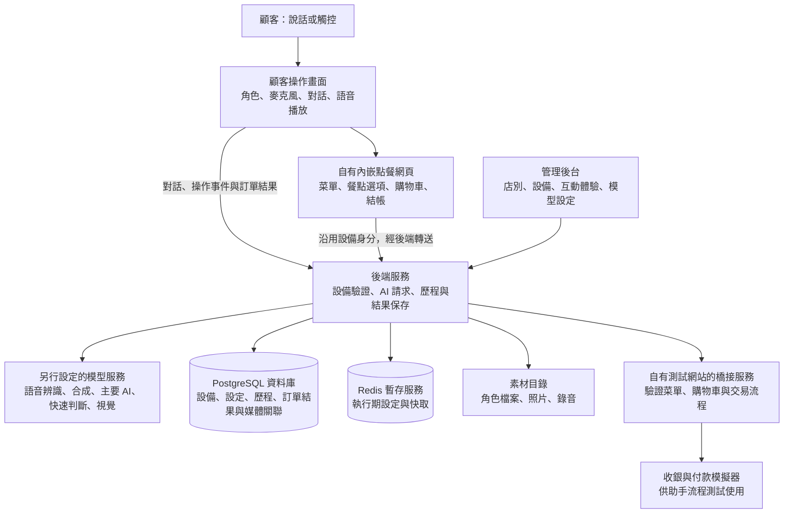
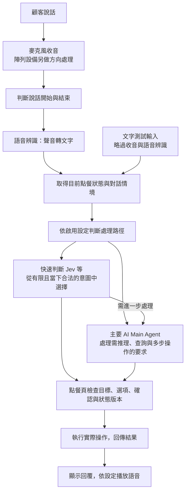
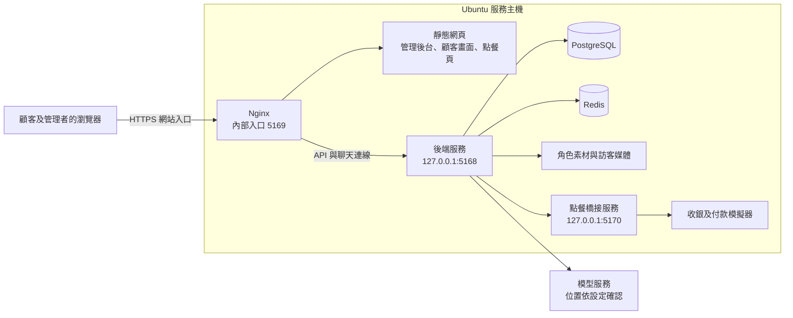
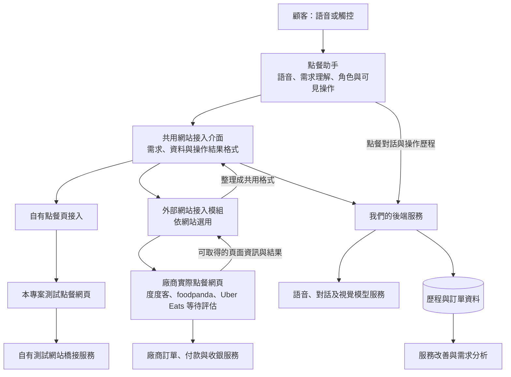

# Webnavior 專案交接手冊

整理日期：2026 年 11 月 10 日。

這份手冊說明專案目的、現有架構、啟動、驗收與維護方式。第十一章集中整理後續規劃與架構提案。

現況依原始碼與部署腳本整理。實際線上版本、硬體效果及整套啟動步驟，仍需在交接環境驗收。

## 一、專案目的

Webnavior 的產品定位是在既有點餐網站上疊加 AI 助手。顧客可以說出想吃什麼、詢問餐點或調整數量，由助手協助操作網站。訂單、付款及後續交易流程沿用網站原有功能，我們負責協助操作、取得資訊、核對結果及保存相關歷程。

目前程式中的自有點餐頁、橋接服務及模擬器，是驗證助手流程的測試環境。接入外部實際網站的工作，是讓助手能使用對方已完成的功能，並非另建一套收銀、付款、發票或對帳系統。

產品朝兩個方向發展：一是讓顧客看見 AI 移動滑鼠、捲動畫面並協助點餐；二是讓盲人也能透過語音了解餐點、表達需求及確認結果。接下來的體驗改善與長期架構提案集中在第十一章。

## 二、現有系統架構

目前由顧客操作畫面、獨立點餐網頁、管理後台、後端與點餐橋接服務組成。下圖只呈現現有程式的主要分工，實際部署位置與模型主機仍需依交付環境確認。



點餐頁是放在顧客畫面裡的獨立網頁，兩者透過受驗證的訊息交換操作請求與結果。程式中的 WebMCP 指點餐操作工具，Eventa 是兩個網頁間傳遞訊息的機制。完成操作的依據是點餐頁回傳的實際結果。

### 模組與程式位置

| 部分 | 白話用途 | 程式位置 |
| --- | --- | --- |
| 顧客操作畫面 Kiosk | 收音、顯示角色、播放語音、安排對話與操作 | `apps/stage-kiosk` |
| 自有測試點餐網頁 | 提供餐點、選項、購物車與結帳，驗證助手操作 | `apps/order-menu` |
| 管理後台 | 管理設備、店別、互動體驗與模型 | `apps/stage-web` |
| 後端服務 | 驗證身分、呼叫模型、保存紀錄及轉送點餐請求 | `apps/server` |
| 測試網站橋接服務 | 提供測試菜單與交易狀態，附付款及收銀模擬器 | `apps/order-menu-server` |
| 共用規則 | 訊息格式、對話規則與互動服務契約 | `packages/stage-shared` |
| 共用畫面與功能 | 角色、服務連線與共用畫面邏輯 | `packages/stage-ui` |
| 共用文字 | 點餐提示與多語言訊息 | `packages/i18n` |

### 功能模組與目前的模組化程度

上表是應用與套件分工；應用內也已有負責特定功能的模組。提示詞與程式規則是這些模組採用的實作方式，並不代表系統沒有模組。

| 功能模組 | 主要責任 | 主要程式位置 |
| --- | --- | --- |
| 收音與裝置選擇 | 選定麥克風、管理收音生命週期、偵測聲道及陣列方向處理 | `apps/stage-kiosk/src/composables/useKioskMicrophoneSelection.ts`、`useArrayMicrophone.ts` |
| 語音服務 | 整理錄音、呼叫辨識與合成服務、處理音訊格式與服務設定 | `apps/stage-kiosk/src/services/kiosk-audio.ts`、`apps/server/src/services/domain/kiosk-audio/` |
| 語句排程與互動輪次 | 排列顧客語句、管理取消與插話，阻止舊請求影響新一輪 | `apps/stage-kiosk/src/services/kioskUtteranceQueue.ts`、`apps/stage-kiosk/src/composables/useKioskInteractionTurn.ts` |
| 互動網頁連接 | 綁定目前網頁、發現可用操作、執行請求並處理回傳及斷線 | `packages/stage-ui/src/services/interactiveServiceClient.ts`、`apps/stage-kiosk/src/services/scenario-registry.ts` |
| 需求判斷與點餐指引 | 區分詢問、訂購及回答問題，組織提示詞與有限候選判斷 | `apps/server/src/services/domain/kiosk-interaction-decision/`、`kiosk-conversation-skills/` |
| 測試網站的點餐規則 | 解析餐點、數量與選項，管理購物車、確認及結帳狀態 | `apps/order-menu/src/kiosk-intents.ts`、`apps/order-menu/src/domain/` |
| 接待與歷程保存 | 管理顧客會話、重置、對話紀錄及訂單結果保存 | `apps/stage-kiosk/src/composables/useKioskCustomerSession.ts`、`useKioskInteractionRecording.ts` |
| 模型設定管理 | 保存、驗證與啟用各項 AI 能力的服務設定 | `apps/server/src/services/domain/webnavior-ai-control/` |

目前已有功能拆分，但整體協調仍集中在 `KioskScene.vue`、後端 Kiosk 路由及自有點餐頁的 `webmcp.ts`。修改一句話的理解或追問方式，有時仍需同時調整提示詞、前端狀態、後端檢查與點餐頁規則。這表示模組之間仍有耦合，也存在隨需求逐步演進、需要整理的部分。

現有模組尚未全部做到獨立替換、獨立測試及獨立部署。尤其自有點餐頁與助手共用的情境格式，還不能直接視為已適用所有外部網站。接手時應先掌握既有責任邊界；後續重整以穩定共用介面、集中網站差異及減少跨模組修改為方向，而不是單純增加檔案或目錄。

### 顧客說一句話之後



這是責任分工示意，不代表每句話都會執行點餐操作。背景語音、未說完的話、釐清與故障各有處理方式；說話被辨識成文字，也不代表已同意下單。VAD 是說話起訖判斷、ASR 是語音轉文字、TTS 是文字轉語音。

### AI 如何理解需求與執行操作

目前的主要做法是「提示詞工程，加上程式判斷」。提示詞就是交給模型的工作說明，例如要區分詢問與訂購、保留顧客條件、缺資料時先追問，以及只能根據真實操作結果回報成功。程式則負責提供當下狀態、比對實際餐點、套用篩選條件、解析數量與選項，並檢查這次操作是否可以執行。

因此，目前不是只靠關鍵字完成所有理解，也不是讓模型自由決定全部流程。餐點名稱、別名及部分欄位由程式比對；一句話是在詢價、訂購、修改或回答上一題，則會搭配模型的語意判斷。模型提出操作後，仍要通過程式檢查。

| 機制 | 目前的做法 |
| --- | --- |
| 提示詞工程（Prompt） | 用文字指引模型理解需求、選擇工具及回答；部分指引集中在程式中，部分設定可由後台管理 |
| 程式比對與篩選 | 根據真實菜單、名稱與別名、食材、價格、份數、選項及當下狀態處理需求，不只靠模型文字回答 |
| 工作流程（Workflow） | 對話轉交、工具執行、追問、結帳及故障處理已有程式流程與狀態控管；目前主要點餐路徑不是由獨立工作流引擎或可視化流程編輯器編排 |
| 技能（Skill） | 程式內已有名為點餐 skill 的內建模組，主要集中管理點餐指引及部分意圖判斷；尚不是可由管理者自由安裝、增減或組裝技能的通用平台 |

程式中的內建點餐模組位於 `apps/server/src/services/domain/kiosk-conversation-skills/index.ts`，對話入口會載入它的指引，部分意圖恢復也會使用它。它的名稱雖然有 skill，實際仍屬於目前「提示詞加程式規則」的做法。程式庫中給開發工具使用的 `.agents/skills` 則是開發指引，不會直接成為顧客點餐時的技能。

接手時先確認模型收到哪些指引，以及程式如何比對資料與檢查操作。

### 現有資料保存

目前已有訪客會話、逐字稿、互動／工具事件，以及成功訂單結果的保存基礎。成功訂單契約可保留訂單識別、收銀系統訂單號、數量、總額、內用／自取、測試／正式標記，另有選填餐點明細、取餐號或桌號。目前尚未提供外部訂單的持續追蹤或完整分析報表。

## 三、目前狀態與限制

| 項目 | 目前交接判斷 |
| --- | --- |
| 顧客畫面、點餐頁、管理後台 | 已有程式與分開的啟動入口，接手機器仍需實際啟動驗收 |
| 語音辨識、語音回覆、主要 AI | 已有連線流程，必須提供可用的模型服務與設定 |
| 語音辨識即時性 | 依目前使用觀察，主要問題是錄音上傳與辨識結果回傳受到網路影響。場域網路慢或不穩時，顧客說完後會等較久才出現辨識文字 |
| 語音合成即時性 | 依目前使用觀察，主要問題是請求往返與合成音訊下載受到網路影響。即使已有回覆文字，仍可能因網路等待而無法立即播出；固定歡迎詞可使用預先準備的音檔 |
| Main Agent 是否堪用 | 初步有潛力，理解、速度、連續對話及操作穩定性仍需更多測試 |
| 是否移除 Jev | 可評估，尚未決定；不能宣稱主要 AI 已可取代它 |
| 麥克風陣列收音 | 平常較安靜的測試結果不能代表吵雜現場；多人說話、現場設備噪音及本機喇叭音量大時，辨識與插話效果仍需驗證與改善 |
| 自有測試網站 | 含模擬付款及送單，供驗證助手使用；不是本專案未來需要自行完成的正式交易系統 |
| 點餐歷程與訂單資訊 | 已有會話、互動事件及成功訂單結果保存；後續訂單追蹤與完整分析尚未提供 |
| 呼叫工作人員 | 目前有模擬通知呈現，不能宣稱真的通知到人 |
| 外部網站的操作與結果取得 | 目標是使用既有網站的點餐與交易功能；尚需逐站驗證頁面讀取、操作與結果辨識，不另行承擔其付款、發票或對帳實作 |

本次整理沒有重新確認線上版本，正式交接時要補上實際網址、畫面載入版本及現場測試結果。

目前語音辨識與合成的即時性，主要受場域到服務主機之間的網路影響；服務由團隊自行架設，也仍有傳輸及往返延遲。因此改善優先方向是減少對外網路依賴，評估將語音服務放在本機或場域區網。

驗證時分開記錄顧客說完到文字出現、回覆文字到第一聲語音，以及整次互動總耗時，再對照錄音上傳、請求往返與音訊下載時間。服務運算時間也保留量測，作為區分原因的依據；目前尚未建立可承諾的整體延遲標準。

## 四、接手前要取得的資料

帳密透過團隊指定的安全管道交付，不放在文件或程式庫。未取得的內容明確寫「待交付」，不要照抄歷史值或自行猜測。

| 要交付的東西 | 用途與目前待確認事項 |
| --- | --- |
| 程式庫權限及交接版本 | 整理手冊時有多項未提交修改；交付時核對已提交範圍與剩餘修改，不能漏交必要程式 |
| 主機、登入方式與維護人 | 待交付實際位置、權限及聯絡窗口 |
| 資料庫與暫存服務連線 | 由受保護設定檔交付，分清楚開發與正式資料 |
| 後端設定及加密金鑰 | 保留既有登入與已儲存模型憑證的可用性 |
| 模型網址、名稱、金鑰及負責人 | 由後台與模型服務維護人核對，不在文件中寫出祕密 |
| 管理帳號、設備歸屬及現場 PIN | 待交付，確認每個角色可操作的範圍 |
| 麥克風、喇叭、攝影機及擺位 | 待逐台記錄型號、連接方式、方向與距離 |
| 上一版程式、網站及資料備份 | 待確認保存位置、維護人及可行的還原程序 |

`BETTER_AUTH_SECRET` 是登入簽章祕密，`LLM_ROUTER_MASTER_KEY` 是模型憑證的加密主金鑰。接手既有資料庫時保留原值，不能為了方便重新產生，否則會造成登入或解密問題。

## 五、如何在開發機跑起來

以下是同一台電腦的本機開發流程。所有 `pnpm` 指令都在專案根目錄執行。各常駐服務使用獨立終端機，成功啟動後保持開啟。瀏覽器統一用 `localhost`，避免任意混用 IP 與 `127.0.0.1` 導致設備憑證或來源驗證對不上。

### 5.1 工具與相依套件

準備 Git、Node.js、Corepack、PostgreSQL 與 Redis。現有部署腳本指定 Node.js `24.22.1`，根套件指定 pnpm `10.33.0`，接手機器先對齊版本。

```bash
node --version
corepack enable
corepack prepare pnpm@10.33.0 --activate
pnpm --version
pnpm install --frozen-lockfile
```

版本應顯示 `v24.22.1` 與 `10.33.0`。套件安裝會自動建置共用套件，首次可能下載角色資源，需要網路。成功應以結束碼 0 完成。不同作業系統要各自安裝，不直接複製別台的 `node_modules`。

### 5.2 資料庫與後端設定

優先使用交付的開發資料庫及 Redis，先確認不是正式資料。全新空白環境，可由有權限的人建立專用 PostgreSQL 帳號與資料庫，例如：

```bash
sudo -u postgres createuser --pwprompt webnavior_dev
sudo -u postgres createdb --owner=webnavior_dev webnavior_dev
```

已安裝 Ubuntu Redis 服務的開發機可檢查：

```bash
systemctl status redis-server --no-pager
redis-cli ping
```

未設定密碼的本機 Redis 應回覆 `PONG`；有密碼時使用交付的驗證方式。上述指令假設資料庫與 Redis 已安裝，不是安裝程序。在已有正式服務的主機上，不要重建資料庫或直接啟動專案整份 Docker Compose，以免開出重複服務及衝突的連接埠。

建立或安全取得 `apps/server/.env.local`。新環境至少需要下列內容；尖括號要換成實際值，不能原樣執行：

```dotenv
NODE_ENV=development
HOST=127.0.0.1
PORT=5168
API_SERVER_URL=http://localhost:5168
WEB_APP_URL=http://localhost:5167
AUTH_UI_URL=http://localhost:5167
ADMIN_UI_URL=http://localhost:5167
ADDITIONAL_TRUSTED_ORIGINS=http://localhost:5169,http://localhost:5166
DATABASE_URL=postgresql://webnavior_dev:<資料庫密碼>@127.0.0.1:5432/webnavior_dev
REDIS_URL=redis://127.0.0.1:6379/0
BETTER_AUTH_SECRET=<交付的登入簽章祕密>
AUTH_GOOGLE_CLIENT_ID=<Google 登入應用識別>
AUTH_GOOGLE_CLIENT_SECRET=<Google 登入應用金鑰>
AUTH_GITHUB_CLIENT_ID=<GitHub 登入應用識別>
AUTH_GITHUB_CLIENT_SECRET=<GitHub 登入應用金鑰>
LLM_ROUTER_MASTER_KEY=<交付的 base64 編碼 32 位元組主金鑰>
KIOSK_POS_BRIDGE_URL=http://127.0.0.1:5170/
KIOSK_ADMIN_PIN=<現場設定用的 4 至 12 位數字>
KIOSK_DEVELOPMENT_REGISTRATION_ENABLED=true
WEBNAVIOR_TEST_AUTH_ENABLED=true
```

OAuth 是第三方登入設定；目前後端啟動仍要求 Google、GitHub 的四個欄位有值。兩個開發開關只用於本機，正式環境必須關閉。資料庫密碼有網址特殊符號時須先編碼；有密碼的 Redis 格式為 `redis://:<編碼後密碼>@127.0.0.1:6379/0`。

### 5.3 三個前端與橋接服務設定

顧客畫面 `apps/stage-kiosk/.env.local`：

```dotenv
VITE_SERVER_URL=http://localhost:5168
VITE_API_SERVER_URL=http://localhost:5168
VITE_ORDERING_SCENARIO_URL=http://localhost:5166
```

管理後台 `apps/stage-web/.env.local`：

```dotenv
VITE_SERVER_URL=http://localhost:5168
```

點餐頁 `apps/order-menu/.env.local`：

```dotenv
VITE_AIRI_ORIGIN=http://localhost:5169
VITE_ORDER_MENU_SERVER_URL=http://localhost:5168/api/kiosk/pos
VITE_ORDER_MENU_PUBLIC_URL=http://localhost:5166
```

菜單透過後端轉送至橋接服務，保留設備驗證。`VITE_AIRI_ORIGIN` 是允許操作點餐頁的顧客畫面來源，不是模型網址。前端 `VITE_` 設定會送到瀏覽器，不放密碼或模型金鑰。

橋接服務 `apps/order-menu-server/.env.local`：

```dotenv
ORDER_MENU_SERVER_PORT=5170
ORDER_MENU_POS_SIMULATOR_PORT=5171
ORDER_MENU_ALLOWED_ORIGIN=http://localhost:5166
ORDER_MENU_POS_UPSTREAM_URL=http://127.0.0.1:5171
ORDER_MENU_KIOSK_API_URL=http://127.0.0.1:5168
ORDER_MENU_POS_TIMEOUT_MS=3000
```

### 5.4 依序啟動

先建置資料表套件，再啟動後端：

```bash
pnpm -F @proj-airi/server-schema build
pnpm -F @proj-airi/server dev
```

後端啟動會套用內嵌的資料庫遷移，也就是把資料表調整成程式需要的結構。看到 `Applied schema` 和 `Server started` 後，在另一個終端機檢查：

```bash
curl -fsS http://localhost:5168/livez
curl -fsS http://localhost:5168/readyz
```

兩個請求都應成功。前者檢查程式存活，後者檢查資料庫與 Redis 就緒；不代表外部模型也可用，模型需另外驗證。

全新本機資料庫可在此時建立測試帳號：

```bash
pnpm -F @proj-airi/server seed:test-accounts
```

會建立測試店，以及系統管理員 `admin@webnavior.local`、店別管理員 `manager@webnavior.local`、內容管理員 `content@webnavior.local`。搭配開發帳號辨識使用，不是正式帳號建立流程，也沒有正式環境通用密碼。

開啟管理後台後，登入頁應顯示「測試模式：輸入已建立的帳號即可登入」。輸入上面的帳號即可；若仍要求密碼，先確認後端的 `WEBNAVIOR_TEST_AUTH_ENABLED=true` 已生效並重新啟動，不要猜測測試密碼。

接著各開一個終端機執行：

| 順序 | 指令 | 成功後用途與入口 |
| --- | --- | --- |
| 1 | `pnpm -F @proj-airi/order-menu-server dev` | 橋接服務 `127.0.0.1:5170`、模擬器 `127.0.0.1:5171` |
| 2 | `pnpm -F @proj-airi/order-menu dev` | 點餐頁 `http://localhost:5166/` |
| 3 | `pnpm -F @proj-airi/stage-web dev` | 管理後台 `http://localhost:5167/admin` |
| 4 | `pnpm -F @proj-airi/stage-kiosk dev` | 顧客畫面 `http://localhost:5169/kiosk/` |

每個前端應顯示啟動網址，並能在瀏覽器開啟。確認橋接服務和公開菜單：

```bash
curl -fsS http://localhost:5168/api/kiosk/pos/v1/catalog
```

應回傳包含餐點的 JSON 資料。獨立點餐頁可以瀏覽，完整交易仍需要顧客畫面的設備身分。另一商家測試入口是 `http://localhost:5166/supplier.html`，有獨立測試菜單與交易狀態。

### 5.5 註冊、發布體驗與設定模型

1. 開啟顧客畫面，新環境會顯示「建立測試設備」。本機開發註冊開關啟用後才可使用。
2. 建立設備後，到管理後台「Kiosk 設備」確認店別與設備歸屬。
3. 在「互動體驗」設定角色、歡迎詞與服務場景。儲存草稿後要發布，並確認設備已指派該版本；只存草稿不會更新顧客體驗。
4. 確認互動服務的點餐網址是 `http://localhost:5166`，允許的顧客畫面來源是 `http://localhost:5169`。已儲存網址可能優先於前端初始設定。
5. 在「Kiosk AI 能力」分別設定對話、視覺、語音辨識 ASR 與語音合成 TTS。輸入服務網址、金鑰、模型及逾時，測試連線、驗證並儲存、選擇啟用，最後套用到 Kiosk。
6. 若使用 System One 快速判斷，另設定其服務並執行真實就緒驗證後啟用。它與主要 AI 是不同設定；是否保留 Jev 仍在評估，不要逕自刪除。
7. 重新載入顧客畫面，允許麥克風及攝影機，確認選到實際要用的裝置。

正式環境不能直接使用開發註冊按鈕；目前註冊畫面仍標示正式流程待替換。交接時須提供既有設備有效設定，或先完成正式註冊流程，不能宣稱已有完整的正式開通程序。

### 5.6 換到另一台電腦測試

遠端電腦的 `localhost` 指向它自己，不是伺服器。跨機測試要使用實際 HTTPS 網址，同步調整後端可信任來源、顧客畫面的 API、點餐網址及允許的控制來源。一般區網 HTTP 網址可能無法使用麥克風與攝影機。

正式部署建議由同一 HTTPS 網域提供管理後台、顧客畫面、點餐頁及 API。

## 六、跑起來之後怎麼驗收

先用文字排除收音因素，再測真實語音，最後測硬體及實際使用情境。

| 測試 | 操作 | 要確認的結果 |
| --- | --- | --- |
| 畫面與菜單 | 開啟顧客畫面及點餐頁 | 角色、菜單與價格正常顯示 |
| 文字流程 | 設備設定切純文字模式，使用模擬語音辨識輸入 | 對話與實際點餐狀態一致；此測試不驗證麥克風或 ASR |
| 餐點查詢 | 詢問菜單中確實存在的餐點 | 有真實資料依據，不把查詢當加入購物車 |
| 加入與修改 | 說出餐點、份數，回答選項後修改數量 | 品項、選項、份數正確，無重複加入 |
| 多道餐點與追問 | 一次說多道菜，接著說「再一份」或改條件 | 對應正確餐點，保留尚未完成的要求 |
| 測試訂單 | 檢查購物車並完成確認 | 只有取得接受結果才說成功；不當成真實付款 |
| 語音輸入與輸出 | 用麥克風說話並聽回覆 | 不漏字、不重複處理，語音和畫面一致 |
| 語音等待時間 | 比較正常與不穩定網路下，說完到辨識文字、回覆文字到第一聲語音的時間，另記上傳、往返及下載耗時 | 確認網路對辨識與合成等待的影響，不只記主要 AI 耗時 |
| 播放時插話 | AI 播放語音時提出新需求 | 不誤收喇叭聲、不重複操作，不遺失已執行結果 |
| 不同方向與距離 | 測正面、左右、遠近及背景說話 | 記錄辨識文字、漏字與回音，不只看音量 |
| 吵雜現場與設備噪音 | 用相同語句比較安靜、多人交談、現場設備運作及本機喇叭大聲播放 | 分別記錄辨識錯誤、漏收、誤觸發與插話表現，確認安靜測試與現場差距 |
| 盲人語音使用 | 在測試環境邀請盲人使用者完成指定任務 | 資訊、選項、確認、錯誤均有語音，可完成或明確退出 |

每次留下日期、設備擺位、載入版本、模型設定、原始語句、辨識文字、耗時、網頁結果與失敗症狀。文字或合成測試不能替代真人收音與現場驗收。

設備設定有一般點餐機與桌邊服務兩種模式。一般點餐機走付款流程；桌邊服務目前使用測試桌號、不付款送出測試訂單。模式在新一輪點餐時生效，驗收要記錄當時模式，不能把桌邊免付款當成一般點餐機漏付款。

下一階段另驗證：念到哪道菜，畫面是否定位並亮起同一道菜；餐點詢問是否仍錯用推薦欄位。

## 七、麥克風陣列要特別注意什麼

平常測試時，講話的人少、距離固定、背景較安靜，容易得到較好的結果。實際場域可能同時有人交談、廣播、音樂，或有風扇、空調、廚房設備等持續噪音；本機喇叭音量大、麥克風離設備太近，也會改變收音條件。這些情境必須分開測，不能用平常能辨識來推論現場也能穩定使用。

測試至少區分四組：安靜環境、現場多人與背景聲、現場設備噪音大、本機大聲播放回覆時顧客插話。使用相同語句、距離及麥克風設定，記錄設備擺位與音量設定，比較漏字、誤辨識、背景聲誤觸發、句首被切掉及等待時間。噪音種類會影響處理效果，單看總音量不足以判斷問題。

一般麥克風走一般收音流程；陣列路徑會確認實際聲道，再做方向處理。目前有八聲道輸入、七支麥克風位置映射的設定，不能只看裝置名稱就認定方向正確。聲道順序、陣列半徑、正面朝向、喇叭擺位與顧客距離都需實機確認。

方向處理會依 AI 是否實際播放語音切換策略，目的是降低喇叭回音與側面干擾。但如果處理已刪掉顧客聲音，單純放大音量無法恢復。已改善部分麥克風問題，不代表陣列收音已全部解決。

現場設定入口：兩秒內點「AIRI 餐飲服務員」標籤五次，再輸入 PIN。PIN 由後端驗證；設定在後端 `KIOSK_ADMIN_PIN` 或 `KIOSK_ADMIN_PIN_FILE`，不要放入前端 `VITE_` 變數。

選好具體麥克風後，要按「套用並重新啟動」才切換。修改方向映射及陣列半徑前先停止收音。

隔離模型因素時，可建置獨立收音檢查頁：

```bash
pnpm -F @proj-airi/stage-kiosk build:audio-check
```

輸出在 `apps/stage-kiosk/dist-audio-check/`。將整個目錄放到獨立 HTTPS 靜態路徑，在接有陣列的電腦用 Firefox 開啟。允許麥克風、選原始八聲道輸入，分別錄正面、左右與背景語音；每組錄 15 秒，下載音檔及參數後再錄下一組。

頁面只留最新一組，重新整理會清除記憶體錄音，不會保存到後端。它不呼叫模型、不建立訂單，適合比較原始與處理後聲音。

## 八、既有 Ubuntu 部署如何維護

本節是程式預期的既有部署，不是空白作業系統的自動安裝流程。實際主機、帳號與網域仍須交付核對。

### 部署分工

下圖對應既有部署腳本的約定。Nginx 提供網頁並轉送後端請求；模型服務的實際位置由設定決定。



| 部分 | 預期位置或入口 |
| --- | --- |
| 網頁伺服器 Nginx | 接收網站請求，內部預期監聽 5169 |
| 管理後台 | 同網域 `/admin`；靜態檔 `/var/www/airi/web` |
| 顧客畫面 | 同網域 `/kiosk/`；靜態檔 `/var/www/airi/kiosk` |
| 點餐頁 | `/menu/` 及 `/menu/supplier.html`；靜態檔 `/var/www/airi/menu` |
| 後端 API | 系統服務 `webnavior-api`，內部 `127.0.0.1:5168` |
| 點餐橋接服務 | 內部 `127.0.0.1:5170`，需另行常駐，不由前端更新腳本啟動 |
| 後端正式設定 | 約定 `/etc/webnavior/server.env`，核對服務實際讀取位置 |
| 角色素材與訪客媒體 | 由 `WEBNAVIOR_KIOSK_ASSET_DIR` 決定，預期 `/var/lib/webnavior/kiosk-assets` |

Nginx 將 `/api/` 與 `/ws/chat` 轉送到後端；點餐頁使用同網域 `/api/kiosk/pos`，再經後端轉送橋接服務。資料庫與 Redis 留在內網。HTTPS 可由前方代理或 Nginx 提供，並讓後端知道原始請求使用 HTTPS。

正式前端設定放在各應用的 `.env.production.local`。將以下範例網域替換成實際值：

```dotenv
# apps/stage-web/.env.production.local
VITE_SERVER_URL=https://kiosk.example.com
```

```dotenv
# apps/stage-kiosk/.env.production.local
VITE_SERVER_URL=https://kiosk.example.com
VITE_API_SERVER_URL=https://kiosk.example.com
VITE_ORDERING_SCENARIO_URL=https://kiosk.example.com/menu/
```

```dotenv
# apps/order-menu/.env.production.local
VITE_AIRI_ORIGIN=https://kiosk.example.com
VITE_ORDER_MENU_SERVER_URL=https://kiosk.example.com/api/kiosk/pos
VITE_ORDER_MENU_PUBLIC_URL=https://kiosk.example.com/menu/
```

前端設定須重新建置才生效。後端則設定正式網域、資料庫、Redis、素材目錄與原有祕密，並關閉開發開關。正式服務應直接讀受保護環境檔，不讓開發用 `.env.local` 蓋掉正式設定。

### 8.1 檢查服務與紀錄

```bash
systemctl status webnavior-api --no-pager
journalctl -u webnavior-api -n 100 --no-pager
curl -fsS http://127.0.0.1:5168/livez
curl -fsS http://127.0.0.1:5168/readyz
curl -fsS http://127.0.0.1:5168/api/kiosk/pos/v1/catalog
sudo nginx -t
```

前兩個指令看 API 啟動與錯誤；三個請求檢查程式存活、資料相依服務及菜單橋接。API 健康不代表模型健康，模型需另查上游連線與健康檢查。

### 8.2 更新腳本目前的限制

`scripts/updateKioskUbuntu.sh` 會拉取程式、安裝套件、同步資料表、建置資料表套件、重啟 API、等待健康檢查，再建置並覆蓋三個前端。目前不能直接當作無條件可用的一鍵更新：

- 它要求乾淨工作目錄，有未提交修改時會拒絕執行。不要為了更新而丟棄修改。
- 它仍要求舊的 `VITE_KIOSK_ADMIN_PIN`，但目前畫面已改成後端 PIN 驗證。這是待修正的腳本落差，不要把真實 PIN 放進前端。
- 它的 `db:push` 會讀 `apps/server/.env.local`，可能與正式服務的資料庫不同。執行前必須核對目標，不能只檢查正式環境檔。
- 它不替橋接服務安排更新及重啟，也不自動完成備份、還原或現場驗收。
- 靜態目錄同步會刪除新建置沒有的檔案。額外放在管理站的獨立收音頁需要另行保留或重發。

### 8.3 更新與回復順序

1. 確認沒有進行中的結帳，記下原始碼版本、必要的未提交修改、三個前端載入版本及後端設定來源。
2. 備份資料庫、素材目錄、三個完整靜態目錄、設定與原有程式。備份放在發布目錄外，確認能還原；只記 Git 版本不足以保留未提交修改。
3. 在可回復的程式副本安裝與建置，依修改範圍執行第十節檢查，確認網址、資料庫目標與祕密設定沒有被覆寫。
4. 核對本版資料庫變更，使用正確正式環境套用，再啟動相符後端。資料表套件需重新建置，不混用新程式與舊資料表。
5. 橋接服務若有修改，須在無未決交易時，以它自己的常駐管理方式更新。
6. `/readyz` 和公開菜單請求成功後，再發布配套的三個前端。點餐頁 `index.html` 及 `supplier.html` 要來自同次建置，連同完整相依檔一起發布。
7. 重新載入設備，核對實際載入版本，完成一次語音及模擬訂單測試。
8. 失敗時停止繼續發布，回復上一版完整程式及靜態檔。資料表變更不保證可逆；如需還原資料庫，先停止寫入，依已驗證的備份還原程序處理。

模擬橋接服務的交易結果、桌位與接續連結在記憶體中，重啟會遺失。結果不明的訂單仍需核對，不能重啟後直接重送。後端媒體檔是原始內容，`.bin` 副檔名不代表加密；備份也要有存取管制。

## 九、常見問題怎麼查

| 症狀 | 優先檢查與處理 |
| --- | --- |
| 後端啟動就結束 | 看缺少的環境欄位；確認主金鑰長度、資料庫與 Redis 連線 |
| `/readyz` 失敗 | 先查資料庫與 Redis，暫停發布前端；模型問題另外查 |
| 菜單空白或缺少設定 | 核對點餐頁 API 設定、橋接服務與公開菜單；改前端設定後重啟或重建 |
| 註冊失敗 | 核對 API 網址、設備憑證及實際網站來源；本機確認註冊開關，正式環境不要開它 |
| 還在連舊菜單 | 檢查後台已儲存的互動服務網址，不只改建置預設值 |
| 麥克風無法開啟 | 確認 HTTPS／本機環境、瀏覽器權限、裝置選擇及套用重新啟動 |
| 漏字或收進喇叭聲 | 對照原始與處理後音檔、實際聲道、映射及距離，不只增加音量 |
| 有辨識文字但操作錯誤 | 逐段查語意、當下菜單狀態、確認問題、工具請求與執行結果 |
| 502 或模型不可用 | 查模型上游、網路及健康檢查，不等於本地 API 或資料庫故障 |
| 說成功但畫面不符 | 查工具回傳及訂單結果，不能依 AI 自述認定成功 |
| 付款或送單結果不明 | 保留鎖定與交易資訊，交人工核對，不清購物車或自動重試 |
| 更新後缺少資料欄位 | 確認資料表套件已重建、正確資料庫已更新，再重啟 API |
| 重新整理仍是舊版本 | 核對載入版本與入口檔；必要時用 `/kiosk/admin-recover.html` 修復管理快取，不先刪設備資料 |

### 尚待處理的現場問題

最近一次唯讀調查發現，後台對話的錄音播放可能配到另一句音檔，涉及依相鄰活動或陣列順序猜測關聯。後續應綁定同一會話與同一句話的確切紀錄。目前能支持「歷史播放對應錯誤」，不能據此宣稱即時語音辨識交換了句子。

另有餐點替換反覆釐清、要求其他餐點卻重複邀請工作人員、外帶要求產生無效操作參數，以及「麵食／面食」分類對應問題。這些仍需重現及處理，本次文件整理沒有修復，不能標成已解決。

## 十、修改後如何檢查

先跑與改動有關的測試，再檢查該套件的型別。型別檢查是確認程式介面能否對上，不能替代實際收音、真實模型與點餐驗收。

```bash
# 重播已整理的點餐案例，包含相關共用規則
pnpm -F @proj-airi/stage-kiosk test:ordering-regressions

# 點餐頁與橋接服務測試
pnpm -F @proj-airi/order-menu test:run
pnpm -F @proj-airi/order-menu-server test:run

# 依實際改動選擇，不必每次全部執行
pnpm -F @proj-airi/stage-kiosk typecheck
pnpm -F @proj-airi/order-menu typecheck
pnpm -F @proj-airi/order-menu-server typecheck
pnpm -F @proj-airi/server typecheck
pnpm -F @proj-airi/stage-web typecheck
```

這份指令清單不是測試通過證明。提交程式前仍須記錄各次檢查結果；交接時也要重新確認交付版本。本手冊的完整啟動步驟與實機驗收尚未逐步重跑，模型及硬體可用性仍需在接手機器確認。

## 十一、後續規劃與架構提案

### 近期改善

接手後先完成現有系統驗收，確認第九章的已知問題，再進行以下改善：

- **麥克風陣列收音。** 固定設備、方向、距離與測試語句，比較原始及處理後音檔，分開查收音、語音辨識與模型理解問題。
- **語音辨識與合成的即時性。** 目前主要問題是網路延遲，優先評估將語音服務放在本機或場域內主機，減少錄音上傳、請求往返與音訊下載對外網路的等待。比較正常與不穩定網路的實際體驗，確認調整服務位置後的改善幅度。
- **餐點詢問的畫面呈現。** 規劃讓 AI 念到哪道菜，畫面就捲動到該位置並讓餐點亮起來。顧客詢問特定餐點時，回到菜單呈現，避免使用推薦欄位跳出結果。
- **完整語音操作驗證。** 檢查餐點、選項、金額、確認與錯誤是否都有語音回饋，並邀請盲人使用者測試。長期目標是顧客不看畫面也能完成點餐；目前仍需找出必須看畫面或求助的步驟。

### Main Agent 與 Jev 的評估

Main Agent 初步表現有潛力，但是否堪用仍需更多測試。評估範圍包含理解正確性、回應速度、連續對話、網頁操作與失敗處理。

依使用者現場觀察，麥克風改善已改善當初促使採用 Jev 的部分問題，因此可以重新評估 Jev 的必要性。是否移除尚未決定，比較時應使用相同情境並核對實際操作結果，不能只看單次回答或耗時。獨立工作流引擎及通用技能管理也尚未選型，現階段先驗證既有提示詞與程式規則能否滿足需求。

### 模組化整理

現有程式已有功能模組，下一步是整理模組之間的責任與介面，減少一項需求就牽動多處的情況。規劃先以實際點餐流程確認以下邊界：

- **語音輸入與輸出。** 將收音、辨識、合成及播放的結果、錯誤與時間資訊交付給對話流程，避免其他模組直接操作它們的內部狀態。
- **對話與網頁操作。** 對話模組表達顧客需求，網站接入模組處理具體網頁差異；執行結果回到同一輪對話，不在兩邊各自推導一份訂單狀態。
- **提示詞與執行規則。** 集中管理同一責任的模型指引，並保留程式對真實狀態與操作權限的檢查。改提示詞時，以跨模組案例檢查行為是否一致。
- **歷程保存。** 以同一會話、操作及來源訂單關聯資料，將保存責任與畫面呈現、網站操作分清楚。

整理時先逐步縮減主場景與後端路由承擔的業務協調，不為了模組化而拆出只轉送參數的小檔案。是否再做成外掛或獨立服務，需等替換與部署需求明確後決定。

### 外部網站接入與可抽換架構

狀態：架構提案，尚未實作或決定最終技術。

目標是在保留同一套點餐助手的情況下，更換實際操作的點餐網站。下圖呈現提案中的責任分工；圖內的共用接入介面、網站專屬模組與分析能力仍待設計。



本提案把共用助手與網站接入模組分開。助手處理「找牛肉麵、加兩份、查看購物車」等需求，接入模組負責找到對應資料與控制項、操作實際網頁，再核對結果。更換網站時，以調整接入模組為主，保留語音、對話、角色呈現與歷程保存。

度度客、foodpanda、Uber Eats 是未來可評估的網站範例。各網站的可讀內容、登入要求與操作能力不同，接入前需逐站確認是否允許嵌入，以及可使用的頁面結構、瀏覽器資訊或相容介面。目前尚未完成這些網站的串接。

接入模組規劃讀取餐點名稱、介紹、價格、選項、供應狀態、購物車與結帳步驟，將必要資訊整理給 AI，操作後再讀取結果。資料來源可以是實際頁面或網站提供的介面，具體方式依網站確認。價格與庫存要附上取得時間，無法取得的資訊標示未知。

本專案在外部既有網站上疊加助手，訂單、付款、發票與收銀流程沿用網站本身的功能。接入模組負責協助操作並取得結果，不另外建立或取代對方的交易後端；目前自有橋接服務用於測試網站。送出操作與訂單成功需要分開核對，訂單編號、付款及接單結果以原網站提供的資料為依據。

| 設計範圍 | 提案內容 |
| --- | --- |
| 共用助手功能 | 保留語音、需求理解、顧客確認、可見操作呈現及歷程保存；網站差異集中在接入模組 |
| 網站專屬處理 | 各自負責頁面讀取、餐點與規格對應、定位及操作、登入要求與結果辨識；網站改版優先修改該模組 |
| 共用資料格式 | 將可取得的餐點、價格、選項、購物車與訂單結果整理成一致的概念，同時保留來源及網站原始識別；缺資料時標示未知 |
| 能力差異 | 明確說明目前網站能否查詢、加入、修改、結帳及追蹤訂單。缺少某項能力時告知限制或交由顧客操作，不假裝各網站都相同 |
| 網站與店家設定 | 指派經確認的網站、店家及對應接入模組，不能只改網址就宣稱完成切換 |
| 訂單與歷程隔離 | 每輪綁定網站、店家及會話，保留來源訂單識別；不能把不同網站的餐點、購物車或訂單編號混用 |

切換網站原則上在新一輪點餐開始時進行。進行中的購物車、付款或結果不明的訂單，不直接搬到另一網站或重送；先處理原網站的結果，再開新一輪。各網站的貨幣、計價、規格與流程差異也要保留，不能為了統一格式而改變原本交易意思。

若未來採用此架構，建議以至少兩個不同網站檢查共用介面是否適用，並測試查詢、選項、加改餐、完成及失敗結果。能否嵌入、讀取與操作須逐站確認；任何新網站的加入，都需確認真實資料及操作結果，不能只測到首頁可以開啟。

### 點餐歷程與訂單資料的擴充

狀態：已有部分保存功能，以下為擴充規劃。

點餐助手的價值不只在最後幫顧客按下送出。顧客問了什麼、看過哪些餐點、提出什麼條件、如何改餐，以及最後是否完成訂單，都能幫助我們了解需求與改善服務。即使最後沒有下單，過程中遇到的查無餐點、選項不足、辨識錯誤或中途放棄，也值得記錄。

未來接外部實際點餐網頁時，仍希望把可取得的點餐歷程與訂單資訊帶回我們的系統，而不只把頁面資訊暫時送給 AI 看完就丟掉。每次互動應能追到相關操作與最後結果，讓接手者能回答「顧客想要什麼、助手做了什麼、最後實際訂了什麼」。

| 資料階段 | 希望保留的內容 | 可以用來了解什麼 |
| --- | --- | --- |
| 餐點詢問 | 顧客原話、辨識文字、詢問的餐點、價格或飲食條件，以及查詢結果 | 顧客需求、菜單資訊缺口、辨識及理解問題 |
| 瀏覽與選擇 | 實際展示或定位的餐點、顧客明確提出的比較與選擇 | 哪些餐點被詢問或展示，以及顧客接續提出什麼需求 |
| 購物車變更 | 加入、移除、數量與規格調整，以及實際執行結果 | 改單經過、錯誤操作與最後選擇形成的過程 |
| 點餐效率與中斷 | 各階段耗時、重問、失敗、未完成與要求人員協助 | 顧客卡在哪一步，延遲或操作問題是否影響完成 |
| 送出訂單時 | 外部或自有系統回傳的訂單識別、餐點、數量、可取得的規格、金額、用餐方式與送出結果 | 將點餐過程對上實際訂單，核對有沒有漏餐、重複或不一致 |
| 送出訂單後 | 訂單頁或相容介面實際提供的付款、接單、取消、取餐等後續狀態與取得時間 | 了解送出之後是否完成、失敗或有變更；哪些狀態能追蹤仍需確認 |

後續資料設計要把同一次點餐的會話、店別、網頁來源、操作及訂單識別關聯起來，附上取得時間；實際識別欄位依來源確認。重複讀到同一張訂單或重新整理頁面，不能當成多筆新訂單。顧客提出的需求、AI 的提案、操作嘗試與真正成功的結果要分開記錄；看過餐點不等於喜歡，加入購物車也不等於已購買。

外部網頁讀不到的資料要標示未知；若沒有後續通知或可重新查詢的入口，就只能保存最後一次確認的狀態與時間，不能宣稱持續同步。訂單業務事實仍以負責交易的系統為準，我們保存的是有來源依據的歷程與結果。分析所需資料優先採必要欄位，不保存支付憑證、可直接操作交易的接續連結或與目的無關的個人資料。

### 場域本地處理與網路延遲

狀態：部署提案，服務配置與硬體尚待評估。

即使服務都是團隊自行建立與維護，只要它們放在場域外的主機，顧客每次說話、辨識、模型判斷與語音回覆，仍可能需要透過對外網路往返。場域網路慢或不穩時，等待時間就會拉長；同一句話若需要多次模型請求，也會累積多次網路延遲。因此，「服務是自己架的」不代表「不受現場網路影響」。

後續希望**盡可能把即時互動需要的處理放在點餐機本身，或場域內的主機**，減少每個步驟都要連到外部主機。這是部署與架構的評估方向，尚未代表目前已全面本地化，或已能離線完成所有服務。

- **先量測時間花在哪裡。** 分開記錄上傳與網路往返、排隊、模型運算、網頁操作及語音播放等待，避免把所有慢都歸因於模型或網路。
- **優先評估即時路徑。** 檢查菜單與畫面素材、語音辨識、主要模型判斷及語音合成，哪些可在本機或場域區網提供。要連同硬體需求、辨識品質、模型能力與維護成本一起比較；本地模型也可能因硬體不足而更慢。
- **減少不必要的往返。** 檢查同一需求是否反覆查詢狀態、重複判斷或拆成過多模型請求，在保留正確性與操作檢查的前提下簡化。
- **區分即時處理與中央管理。** 評估設定同步、歷程及媒體上傳等工作，哪些可以不擋住當下點餐；如改為稍後同步，需另外設計保存、補傳及失敗處理，不能直接假設現有流程已支援。
- **驗證網路不好時的實際體驗。** 在正常、延遲偏高、短暫斷線的情況下測完整流程，明確記錄哪些能繼續、哪些需要等待或提示。付款、送單及結果核對仍須依實際交易服務處理，不能因本地化就假設離線交易成功。

### 既有網站的疊加與驗收範圍

外部點餐網站已經有自己的訂單與交易流程，正式交易串接不列為本專案待建置功能。我們要驗證的是助手能否在原網站上正確查詢、選餐、調整購物車、協助完成網站允許的步驟，以及讀取送出後的訂單資訊。

網站要求的顧客確認、登入、掃碼或支付操作，依原網站流程處理。助手讀不到結果時，保留未確認狀態並交由顧客查看原網站，不重複送單，也不自行宣稱付款成功。自有測試頁及模擬器用來重現助手行為，不能替代目標網站的實際操作驗收。

### Tommy 提供的經驗

Tommy 提到，過去他們是用關鍵字的方式篩選餐點及進行點餐。白話來說，就是根據顧客話語中的關鍵字，找出相關餐點並處理點餐需求。

後續可把這項經驗納入篩選與點餐流程的評估。具體關鍵字規則、判斷順序及實作方式仍待與 Tommy 確認，本專案是否採用尚未決定。

## 十二、交接完成檢查表

- [ ] 接手者已拿到程式、必要的未提交修改、帳號權限及受保護設定。
- [ ] 能解釋顧客畫面、點餐頁、後端、橋接服務與模型各自做什麼。
- [ ] 能依第五節啟動必要服務，辨認每個成功結果。
- [ ] 能設定設備與模型，區分儲存草稿、發布體驗及套用模型設定。
- [ ] 完成文字、真實語音及模擬訂單流程，留下版本與測試紀錄。
- [ ] 能進入現場設定，確認實際麥克風、聲道及收音方向。
- [ ] 能查紀錄、分辨模型與收音問題，知道如何保留結果不明的交易。
- [ ] 知道備份位置、維護人與可實際執行的回復程序。
- [ ] 知道 Main Agent 仍需評估，移除 Jev 尚未決定。
- [ ] 知道兩項產品精神，以及餐點定位亮起、盲人語音使用和陣列收音的後續工作。
