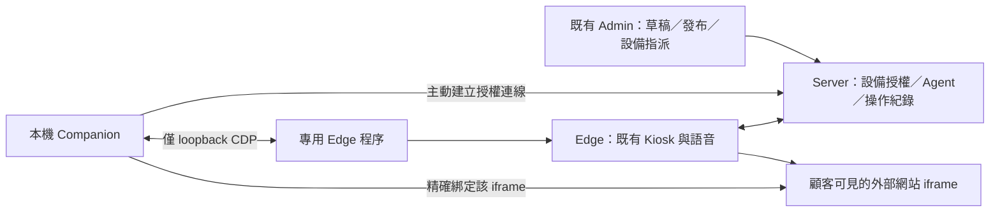

# Kiosk／PB：一般瀏覽器零安裝整合規劃

2026-10-30 路線已更新：登入後的 PB 原生控制介面仍未通過可行性測試，
使用者已同意改為 Electron。後續實作以
[Electron 計畫](2026-10-28-windows-kiosk-electron.md) 為準。
以下零安裝條件與 Companion 記錄保留為歷史調查，並非目前交付承諾。

狀態：2026-10-30 更新。`no_mcp` 已合併至 `pb_order`，保留所有未提交 PB 工作。
Mac 的真實 Webnavior＋PB 已通過固定商品增刪改、付費白飯、多輪確認與唯讀查詢；
五階段尚未全數完成。實測證據見 [PB 整合驗證](../research/2026-10-29-webnavior-pb-integration.md)。
使用者已確認目前只有三款便當與白飯、無法修改店家商品，先以現有品項驗證；
先在 Mac 假設辨識文字正確，Windows／觸控／麥克風與實機驗收延後。
Electron 是未來可能的封裝方向，本輪未替換既有 Kiosk 或聲稱已完成正式部署。

## 最新需求：任意 Kiosk 開網址即可使用（2026-10-30，優先於後文舊方案）

使用者已明確拒絕瀏覽器擴充套件。交付目標是：現場只開既有 Kiosk 網址，
iframe 顯示 PB 點餐介面；真人說話或輸入文字，沿用現有 Agent 操作同一個畫面。
每台 Kiosk 不安裝擴充套件、Companion、Electron 或其他控制程式，不使用特殊
瀏覽器啟動參數，不要求每天執行 `tryWebnaviorPbPrototype.mjs`。
一般瀏覽器仍需要授予麥克風權限，且設備必須支援本產品所需的網頁能力；
「任意 Kiosk」不代表承諾所有舊瀏覽器、驅動與麥克風陣列皆相容。

目前 Firefox／Chrome 的 PB 成功案例皆有測試控制器協助；它們證明 Adapter 與
操作政策可行，**沒有證明一般瀏覽器直接開 Kiosk 即可操作 PB**。
不得再以現有案例或把腳本藏進啟動指令，宣告這個新交付目標已完成。

### 已確認的承載限制與可行性門檻

使用者已回覆 iframe 必須保留 PB 原網址；排除代理網址，也不將遠端瀏覽器
串流檢視器冒充 PB 原網址 iframe。結合先前限制，本輪同時要求：

1. 一般 Kiosk 瀏覽器直接開啟既有 Kiosk 網址。
2. iframe 直接載入 `https://app.esgpb.com/order/store/1kgJeql/pick_up/menu`。
3. 不安裝擴充套件、本機程式或使用特殊瀏覽器啟動參數。
4. Agent 與真人語音／文字控制顧客正在看的同一個 PB document。

**目前專案尚無證據能同時滿足這四項；這不是已選定技術路線的實作排程。**
父頁的跨來源 DOM 存取受同源政策限制；把 Agent 移到 Server 或在另一個
瀏覽器成功操作，不會因此取得目前客戶端 iframe 的控制權。
若 PB 原頁提供合作橋接、postMessage／工具協定，可由現有 Kiosk 使用；
尚未證明 PB 提供此介面，不能假設存在，也不能把我們注入的 listener 當成原站能力。

最新實測：使用者重新手動登入後，第一方 PB 與真正 Kiosk iframe 均確認登入、
未注入本專案 PB peer；現有 discovery 仍逾時空工具，原站 `search_product`
訊息無可見搜尋效果／父頁回執，內部聊天 frame 也未掛載。登入前／後的缺口均已
查證，不能繼續將本店原生介面視為可用控制方案。除非 PB 提供／啟用合作能力，
目前零安裝四條件沒有通過可行性門檻。使用者已詢問測不通時 Electron 是否可繼續；
其受控承載替代路線與驗證進度見 Electron 計畫，安裝／發布不因原型通過而自動完成。

先做兩項可追溯的技術核對：

已確認的歷史證據：`953831e`（2026-10-21，讓一般瀏覽器也能操作菜單）
在自有 `apps/order-menu/src/interactiveService.ts` 加入 Eventa window-message
接收端，再由 `interactiveServiceClient` 呼叫菜單內的工具。`cb48ac0` 的前一代
WebMCP 相容檢查同樣修改自有 Menu。這兩筆證明自家菜單的舊接法，不能當成
使用者所述大麥／PB 外站成功控制案例的結論；外站呼叫鏈仍待找到實際證據。

### 同事文件核對結果（2026-10-30，來源 0.22.5）

使用者提供 `Downloads/iframe_SKILL.md` 與
`Downloads/ESGPB_Order_Agent_系統架構與重建部署指南_20261030.docx` 作為參考。
已讀架構圖及第00、02、04–07、09–10、16–18節相關內容；文件是架構與重建
規格，不是完整原始碼，也不是要求本專案執行其中安裝／送單指令的授權。

成功案例的控制路徑已釐清：

`工作台輸入 → 同源 FastAPI :7002 → LLM 提案／後端驗證 → Playwright
connect_over_cdp → 預先以 --remote-debugging-port=9222 啟動的 Windows Edge
→ 唯一工作台分頁／pw_session → #site-frame → PB 原網址頁面`。

| 已有證據 | 對本專案的意義 |
| --- | --- |
| 後端連既有偵錯 Edge，不 launch 第二個瀏覽器 | 同事的成功不依賴擴充套件或 Electron，但仍有瀏覽器控制通道；不能描述成父頁 JS 直接取得跨來源 DOM |
| 文件第06節明確區分一般瀏覽器與同一 CDP 瀏覽器 | 這份實作不能證明任意未設定 Kiosk 只開網址即可操作 PB；它的成功與零安裝四條件是否可同時滿足，仍須區分 |
| 後端需可連線到該 Edge 的 loopback CDP | 雲端 Server 的 localhost 不是客戶端 Kiosk。遠端模型／API 已運作不代表遠端 Server 能操作現場 Edge；若採此路徑，必須明列控制服務與連線部署方式，不能只隱藏啟動指令或公開9222 |
| session fragment、host／port／path 與唯一 iframe 綁定 | 可借鑒同頁所有權與錯分頁拒絕，不按第一個同網址 tab 選擇；UUID 不當成身份憑證 |
| 原生滑鼠／鍵盤、唯一目標、讀回與操作鎖 | 可借鑒穩定互動與真人可見效果；目前 PB 核心／Agent 不必改寫為 Python、FastAPI、Ollama，也不因文件改用最多三筆等業務限制 |
| Skill 將 click_failed 視為不明但接續其他待辦，送單另有特殊流程 | 與本專案既有未知寫入暫停／授權範圍有差異；僅作比較，不直接採用，不新增送單或付款權限 |

因此撤銷「仍需尋找同事成功版本」這項資訊缺口。文件已解釋成功原理；它沒有
解除現有零安裝、原網址、無特殊啟動條件之間的可行性門檻。是否接受受控瀏覽器
及可到達它的控制服務，需由使用者明確調整設備條件，不能因提供參考文件而推定。
若仍維持全部原限制，後續只研究 PB 原站合作通道，不把 CDP 實作冒充零安裝交付。

- 回查先前成功控制大麥／PB 的實際實作、啟動方式與呼叫鏈，區分原站介面、
  extension、CDP／本機通道及測試注入；只看文件或同名 function 不足以判定。
  不因 user 未看到本機程序，就斷言過去沒有其他控制通道。
- 盤點 PB 原頁已存在的跨頁訊息介面與可驗證能力，確認來源檢查、握手、
  可操作範圍及是否真的涵蓋點餐；同一站的 HTTP API、`window.route`、iframe
  能顯示與接受自身腳本操作，都不等於允許跨來源父頁控制。

若找到符合條件的原站通道，才把後續階段轉為實作定案；若沒有，必須明確回報
還缺 PB 合作介面或哪一項限制須調整，不能偷偷改成代理／串流／本機控制器。
PB API 能讓 Server 改購物車，也不自動證明客戶端登入、購物車與畫面同步；
另須驗證同一 Session 與即時畫面效果，不能以另一份購物車取代。

既有可重用模組已檢查：`interactiveServiceClient`／window Eventa peer、
`pbBrowserService`／`pbCart`／`pbCatalog`／`pbProduct`、共同語音與文字決策入口。
舊 `computer-use-mcp` 已讀的 browser DOM 實作依賴 extension／CDP；這是已知
模組的實作事實，尚不足以代表所有過去成功案例皆由它完成。

### 後續五個階段（第 1 階段通過前，其餘均未定案）

| 階段 | 實作範圍 | 必須通過的驗收 |
| --- | --- | --- |
| 1. 零安裝可行性 | 回查過去外站成功控制的實際呼叫鏈，並驗證 PB 原頁是否有既存、允許一般 Kiosk 使用的操作介面；全程保留 PB 原網址，不使用測試注入冒充原站能力 | 普通 Firefox 與 Chromium 在沒有擴充套件、CDP／BiDi、測試注入的客戶端可開畫面，並透過正式接入碼唯讀取得當前菜單。未通過就保留實際失敗證據，不能推進寫入或靜默換成其他承載方式 |
| 2. 接入、登入與設備隔離 | 將核准來源、網站登入與 Session 放入選定接入邊界；同一台設備只能有一個有效控制者，換頁／重載撤銷舊 binding | 人工首次登入後可正常重開；兩台 Kiosk 不互相操作、不混購物車；登出／到期顯示需登入，不自動重播帳密。不能搬移既有 Firefox 的 Cookie 當成新 Server 會話 |
| 3. 接回既有 Kiosk | 沿用 Profile URL／設備指派、ScenarioSurface、同一 Agent 工具註冊與語音／文字入口。正式接入模組提供 discover／execute／inspect，測試腳本只保留測試責任 | 使用者只開 Kiosk 網址即可連線；文字指令能查詢、加餐、加購、改量、移除；工具未就緒不能宣稱已完成或錯誤放行寫入。不另起一套 Main、Jev 或對話流程 |
| 4. 語音與故障全流程 | 一般麥克風經既有 VAD／ASR、Jev／SLM、Main、同一 PB Adapter、TTS；覆蓋人工觸控與 Agent 競爭、未知寫入、重連與換客 | 真人與文字都操作顧客看到的同一筆購物車；語音需觀察實際 ASR 結果，不把模擬文字冒充收音驗收。斷線不重做已派送寫入，舊確認不可跨客使用；保留原購物車 |
| 5. 日常入口與整體交付 | 將選定 Server 接入能力納入平台正常服務生命週期，整理既有服務啟動說明；以乾淨客戶端驗收。部署工作仍由使用者另行安排 | 停掉所有 `tryWebnaviorPbPrototype` 程序後，重新開啟 Kiosk 網址仍能語音／文字操作 PB；Firefox 與 Chromium 都沒有本機控制依賴。後端重啟／登入過期可明確恢復，按步驟由使用者親測。未通過本列，不宣告可按原方式使用 |

階段 1 是可行性門檻，不保證 PB 已有合作控制介面。若找不到符合全部限制的
接入通道，應回報缺少的能力與實測證據，不以隱藏本機程序、代理或串流過關。
第一輪沿用現有真站品項及白飯，不更改店家商品，不送單或付款。每日換品名、
價格、類別與選項，沿用新鮮菜單／規格版本觀察，禁止要求人員每日改商品 ID。
PB 實際程式或協定改版仍需另行維護，不能承諾永遠不受影響。

### 實作邊界與驗收細節

- iframe 保留核准 PB 原網址；來源、設備、Session、document 與操作結果均須可
  對應顧客眼前的同一頁。若需 PB 配合，具體列出合作協定及能力，不假設已取得。
- 代理、Server 瀏覽器串流、擴充套件與本機 Companion 均不屬本輪選定路線。
  先前調查只保留為排除背景，不能在不可行時自動切換。
- 登入到期只撤銷代操作並提示登入，不清空購物車；保留既有一用確認、未知效果
  暫停與換客交接政策。帳號與 cart 在 PB 端的關係需實測，不按 Cookie 名稱推定。
- 自動化真站案例每次先讀新鮮基準，只撤銷已證明的測試效果；離線合成、文字
  真站、合成音訊、真人語音分開記錄。一般 Mac 麥克風流程與陣列多通道分開驗收。
- 這輪只改規劃；不部署、不變更目前登入 Profile、不關閉使用者服務、不引入依賴。
  後續若需要新套件，先比較現有內部實作與官方來源，交由使用者選擇。

官方依據：
[同源政策](https://developer.mozilla.org/en-US/docs/Web/Security/Defenses/Same-origin_policy)、
[Cookie 的 Domain／SameSite 限制](https://developer.mozilla.org/en-US/docs/Web/HTTP/Reference/Headers/Set-Cookie)、
[Playwright 控制的是其啟動或連線的瀏覽器](https://playwright.dev/docs/api/class-browsertype)。
這些規則是接入條件，不能替代 PB 代理／串流的實際測試。

## 舊 Companion／Windows 方案（歷史候選，本輪不採用）

下列內容保留已完成原型、共用模組及先前候選設計的背景；涉及每台設備安裝
Companion、特殊瀏覽器啟動或擴充套件的步驟，不再是本輪零安裝交付路線。

## 目標與決策

保留現有 Web Kiosk 的角色、語音、ASR/VAD、對話、Admin 草稿／發布及設備指派。
Windows 主機啟動一個本機 Companion，管理專用 Edge 與 CDP，讓 Agent 操作
顧客正在看的同一個 iframe。日常使用不要求瀏覽器擴充功能或 Electron，
但需要安裝及啟動 Companion；單靠公開網頁無法提供相同控制能力。

### 雙執行端與麥克風陣列（Oct30 決策）

使用者希望同時保留瀏覽器＋Companion 與 Electron；Electron 的考量是麥克風陣列
收音，不是重寫點餐系統。兩者共用 Kiosk UI、Agent、PB Adapter 與效果／交接政策，
各自負責外部網站承載及控制通道。收音另設能力邊界，避免讓點餐邏輯依賴殼層。

- 一般收音或陣列硬體提供的處理後輸出，可沿用瀏覽器收音。
- 若需要原始多聲道或廠商 SDK，可由本機原生音訊程序擷取／處理後接入同一語音
  流程；此程序可由 Companion 或 Electron 管理，不必兩套重寫。
- Electron renderer 若仍用 getUserMedia，仍在 Chromium 擷取路徑；換殼本身
  不保證多聲道或降噪效果。尚未選擇原生函式庫、硬體 SDK 或實作原生收音。
- 待確認設備／驅動實際提供的 raw 與 processed 通道及回音參考需求，再決定來源、
  處理與格式轉換的位置；不得只按聲道數推定收音品質。VAD 與 ASR 須使用一致的
  處理後訊號。雙執行端並存不等於同一台設備同時開兩個點餐執行者。

[W3C capture 規格](https://www.w3.org/TR/mediacapture-streams/#dom-mediatrackconstraintset-channelcount)
定義 channelCount 約束，未規定統一雙聲道上限，實際支援仍須設備驗證。
[Electron 官方說明](https://www.electronjs.org/docs/latest/)確認其包含 Chromium；
[Seeed 陣列文件](https://wiki.seeedstudio.com/respeaker_xvf3800_introduction/)則示範
陣列的處理後輸出與多聲道韌體可以是不同介面。此例不是設備選型建議。

首階段人工登入，保留專用瀏覽器 Profile 的登入狀態。帳密不存入 Admin、
LLM、對話逐字稿、設定或診斷紀錄。使用者已指定門市準備的共用帳號，
並完成專用瀏覽器一次人工登入；正式多客使用前必須完成購物車交接政策。

當前 ESGPB 真站只驗證登入、觀察、選規格、購物車讀回與可逆修改；禁止送單及付款。
未來指定測試站才驗證既有顧客確認後送單流程，付款交由顧客。

## 已有證據與限制

| 項目 | 實際狀態 |
| --- | --- |
| iframe 登入與重載 | Chrome 156.0.8078.48、獨立暫存 Profile／loopback fixture 通過 |
| 規格／購物車 | M 烏龍、微糖微冰加入、讀回、移除通過，保留原有 $35 品項 |
| Cookie 相容 | 三個指定 Cookie、輪替請求排序、停用還原通過；六項單元測試通過 |
| 真實登出 | 未實測；刪除後不復活 Session 目前只有單元測試 |
| Windows Edge／觸控／Assigned Access | 未驗收；Mac 沒有 Edge，不能以 Chrome 結果代替 |
| 真實 Kiosk／Main | Chrome、1080×1920、模擬 ASR 入口的 D11／D12／D04 通過；實際語音全鏈路與 Jev／SLM 未驗收 |
| 真實 Kiosk／PB 購物車 | 固定商品增刪改／替換及付費白飯已通過；每次以當次新鮮購物車為基準，只撤銷可證明的測試效果 |
| 更換第二個網站 | 未驗證；Cookie 修正不保證解除 CSP、X-Frame-Options 或其他登入限制 |

實作入口：`scripts/verifyIframeCookieCompatibility.mjs` 與
`apps/stage-kiosk/scripts/browserCookieCompatibility.mjs`；執行方式見
[Kiosk README](../../apps/stage-kiosk/README.md#esgpb-iframecdp-compatibility-experiment)。

ESGPB 除了 `order_session`、`XSRF-TOKEN`，還需要 `srvkey` 維持負載平衡路由。
公開 GET 對照顯示不同節點提供不同 JS hash；缺少路由 Cookie 可能混用版本而 404，
表現成登入按鈕無反應。相容處理須在初次載入前準備完成，並等待登入輪替 Cookie
寫入後才放行後續請求。原型清除的是負向測試留下的暫存 Profile 快取，
不可延伸成正式設備每次登入都清快取或重載。

## 執行架構與通道

正式方向採 Companion 主動向 Server 建立授權通道，避免公開 Kiosk 頁面必須
直接連本機 HTTP／WebSocket。第一階段沿用現有 HTTP／SSE 的工程模式，
新增 Companion 的命令接收、回執、心跳與撤銷介面；先做最小授權垂直切片，
不先引入新訊息佇列或選購新的通訊套件。若 SSE 需要 Authorization header，
使用具該能力的客戶端方式，不假定原生 EventSource 可設定 header。
正式環境使用 HTTPS；本機開發保留既有 loopback 設定。

現有 Kiosk 路由有 SSE，但沒有已完成的 Companion 控制通道。
`CONTEXT.md` 的 Kiosk Control Connection 是領域概念，不能視為可直接重用的
WebSocket 實作。型別化跨程序契約沿用 Eventa 慣例，中立資料由契約擁有者匯出，
外部輸入使用 Valibot 驗證；不向網頁或模型暴露原始 CDP、任意 JS、檔案或 shell。

| 通道選項 | 判斷 |
| --- | --- |
| Companion 主動連 Server | 主方案；設備授權與稽核集中，符合現有需連網 Kiosk；需新增通道與回執生命週期 |
| Kiosk 直接連 localhost | 保留為必要時的獨立評估；有本機網路權限、Origin、配對與部署差異，不作首階段依賴 |
| 網頁直接連 CDP | 不提供；CDP 具高權限，只由本機 Companion 持有 |

### 配對與同頁所有權

1. Companion 以一般 Windows 使用者啟動專用 Edge Profile，記錄自己啟動的程序與
   CDP endpoint，開啟已允許的 Kiosk 入口。不要附著任意個人 Edge 或以「第一個 tab」選頁。
2. 已註冊的 Kiosk 透過既有設備驗證流程申請一次性、短效配對票；現場人員在
   Companion 本機配對流程確認。Server 驗證設備與現場授權，配發可撤銷且只限該設備
   的 Companion 憑證。票證只在配對記憶體／介面出現，不放 URL、log 或 LLM。
3. Server 發出本次綁定 challenge；Companion 經 CDP 驗證自己的 Kiosk top-level
   document、來源、challenge 與 iframe ancestry，回報 target/frame/document 世代。
   只驗證 URL 相同不足以證明是顧客所見頁面。
4. 每台設備只允許一個有效執行者。Server 發放 ownership epoch；每筆操作綁定
   device、Profile release、Customer Session、Agent Interaction、binding、document
   與 epoch。重新配對、撤銷或換頁後，舊控制者與舊參照一律失效。
5. Companion 憑證與 Kiosk HttpOnly 設備 Cookie 分開；不透過 CDP 讀出設備 Cookie
   當作配對捷徑。設備停用時同時停止 Companion 接單。

首個實作切片必須把配對、challenge 證明及撤銷寫成完整驗收，再開放寫入操作。
本機 Profile 的檔案權限與 CDP loopback 是必要隔離，但無法抵抗同 Windows
使用者權限的惡意程式；不宣稱它是對本機管理員的安全沙箱。

## Module 與現有程式調整

在既有互動執行 Seam 提供兩個真實不同的 Adapter：自有 Menu 的服務工具，
以及第三方網站的瀏覽器工具。共用操作所有權與生命週期，不共用假的菜單資料。

| 落點 | 責任與改動 |
| --- | --- |
| 新增 `apps/stage-kiosk-companion` | 專用 Edge 啟停、Profile、CDP/frame 綁定、觀察／操作、相容策略與復原；runtime entrypoint 只負責組裝 |
| `packages/stage-shared` 中立契約 | 模式／能力、操作 envelope、回執與健康狀態；不帶 Node、Electron 或瀏覽器 runtime 型別 |
| `apps/server/src/services/domain/kiosk` 及 routes | 配對與撤銷、單一控制者、命令／回執關聯、發布策略驗證、設備健康；沿用設備／Site 權限 |
| stage-ui `interactiveServiceClient` 與 Kiosk client | 保留自有 Menu Eventa 流程；增加外部 Adapter 的明確能力與狀態，不讓發現超時等同網站離線 |
| `ScenarioSurface.vue` | 保留 iframe；綁定實際 document／navigation，切網址前停用舊操作；不再要求原生 View 對位 |
| Kiosk `tools/interactiveService.ts` | 外部工具透過同一工具註冊流程送給 Agent；解除對自有 Menu host-only 契約的錯誤假設 |
| `KioskScene.vue`、Fast Path、Server interaction | 按能力進入外部 Main 流程；保留 recipient、注意力、對話／確認；不產生假的 Menu legal candidates |
| Admin Profile／devices | 保存既有 URL／發布；增加執行模式、受審查策略引用與分項健康狀態 |

Companion Module 對外提供綁定、觀察、執行、查詢操作、停止的有限 Interface，
隱藏 CDP target、Cookie、瀏覽器參照和程序清理。不要把每個 CDP command 包成一層
轉發 Module，也不要讓 UI 自行管理 Cookie 輪替或 pending request。

### Agent 的觀察、操作與回執

- 觀察只輸出當前可見的可互動內容、必要文字、狀態及有限 element reference。
  密碼欄位、Cookie、Authorization、隱藏 token 與完整 Network body 不進模型。
  診斷截圖需遮罩敏感欄位，登入階段不預設保存影像或 trace。
- reference 綁定 document 與觀察版本；換頁、重載、人工修改或工具修改後重新觀察，
  過期參照不猜測修復。人工觸控優先，正在操作時暫停 Agent 寫入。
- 外部結果標明來源與可驗證範圍。購物車畫面讀回只能證明畫面狀態，不能冒充
  自有 POS receipt、item ID、付款狀態或服務端 idempotency。
- Server 記錄 operationId 與 dispatch 狀態後才下發；Companion 去重並保存足夠的
  操作狀態，結果送達可重傳，網站寫入不可因此重做。斷線／程序崩潰後無法確認
  是否已執行者標記 unknown，停止後續寫入並觀察／人工釐清。
- 不承諾外部網站 exactly-once。沒有網站支援時，「沒收到回執」不代表「沒加入購物車」。
  Server restart、Companion restart、重複派送與回執遺失都必須列入測試。
- 未驗證網站預設唯讀。先在 fixture 驗證明確購物車操作政策，再對 ESGPB 啟用有限
  可逆操作。不能只用「送出」文字黑名單，或讓通用 click 繞過被禁止的送單動作；
  無法判定副作用的目標拒絕寫入，請顧客操作。
- 未來送單是獨立權限與一次性確認動作，綁定最新品項、規格、數量、價格與 document；
  購物車變動即失效。遵守[既有確認／未知結果規範](2026-10-21-kiosk-main-context-and-ordering.md)，
  不以 Companion 心跳代替訂單成功證據。

## Cookie 相容策略

通用瀏覽器執行與站點相容策略分開。第一個策略只支援已驗證的 ESGPB origin、
路徑與三個 Cookie，不把任意網站的所有 Cookie 改成 None。

延用原型的 Network ExtraInfo、被阻擋原因、HttpOnly／scope／期限保留、
輪替寫入順序與停用還原。Strict、使用者第三方 Cookie 禁令、未知 domain／path
不自動放寬。停用時只還原仍由本次控制者持有的最新值；已登出／被刪除的 Session
不可復活。關閉時先停止派送、處理 pending interception、還原屬性，最後釋放 CDP。

同一 Profile／Cookie scope 只容許一個策略所有者；跨站換 Profile 或重新綁定前
必須停用舊策略。異常退出未完成還原時，下次啟動先對帳；沒有可信紀錄不可
臆測原始屬性，應進入人工重新登入／重建專用 Profile 的復原流程。
Profile 保留登入是正式需求，因此原型「退出即刪除 Profile」不直接沿用。

一般網址可由 Admin 更換；需要新 Cookie 策略時，由受限系統管理流程加入與驗證，
不開放內容編輯者填 Cookie 名稱、任意攔截程式或自訂 JS。

## Kiosk 與 Admin 的使用行為

Kiosk 保持目前畫面，增加分開的狀態：網站載入、Companion 連線、同頁綁定、
登入已確認／待人工確認、Agent 觀察／可逆操作能力。未知登入狀態不可顯示成功。
本機控制失效時保留人工操作的網站，停用 Agent 寫入；不自動重載、清購物車或登出。
需要重新綁定但存在不明寫入時，先走復原流程。

Admin 調整：

| 位置 | 規劃行為 |
| --- | --- |
| 體驗編輯 | 保留名稱／網址／用途；新增自有服務工具或外部瀏覽器模式 |
| 相容設定 | 選擇已核准的策略，ESGPB 為首個；相容策略與操作權限分開 |
| 實測權限 | 本階段只讀／已驗證購物車；送單關閉且由執行端強制執行 |
| 發布與指派 | 沿用草稿→發布→設備指派；顯示 assigned release 與 applied release，不能發布即顯示設備生效 |
| 設備狀態 | Companion 版本／最後心跳、Edge 版本、綁定、策略、登入觀察、未知操作；不顯示原始 Cookie |
| 預覽 | 保留既有預覽，標示瀏覽器預覽不等於目標設備登入或 Agent 控制驗收 |

現有設備 bootstrap 才載入 Profile，五分鐘輪詢主要是 settings，並沒有即時
Profile 發布套用。首階段沿用工作人員在安全閒置點重載／啟動取得新版；
活動對話、購物車或未知寫入期間不得直接換網站。後續需要即時同步時另做
pending/applied release 與閒置啟用，不把它藏在健康輪詢中。

Profile 型別目前分散於 Server schema／domain、Admin 與 Kiosk。擴充前先收斂
中立契約，定義明確 schema 版本與資料遷移；不要用缺欄位的靜默 fallback。
不可修改歷史 immutable release；遷移產生新版本並保留舊發布的可讀性及追溯。

## Windows、登入與營運

先以一般 Windows 11 使用者手動啟動 Companion／專用 Edge，驗收真實硬體，
再評估開機自動啟動與 Assigned Access。Electron 是否使用，與 Windows 鎖機方式
是兩個決策；不能保證現有 Assigned Access 設定會接受相同 CDP 參數與 Profile。

- CDP 僅 loopback，使用動態 endpoint、專用 Profile 與程序所有權；不對 LAN 開放，
  不使用停用 web security、全域允許第三方 Cookie 或 remote-allow-origins=*。
- 自動啟動使用同一受限 Windows 使用者，不以 SYSTEM 執行瀏覽器；驗證程序重用、
  開機競態、崩潰、觸控、鍵盤、音訊／麥克風權限、螢幕縮放與維護入口。
- 沿用安全稽核的受支援 Node 與依賴更新要求，打包時重新確認，不將實驗版 runtime
  視為正式安全核可。更新在閒置且無未知操作時進行，保留版本與回退方式。
- 區分 Windows Profile、Kiosk 設備憑證、Companion 憑證、第三方會員 Session、
  Customer Session 與購物車；結束對話不代表網站已登出或購物車已清空。
- 共用會員已由使用者選定；網站伺服器是否按會員或 Session 共享購物車仍需實測。
  獨立 Edge Profile 無法保證跨設備隔離。正式多客／多機啟用前驗證購物車所有權、
  客人交接與個資清理；若 PB 實際共用同一購物車，需採站方支援的隔離方式或調整
  設備帳號配置，不能只靠本機 Customer Session 宣稱已隔離。
- Cookie 相容不承諾 LINE OAuth 可在 iframe 完成。先保留帳密人工登入；
  SSO、彈窗、頂層跳轉及付款導向分別驗證，不因主站登入通過而宣稱支援。

## PB 優先實作：pb_order 合併後的五個切片

以下是目前先執行的本機功能順序，延續真正 Webnavior＋PB iframe。
原型進度不取代後段的正式 Companion／Windows 部署門檻。
每個切片完成後保留可重現結果，再開放下一個層級；不新增依賴，不另做點餐網站。

### 必要條件：每日實際菜單變動不需人工改程式

使用者要求日常上架／下架、改名、改價、售完、規格／加購與分類變動後持續運作，
不需手動更新程式、Admin 商品對照表、提示詞、商品 ID、selector 或測試腳本。
此要求貫穿五個切片，不是後續優化。現有三款便當與 10 元僅是當次測試資料；
原型中的固定品名案例、便當釐清文字及商品路由數字不能成為正式執行的依賴。

**動態資料取得與範圍**

- PB 是商品與販售條件的資料來源。店別 URL／允許網域屬設備設定；商品、分類、
  價格版本、規格、加購、庫存與可售狀態由當次網站資料發現，不預先列商品 ID。
  資料帶來源、擷取時間、取餐日期／時段、搜尋條件、完整或部分載入範圍與觀察版本。
- 能取得且已驗證的結構化資料可供 Adapter 使用；DOM 是已驗證介面的另一種來源。
  每種事實明確標示來源與可驗證範圍。價格／選項來源互相矛盾時重新讀取查證，
  不靜默沿用舊值或以模型常識補全。商品名稱不得作為唯一識別或價格證據。
- 動態走訪分類、分頁與延遲載入，不假定只有三項便當或第一頁就是完整菜單。
  搜尋無結果、尚未載入、售完、下架與來源失敗是不同結果；資料不完整時，
  先自動補查，不把「沒看到」說成「沒有賣」。推薦與候選分組須涵蓋有效結果，
  不用固定前幾項截斷代替發現所有品項。
- 啟動／重連、營業日或取餐條件改變、每輪有關商品的需求，以及寫入前都要核對
  新鮮資料；網站有可驗證版本／事件時用其失效通知，沒有時以重新讀取的內容
  建立本地觀察版本，不能假稱它是網站全域 revision。快取只作加速，不能授權寫入。
  公開資源 hash 不固定寫死，依目前頁面發現當次版本。

**菜單改變時的對話與操作**

- Main 與 Jev／SLM 的候選、價格與規格皆由同一批實際觀察產生，不在提示詞維護
  每日品項。搜尋、別稱比對與推薦只能導向實際候選；歧義由當前商品選項釐清。
  釐清使用適合當前商品的用語，不一律問「哪一種便當」。
- 每個短答問題保存當時展示的候選及版本。顧客說「第二個」後，先檢查該候選仍
  有效；不能把更新後排序的第二項當作原選項。商品下架、規格消失或價格改變時，
  重新向顧客說明／詢問；不得自行換餐、改選規格或宣稱原價仍有效。
- 寫入前重新核對商品、規格、數量、售價及取餐情境，寫入後核對實際購物車。
  觀察與寫入間網站仍可能改變，處理 PB 的實際拒絕或新價格；價格有變需重新確認，
  不以加購成功推定顧客接受價差。若影響已發生則明確記錄，不能盲目重做／回滾。
- 已在購物車但後來下架的品項仍以真實行識別讀取，不把它改綁到同名新商品。
  是否可繼續修改由 PB 的目前能力與結果決定。換日自動更新販售資料，但不擅自
  更改顧客已選取的取餐日期／時間；原時段失效時請顧客重新選擇。

**驗收方式：同一份執行程式跨菜單版本**

| 變動情境 | 必須觀察到的結果 |
| --- | --- |
| 隔日換成全新名稱、商品／分類 ID，並超過三項 | 自動發現、查詢、推薦、選品與購物車操作，不改程式或提示詞 |
| 價格、必選規格、加購選項變動 | 新查詢採新值；舊問題失效或重新確認；不能沿用舊參數加購 |
| 商品售完／下架／新增，同名不同商品 | 依實際可售狀態處理；不誤綁或錯稱全站缺貨 |
| 清單重排、跨分類／分頁、延遲載入 | 「第二個」仍指向原展示候選；完整性判斷正確 |
| 交談中改價／下架、寫入瞬間拒絕 | 重新查證／向顧客釐清；無錯誤成功回覆與重複寫入 |
| 跨營業日、取餐日期／時段與瀏覽器重啟 | 自動取得對應菜單，保留登入與有效客人狀態，不挪用前日快取 |

保留原歷史 gold 與三個固定 PB 案例作回歸，另加資料驅動的「每日變動」測試組。
同一套自然語意模板由當次資料產生品名與獨立預期結果，固定版本化輸入快照供重現；
不拿模型回答當 oracle，也不覆寫歷史測試。單元／瀏覽器故障測試覆蓋上述全部變動，
真實 Kiosk 再驗證目前 PB 的動態發現與操作。未取得可控真站改菜權限的情境，
標示為測試環境驗證，不聲稱已在 PB 真站跨日實測。
驗收需證明換資料期間程式、提示詞與設定無商品層級差異，不靠人工補對照表才通過。

這裡承諾的是**已驗證 PB 介面內的日常商品資料變動可自動處理**。
若 PB 改版造成未支援的資料格式、頁面結構或操作協定，先自動重新發現並執行
能力檢查；仍不相容就保留人工點餐、暫停受影響代操作並提供去識別診斷。
不可要求門市每日維護 selector，也不可承諾任意站方改版永不需要工程維護；
此類相容修正由工程端處理，與店家正常更新菜單明確分開。

### 1. 明確區分自有 Menu 與 PB 的能力、恢復及重試

本機首個垂直切片已實作：PB Host-only 新鮮上下文與原恢復／重試按鈕接通，
實站回執遺失、模型失敗重試、原購物車保留及三個自然案例通過。
Kiosk 96 個相關測試與原跨 iframe 恢復保護 3 例通過；證據和範圍見
[整合驗證](../research/2026-10-29-webnavior-pb-integration.md#pb-恢復與重試第一個切片)。
這不代表已完成正式模式／配對、完整跨日菜單／過期登入故障矩陣或後續購物車權限。

PB 的恢復及原需求重試已使用真實 browser context；自有 Menu 仍使用原
`kiosk_conversation_context`／`kiosk_agent_task`，不替 PB 假造這些契約。
正式化時仍須用明確能力／模式取代原型的工具名稱辨識。

在既有互動執行 Seam 採兩個 Adapter：owned Menu 與 external browser。
按已驗證的模式與能力選擇 Adapter，逐步取代單靠工具名稱 `browser_observe`
判別模式的原型寫法。共用 Module 承接連線與操作生命週期，Adapter 各自負責
狀態觀察、操作結果查證、重試上下文和所有權；不生成假的 Menu／POS 狀態。
不另加只轉發參數的服務層，也不把 PB selector 或內部路由放進 KioskScene。

分開處理兩種動作：

- **恢復控制連線**：暫停新操作，核對 device／Customer Session／binding／document
  與先前 operationId，再取得新觀察。相同文件可以查已接受操作；新文件不可沿用
  舊參照或去重記憶體。重新登入、換頁或重啟後先恢復可觀察狀態，舊加購不自動重做。
- **重試原需求**：沿用原句與關聯 ID，重新進入正常語音佇列，重新理解與授權。
  舊問題、購物車、文件或客人已變更時撤銷舊重試，不自動把它套到新狀態。
  尚未派送的操作、純觀察、搜尋顯示、未提交草稿與購物車寫入要分級；
  `readOnlyHint` 或工具名稱清單不能單獨決定可重播。

操作紀錄至少區分未派送、執行中、已驗證效果、明確拒絕與結果未知。
既有 inspection 的 `settled` 只證明 RPC 已結束，未必代表 PB 寫入成功；
遺失回執後即使購物車看似相同，也未必能證明某次加購未執行。
無法查清時保留畫面與購物車、禁止重送，交給顧客／現場人員確認。

驗收：模型無效參數不斷整條連線；唯讀回覆遺失可安全恢復；文件重載、遲到回執、
pending／missing 操作及登入過期各有明確結果；人工觸控先停 Agent 新動作；
舊 Session 的回覆不能出現在下一位顧客。自有 Menu 原恢復／重試測試仍須通過。

### 2. PB 購物車讀回與有限增刪改

本機基本商品切片已實作：實際 Main 的 D01 多項加購、D14 改量、D13 先加後刪
替換與移除通過，三個唯讀回歸仍通過；原購物車 30 元完整保留。
另對真正 Kiosk 注入「猜未指定商品／猜同名行」兩例，均在 Host 擋住，PB 寫入為 0。
證據與限制見 [整合驗證](../research/2026-10-29-webnavior-pb-integration.md#基本購物車切片四個自然寫入與唯讀回歸)。
Oct30 已另驗收實際付費白飯，並以當次完整分類／規格與原站固定商品表單執行，
移除加購對舊 Vue 商品卡片快取的依賴；基礎價格和加購價格分別依原站格式傳遞，
最終仍比對完整購物車。七品項／三分類、換名換價與改規格的資料測試通過。
必選／不同售價規格、套餐的真站資料、完整每日瀏覽器變動與異常維護／解鎖介面
仍待完成；這不代表整個第二階段或五階段均完成。

先建立 PB Adapter 的新鮮商品、選項與購物車觀察，再接 Main 可用的有限操作：
加指定商品／規格／數量、設定指定購物車行的數量、移除指定行，以及讀回。
先讓單項加購、改量、移除可逆閉環通過，再處理多項與替換。
「第二個」或同名餐點不能只用品名猜測行；參照須綁定文件、觀察版本與實際行識別。

沿用現有瀏覽器與 Eventa，PB Adapter 隱藏三種可能的執行方式：

| 方式 | 本階段使用原則 |
| --- | --- |
| PB 原 UI／DOM | 目前已有成功的搜尋、商品詳情與備註讀回，優先延續；每次修改以新鮮購物車讀回核對 |
| PB 原生 message／xorder 事件 | 可評估搜尋、分類、商品開啟；先驗證相同效果，不只相信事件的 result=true |
| 已觀察到的站內請求 | 一般 GET 購物車已驗證；寫入路由目前只是源碼證據，須驗證 Session、選項、取餐情境與錯誤行為後才採用 |

這些方式由同一 Adapter 選擇，Main 不需要知道 selector、站內 URL、Cookie 或任意 JS。
未驗證的路由或目標不提供給模型；本階段完全不提供送單／付款能力。
既有原型「所有例外都回 ok:false」僅適用沒有購物車寫入的工具：新增寫入前必須
區分派送前拒絕與派送後未知，不能把可能已成功的加購當成確定失敗。

替換是明確的多步操作，PB 未提供原子替換時不承諾交易性。
保留原項直到新項已驗證加入，再移除明確的原行；第二步失敗就如實回報部分完成，
未知結果停止，不盲目補加、刪回或聲稱已回滾。開始前重新核對原行與當前版本，
中途人工修改或其他執行者寫入即停止。複合加購亦逐項保存已完成／未完成結果。

驗收：D01 各一份、D14 只改雞腿數量、D13 替換、同名不同規格行、庫存不足／
必選規格未填／售價變更／第二步失敗；查價 D12 絕不加車，D04 不擅自挑第一款。
回覆採用實際 PB 結果，數量、選項、行與總額都核對，不以「模型說好了」驗收。

### 3. 多輪問題與 Jev／SLM 接回同一套操作

先建立由 Host／Adapter 簽發的目前問題：客人、原需求、questionId、候選項、
預期效果、狀態版本與期限。單純顯示一段「哪一種便當」文字不足以授權下一句加購。
短答「一份／第二個／對／不要」只解析目前有效問題；查詢或瀏覽可進行，
新需求、更正、換客人或狀態改變會明確取消／取代舊問題。

PB 目前沒有候選工具，`runFastPath` 因而走 `SYSTEM_ONE_DISABLED` 交給 Main。
接入時由 PB 真實觀察產生有限、可驗證的語意候選，延用 `no_mcp` 的分組判斷、
收件對象、整句需求涵蓋與不確定交接。Jev／SLM 只選有限語意選項，
不輸出 selector、工具參數或任意程式；同一 Adapter 在執行前重新核對目標與版本。
不復用假的 Menu itemId、revision 或 POS 回執。

Main 與 Jev／SLM 最終進入相同的效果檢查與顧客回覆流程。複合、更正、
不完整或無法完整表達的需求交 Main，不能只做句子中的一部分。
PB 的一般招呼／店家說明不應強制呼叫商品工具；現有外站每輪一律 required 的
原型政策要按純對話、事實查詢與操作需求收斂，保留每項事實／操作所需的證據。

驗收：A16／D19–D21 短答、D24 未說完、取消與更正、背景對話、連續插話、
重試沿用原句但不沿用舊授權。分別報告 Jev 與 SLM 的實際路由／交 Main 比例、
最後 PB 效果與耗時，不把交 Main 當成判斷正確，也不因接通就切換現場模型設定。

Oct30 本機多輪已接通並通過八輪實際選品項／第二個／改兩份／取消／重新選餐／
完整確認／防重複。Host 題目綁定客人、真實文件、購物車、規格／價格與期限；
讀取只承接上下文，後續工具才能依被確認的完整提案寫入。另十二個零寫入短答
契約案例全通過，七例有 Main 參與裁決，五例全由當前 Jev 完成；不能稱為 Jev
本身正確率。未切換現場設定，也沒有把未啟用的 SLM 當成已實測。
一般招呼／收件確認／致謝由 Host 非操作回覆處理，Main 不需選商品工具。
原恢復保護所需的 Host 新鮮觀察仍保留。完整插話／語音與正式快速路徑仍待驗收。

### 4. 共用帳號的客人交接與真實語音驗收

Oct30 Mac 本機切片已通過真實換客：舊完整確認＋已開商品草稿／備註／搜尋，
換客後同一 PB 文件與登入保留、舊授權失效、草稿清除；非空舊車對新客人拒寫並
隱去舊行，菜單查詢仍可用。工作人員以新鮮快照、明確勾選及版本核對恢復同車後，
新客人可依完整新需求加餐；測試行全部還原。未知／未結束操作不能藉此解鎖。
此為本地 visitor 歸屬門檻，不代表遠端共用帳號跨設備隔離；測試使用本地 staff
session fixture，不是 PIN 認證驗收。最小商品草稿重現及完整真站流程皆有證據。
現有白飯的加購、明確不加、兩份各加一份亦全通過；使用者已決定先假設 ASR
文字正確，實體 Windows、觸控與麥克風驗收延後，不再等待額外菜單／機器。

登入沿用使用者完成的人工登入與專用 Profile；只保存登入所需資料，
到期由現場重新登入。結束交談、新訂單、網站購物車與會員登入是不同狀態。
新客人不得直接繼承上一位的待確認問題、草稿、備註或操作；亦不得預設清空
共用帳號購物車。購物車非空或歸屬不明時，暫停新寫入並由現場確認交接，
讀取／人工操作仍可使用。多設備若共享同一個遠端購物車，先解決隔離再開放同時點餐。

實測保護基準為當時讀取的購物車，不把歷史 30 元寫死為程式條件。
只撤銷本次測試可明確識別且狀態未被別人改動的變更；歸屬不明就停止。
對既有原購物車行的增減亦須有前值、操作證據與核對，不用清空全部恢復環境。

以同一個 1080×1920 Kiosk 跑兩層驗收：先用模擬 ASR 固定文字定位語意／操作，
再用麥克風跑實際 VAD／ASR、插話、等待、人工觸控與客人離開／下一位。
兩層結果分開。案例沿用 A01–A22、D/H 原始意圖和判準，PB 改寫另列，
不修改凍結 gold、不以「請呼叫某工具」替代顧客話語。

驗收報告逐例保存輸入、有效上下文、Jev／SLM 判斷、Main 接手、實際工具、
PB 前後狀態、顧客畫面／語音與完成／部分完成／未知，登入與個資不進報告。
P1 的斷線、寫入後回覆遺失、人工修改與重載故障案例須在購物車流程補驗。

### 雙執行端共用控制接入的本機切片

Oct30 已將 PB 工具／文件操作紀錄抽出為同一個 browser service，iframe controller
透過 window-message、Electron 原生 View 透過隔離 world 與有限 Eventa preload
封包呼叫。同一 Kiosk client 負責文件與工具綁定、遺失回執撤權及查證，原生頁面
只在 placement identity 改變時重連，調整大小／遮罩不重建操作授權。

Mac Electron 真程序的合成 PB URL 測試通過搜尋、回執去重／查證、舊文件與任意
程式碼拒絕、離開菜單拒絕；測試攔截 HTTPS，不連真站／不登入。原 iframe 的18個
瀏覽器契約案例與真實 Webnavior/PB 單行增改刪回歸通過，當次原車完整保留。
這是共用控制接入，不等於正式 Companion 授權、持久操作 journal、多設備隔離或
Electron 真帳號自然點餐／Windows 部署驗收。Electron 採獨立登入 partition；
不複製 Chrome 登入資料。麥克風／原生音訊不影響本切片，未選擇新 SDK 或套件。

### 5. 正式 Companion 與 Windows 試點

以上 1–4 可在明確限店家／本機的受控原型中完成開發，不代表可直接遠端發布。
開放正式現場寫入前，必須完成下一節原部署階段 1 的配對、撤銷、同頁綁定與
單一執行者，以及階段 4 的 Windows／Edge、觸控、麥克風、重啟與更新驗收。
Admin 沿用既有體驗、URL、草稿／發布與設備指派；能力／模式屬此正式化切片。
第二個點餐站另做 Adapter 與能力驗收；共用控制流程可重用，不承諾換網址即可點餐。

後續才在使用者指定的測試站規劃顧客確認後送單與付款導向；目前 PB 真站維持禁用。

### 本輪規劃的落點與第一個交付

| 現有落點 | 後續責任 |
| --- | --- |
| `packages/stage-shared/src/interactiveService.ts` | 中立的能力、操作結果／查證契約；保留原本 discovery／execution／inspection 關聯 |
| `packages/stage-ui/src/services/interactiveServiceClient.ts` | 連線／document／operationId 生命週期，明確拒絕與未知分開；不猜 PB 交易結果 |
| `apps/stage-kiosk/src/services/kioskConversationRetry.ts` 與 `KioskScene.vue` | Adapter 對應的恢復、重試與問題狀態；KioskScene 組裝流程，不放站點實作 |
| PB 原型及其後續 Adapter | 隱藏 DOM／原生事件／站內請求、商品／行參照、觀察與效果核對 |
| `apps/server/src/routes/kiosk` 與既有 domain | 模式對應提示／工具政策、Jev／SLM 接入、顧客回覆及稽核；不在 route 堆站點邏輯 |
| `scripts/tryWebnaviorPbPrototype.mjs` | 真實 Kiosk 自然案例、故障注入、購物車前後核對，技術 smoke 與場域結果分開 |

已完成的第一個交付為切片 1：先以測試重現「PB 恢復卻要求 Menu 工具」與
「PB 無法建立正常重試上下文」，修正後在真實 Kiosk 驗證唯讀斷線恢復，
並重跑 D11／D12／D04、Menu 原流程。該切片當時未新增購物車寫入；後續固定商品寫入進度見切片 2。
採窄範圍 Vitest、相關 package typecheck／lint；不自動跑 root typecheck。
本輪不引入套件或決定新的通用工具函式；實作若有依賴需求，先查既有實作並依規範選型。

## 正式部署順序與驗收門檻

| 階段 | 交付 | 通過條件 |
| --- | --- | --- |
| 1. 真實 Kiosk＋Companion | 專用 Edge 啟動、最小配對／授權、同頁綁定、ESGPB 相容與停用 | 使用真實 Kiosk Vue，人工登入、重載、停用／重啟復原；錯 tab／frame／origin／撤銷均拒絕；Windows Edge 實機補驗 |
| 2. Agent 工具垂直切片 | 外部 Adapter、觀察／參照、回執／unknown、人工優先 | 真正 Kiosk＋PB 的自然案例讀取、選規格、加入／讀回／移除通過；fixture 只補故障注入，不能取代實際整合；重複命令不重做，斷線不盲重試；真站嚴禁送單 |
| 3. Admin 與更換網站 | 契約遷移、模式／策略、設備健康與套用版本 | 草稿發布到指定設備、閒置啟用、切站撤銷舊綁定；第二個站完成獨立能力測試，禁止 ESGPB selector 洩漏到通用執行器 |
| 4. Windows 部署試點 | 安裝／升級／自動啟動、維護、觸控與麥克風；鎖機方式驗證 | 重開機、崩潰、登出、Session 過期、版本更新可恢復；不破壞原購物車，不重送未知寫入 |
| 5. 指定測試站送單 | 接合既有一次性顧客確認及訂單結果查證 | 價格／規格變動撤銷確認；超時查證不重送；付款交顧客；不在目前 ESGPB 真站測試 |

階段 1 先證明「目前這個 Kiosk 可登入並被正確綁定」；階段 2 才證明
「語音 Agent 可操作」。每階段保留可重現驗收，不以腳本成功取代真實使用流程。
Windows 實機無法在本 Mac 代跑的項目明確留給現場驗收，不阻擋其餘開發。

測試使用既有 Vitest／瀏覽器 fixture，先覆蓋配對、所有權、Cookie lifecycle、
navigation、stale reference、重複／未知操作及禁止送單，再做窄範圍 lint／typecheck。
不新增只為測試而存在的公開 wrapper，不自動跑根目錄完整 typecheck。
規劃不新增依賴；實作若需要新套件，先檢查內部實作與官方文件，再依專案規範選型。

## 官方依據與相關文件

- [Microsoft Edge DevTools Protocol](https://learn.microsoft.com/en-us/microsoft-edge/devtools/protocol/)：Edge 的 CDP 與獨立 Profile／target 連線方式；仍需實機驗證。
- [Playwright connectOverCDP](https://playwright.dev/docs/api/class-browsertype#browser-type-connect-over-cdp)：只適用 Chromium，能力低於 Playwright 原生協定，啟動參數也影響相容性。
- [Chrome Local Network Access](https://developer.chrome.com/blog/local-network-access)：網頁連本機程式涉及權限；此為選擇主動 Server 通道的依據之一，不能直接推論所有 Edge 版本行為。
- [原瀏覽器控制調查](2026-10-18-webnavior-routing-and-browser-control.md)、[Electron 替代方案](2026-10-28-windows-kiosk-electron.md)。
- [安全稽核](../research/2026-10-27-security-audit.md)：沿用既有修補與剩餘風險記錄，不在本規劃擴大修改登入設定或部署。
