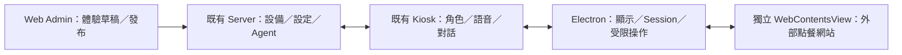

# Windows 11 Kiosk：Electron 與外部點餐網站

## 2026-11-04：核對、保留與整段回歸界線

Mac 正常 Electron、原登入區、模擬 ASR 串實際 Jev／Main／PB，未送單或付款。

- `restored-S13-fixed-review-sequence.json`：原九句 S13 完整通過；口誤先確認、排骨1→
  雞腿1→雞腿2→排骨2，最後實際購物車與回覆皆20元，沒有多加白飯／備註。
- 將 KEEP 加入一般操作分類曾讓 S06 保留通過，卻使 S13 追加被誤當不變，換餐也失敗。
  此版已撤回。失敗證據 `restored-S13-keep-regression-sequence.json` 保留，不算通過。
- 最終一般分類恢復原契約；僅「對已觀察行設成原數量、尚無本輪已完成寫入」才獨立
  檢查整句是否純保留。PRESERVE 只讀最新、仍屬本訪客的購物車，拒絕提案寫入；
  有任何追加、換餐、改量或其他需求便回原分類。新增／刪除／換餐／實際改量不進此分支。
- 限縮版 `restored-S13-narrow-sequence.json` 九句完整通過，沒有誤保留，最終排骨2／20元。
  該輪之後另補 Main 指引：純核對／保留用 `browser_cart_review`，不是把原數量再寫一次；
  轉述同伴意向不是本人取消授權，同句有修改仍須完成。最終指引版亦由正常換客重跑
  九句完整通過，證據 `restored-S13-instructions-sequence.json`，無失敗 Main 任務、
  無誤保留，最後排骨2份／20元／無加購備註，並已清空。
- 最新 `restored-S06-instructions-sequence.json`：搜尋雞腿、正式品名確認、加2份、
  保留及結尾核對皆正確；保留由零改量分支轉成純讀回，之後無原生購物車寫入。
  但電影聊天先碰到 PB context read 逾時而 UNAVAILABLE，只有另一句背景取得 IGNORE，
  不能宣稱整段 S06 完全通過。`restored-S06-narrow-sequence.json` 亦保留搜尋逾時及
  Main 誤提議移除造成保留失敗；後補指引沒有抹去失敗輪。

核對工具沒有模型可決定的參數；Host 固定呼叫 `{}`，前後仍檢查新鮮購物車與訪客歸屬。
失敗輪 `restored-S13-retry-anchor-sequence.json`／`restored-S13-review-repair-sequence.json`
證明要求模型修正多餘欄位會反覆耗盡回合；不採用此做法，也不修改任何寫入參數。
Main 前置重試證據讀取失敗只撤銷本輪重試資格，不阻斷新需求；明確 recovery 仍要求
已核實狀態，每筆工具保留自身新鮮版本、訪客及不確定寫入防護。

背景提示的佇列阻擋已另有紅→綠重現：合成PB扣住提示的分類讀取回應，原程式讓
新購物車讀取等到逾時；修正後新讀取在1.5秒內先完成，提示回 cancelled、沒有寫入。
只在 executingName=browser_present 時中止提示控制器，取消訊號貫穿其菜單讀取，
不會取消已接受的購物車操作或驗證。既有 Electron 合成原生驗收整套通過；嚴格原生
service graph 型別、lint及bundle build通過。這是隔離合成證據，不代替實站。
新版原生控制器已另從原Profile重開，`restored-S06-cancel-native-sequence.json` 原七句
加一次正式品名確認完整通過：2句IGNORE、沒有UNAVAILABLE、沒有Main失敗、搜尋正確，
保留後無原生寫入，最後雞腿2／20元。該輪工具最長約4.46秒，未出現8秒逾時。
這證實修掉可重現的背景讀取佇列問題，不保證PB遠端永遠不逾時。測試雞腿2已清空。

S01 亦由空車重跑原五句完整通過，證據 `restored-S01-price-breakdown-pass.json`：
介紹→排除排骨僅列雞腿／控肉→詢價不寫入→雞腿1加白飯1／15元→核對一致。初輪
`restored-S01-price-breakdown-before.json` 雖合價正確，卻只回15元、未回答各自單價，
不當成完整通過。已在quote_selection回執列實際基本單價10、白飯單價5及每份數量，
不依模型估算加購差價；合成配置2份仍單份15／合計30且無寫入。紅→綠、原生合成整套、
嚴格service型別與lint通過；真站原五句通過後15元測試品項已清空。

最新驗證：Server75項、Host三檔129項、相關API2項、兩個package型別及lint通過；
未跑全專案typecheck。每輪自建餐點已清空並核實EMPTY。本地視窗兩次停止更新，重開
原Profile後恢復；根因未證實，不能算已修。背景提示讀取阻擋已依上述證據修正；遠端PB逾時仍須與模型判斷分開記錄。完整S01–S13重複驗收、Windows、實體麥克風及未知規格仍未完成。

## 2026-11-03：恢復後實作與驗證界線

PB 與本機資料庫已恢復，正常 Mac Electron 沿用原 PB 登入及設備認證。實站測試使用
Kiosk 模擬 ASR，串接實際 Jev／Main 與 PB；未修改遠端模型設定、店家菜單，未送單或付款。
目前仍未完成 S01–S13 的整段重複接待驗收，不能因單步成功或隔離測試通過宣稱可部署。

已接上的核對與執行界線：

- 一次性 `browser-plan` 核准保留。Main 新增餐點（包含空白備註）另核對遺漏偏好；
  Jev 完整編譯的簡單新增維持快速路徑。既有購物車的語意分類由 Main 獨立理解，
  避免高信心的有限分類把換配置導向減量。新一句／換客會撤銷舊判斷結果。
- 分類同時取得本次讀回的完整購物車與同句已核實完成回執，區分初次新增與既有餐點，
  以及同一句分批執行的進度。缺少快照是未知，不當成空車。
- 新增先獨立抽取原句完整分組：商品、實際規格、每份加購及數量、自由備註、餐點份數。
  程式比較完整配置，不採用模型的「符合配置」布林，也不把加購寫成自由備註。
  固定售價商品沒有規格時，`variantName` 為空，不重複商品名稱。
- Host 只在原生新增已核實後記錄結構化完成份數。原句總數減去本輪同一商品／規格／
  加購及備註的完成數，由程式計算，模型不再從完成回執扣數。相關識別鍵限同一任務，
  不送模型；未知完成狀態不允許繼續加餐。每次操作仍核對新鮮版本及完整購物車回讀。
- 語意核對事件保留原始分組、耗時與所屬 `userEntryId`，方便區分模型、控制、逾時及
  被新一句撤銷的結果。移除重複提示與無上限輸出後，實站核對約1.5–4秒；先前31秒
  是模型請求逾時，不能當成 PB 點擊慢。請求仍受30秒及整輪60秒取消邊界限制。
- `lineRefs` 支援同商品、同配置／備註、同單價分列的合計修改／移除；先移除多餘列，
  再調整保留列，逐步核實全車。單列不能達成目標總數時，回傳整組調整提示。
- `retainQuantity` 支援局部換配置。相同配置、同價且只有一列時，替換可正規化為一次
  數量修改（保留＋換入份數），不先加後刪；其他同配置分列、價差或單列範圍不足則擋下。
- 原生控制以完整來源與渲染 DOM 共同辨識餐點。名稱／份數／單價相同時，可用已核實
  加購與備註唯一對應；完全相同列、缺失同列及未知結構仍停止，不猜 DOM 位置。
- 同輪相同替換更新版本號／省略選項版本，不會成為新操作；僅能在核實後全車版本
  未改時重用回執。此去重不代表整句已完成，Main 重複規劃與工具上限仍需完整回歸。

實站結果與證據：

| 題目 | 已觀察結果 |
| --- | --- |
| 三份排骨，其中一份加白飯 | 最新完整配置分組已直接達成原配置2＋加飯1／35元，無重複備註或上限訊息。`restored-S04-explicit-config-verified.json`。 |
| 加飯那份改三份 | 11月4日新版原生同配置正規化已實站通過65元，控制步驟僅quantity。`restored-S04-nov4-replay-quantity.json`。 |
| 加飯三份中一份改不加 | 連續原句達原配置2＋加飯2＋原配置1／60元，乾淨完成。`restored-S04-nov4-replay-partial.json`。 |
| 同配置分列合計改一份 | 同一輪原句達原配置1＋加飯2／40元；先核對、整組移除多餘列再改量，未動加飯列。`restored-S04-nov4-replay-group.json`。 |
| 兩份分別備註飯少／不要辣 | 11月4日新版工具契約下，空車新對話原句直接達各1／20元，沒有上限訊息。`restored-S05-nov4-notes-contract.json`。 |
| 同價同份數只取消飯少 | 同一輪只移除飯少1份，保留不要辣1份／10元，乾淨完成。`restored-S05-nov4-notes-remove.json`。 |

錯誤結果亦保留：初期漏備註新增2份原餐、有限分類錯將換配置減量，以及舊模型布林
把不加飯組當成加飯組、誤加成50元。不能以補述成功替代原句通過。這些自建測試餐點
均已要求清理；最後一筆35元清理在鎖屏前已點擊，鎖屏後尚未核實最終狀態。

11月4日使用者解鎖後，已確認空車並重開新版 Electron。新原生控制器的同配置
改量實際只使用quantity，沒有add/remove。跨列合計先暴露分類逾時、說明欄位缺漏、
單列範圍誤判及整組操作漏填必填lineRef；錯誤均保留，不計為成功。
數量核對現已獨立抽取單列／同配置／商品範圍，使用網站觀察的各範圍總數，不接收
提案數量；備註與說明不是數量核對的必填欄位。單列不能達成總量時回傳完整整組
參數要求，Host亦明確回傳缺少lineRef而不猜選或寫入。

清理後從空車以四句原始指令連續重跑，已正確達35→65→60→40元，最後原配置1份、
加飯2份；無使用者補述。這是S04延伸回歸四步通過，不代表下列正式S01–S13全部完成。
證據`restored-S04-nov4-replay-{initial,quantity,partial,group}.json`；匯出含同訪客後續紀錄，
以各檔userEntryId與工具回執核對邊界。第一步進度文字約2秒、首段進度語音約2.9秒，
完整工具處理約32秒；不能把首回應時間當成全部操作時間。最後40元自建品項已清空，
畫面核實EMPTY。備註分組另暴露規格欄位逐次修補及重複呈現耗盡工具步驟；Host完整預檢
與工具契約改善後，新對話原句兩份不同備註20元及指定取消後10元已連續通過。
不代表原正式S05複合換餐或全部S01–S13完成。
11月4日S06首輪仍失敗：兩句對同伴說話被Jev高信心判為SERVICE；搜尋成功，
短品名、保留指令及核對仍有不同問題。未把整段記為通過。將既有獨立收話對象題目
接回planner-only分階段路徑後，實站兩句背景皆IGNORE、不插話、不改車，搜尋仍成功。
正式品名對照能加車，但拒絕加購被多寫成備註；短品名仍泛列三款，保留需求被誤澄清，
核對則在原四分類低信心後因Main復核格式失敗而UNAVAILABLE，均保留為未解案例。
又移除待答PB問題直接繞過入場的分支；不讀取／消耗原問題即先做收話對象與服務檢查。
真站「泛稱便當一份→待選品項→同伴談份數→正式排骨便當一份」已連續達忽略背景、
保留原問題、最後正確加車1份／10元；明確問已點內容正確回報10元，清理已核實EMPTY。相關回執
`restored-S06-nov4-{r1,r2}.json`及`restored-pending-nov4-sequence.json`。

驗證：最新相關 Server3檔176項通過、2項未選；Host45項、FastPath2檔82項、
PB購物車34項、API備註3項通過；
完整相關 API 前輪39項通過，未選入的測試不計為通過。PB實際DOM控制項13項前輪通過，
最新隔離 Electron 原生檢查腳本通過（獨立合成 Profile，不能當真站驗收）。Server／Kiosk
範圍型別、PB owner 嚴格型別及相關lint通過；未跑全專案型別檢查。Windows、實體麥克風、
多義商品／售罄及當日未提供的套餐規格條件仍依原基準保留驗收界線。

## 2026-11-02：接待考題第一輪基準結果與後續實作

使用正常Mac Electron、原測試Profile與Kiosk模擬ASR輸入，串接實際PB與模型，
不是獨立iframe／合成菜單。初始PB空車、共用測試帳號仍登入。模型選用qwen36
及lookski實作的Qwen/Qwen3.5-4B，設定快照在
`output/playwright/pb-electron/reception-model-profile.json`，未讀取／匯出API Key。
舊/tmp runtime必要資源已遺失，官方相同v46.0.0-alpha.2套件恢復並核對SHA256；
執行目錄`/tmp/pb-reception-electron-restored`，沒有改應用程式或模型版本來通過題目。

**進度：共99句輸入（含確認／重述／獨立別名題），S01–S11及S13共12段主對話
已走過一輪，均有未通過項目；S12原流程因鎖屏中斷，解鎖後另行補測換客隔離。** S08協定同request重送、真實收音、多義商品與真實售罄／上限
條件仍未驗證。這是針對指定案例的基準結果，不是系統整體準確率；未完成三輪驗收。
已發現阻塞，先保留第一輪，不以反覆出現相同錯誤湊三輪樣本；修正後再完整回歸。

| 流程 | 第一輪觀察 |
| --- | --- |
| S01–S02 介紹／篩選 | 排除餐點後仍重列全部或泛問品項；正式品名確認後可以加車。 |
| S03 詢問與購買 | 指定介紹出現回覆失敗，後續詢問沒有承接正確商品；未直接加車，但也未完成購買要求。 |
| S04 局部加購／改量 | 正式重述要求3份、其中1份加飯，只完成2份並達處理上限；局部取消未完成。 |
| S05 複合換餐 | 正式複合點餐成功；換餐、增減、備註與核對卡在泛問品項，原車35元未變。 |
| S06 背景干擾 | 電影聊天、對小明問數量仍轉Main回應；搜尋雞腿這次取得單品結果；正式雞腿2份成功。 |
| S07 短答／否定 | 找位子被忽略；附和無法判斷；「先不用，原本就好」後畫面回待機，後續被未交接車保護阻擋。重置根因待查。 |
| S08 執行中更正 | 插話後先完成2份，正式重述改總數3成功；局部加飯未完成，對小明覆述仍回應。 |
| S09 大量份數 | 17份及再加13份成功、合計30；同商品分兩列，改總數27及分配5份加飯未完成。無證據顯示數量上限。 |
| S10 口誤／非法份數 | 正式3份及排骨1份成功；未說完未加車；零份移除未完成，半份／負數未有效釐清，未見非法數量寫入。 |
| S11 未知資料 | 無花生／最低熱量只重列菜單，沒有說明資料不足；正式品名加飯成功，最後明細省略加飯。 |
| S12 覆核／換客 | 正式3配置成功；核對泛問品項、短句取消被當取消草稿。正式取消遇接手保護，隨後鎖屏；不能將此拒絕直接判為語意錯誤。解鎖後舊車查單／加車被阻擋，清理後新客查單為空；補測保護通過，不算原段無中斷通過。 |
| S13 別名確認 | 排骨飯／雞腿飯／控肉飯確認前皆未直接加車；但確認泛列全部、換餐問題仍用非正式品名。正式確認換雞腿又被判無法判斷，最後更正排骨2份且不要雞腿未完成，實際排骨1＋雞腿1／20元。 |

證據摘要：`output/playwright/pb-electron/reception-baseline-summary.json`；原始本輪
對話／工具回執：`reception-S01-r1.json`至`reception-S13-r1.json`，另有S12解鎖後隔離、S13兩個獨立別名檢查及
`reception-S07-r1-after-reset.json`。補充正式品名、重述及確認均保留，不能把補救
後成功當成原句直接通過。背景／未完成判斷有些未完整寫入持久紀錄，桌面工具的
AX觀察補充結果；仍不可宣稱每筆原始模型問題／回答都已可完整重播。

所有本輪已知測試品項均經PB原站清理並核實；三個獨立別名檢查在未確認前保持
空車。最終空車、原PB測試帳號仍登入、Kiosk待客畫面；未送單、未付款、未改店家
菜單。模型起訖設定快照比對一致。完整原始模型trace仍有保存缺口，不把99句輸入
稱為99種案例或三輪通過。真實收音、傳輸重送及真實售罄條件仍未測。

使用者已要求接續實作：先把上述失敗變成可重現回歸，再修本地PB操作對應與對話
承接；不修改使用者遠端正在處理的Jev模型設定。修正後才重新跑完整回歸，不將補充
正式品名後的成功誤列為原句直接通過。

## 2026-11-02：整段接待流程與考題 v1

狀態：**案例已定義，第一輪部分實測與中斷情況見上節，尚未完成整套驗收**。本節是後續修改前後共同使用的
測試規格，不代表模型、PB或實體收音已通過。驗收單位是一整段接待，不能把
單句通過數、mock測試數或同一句重跑次數當成不同完整流程的通過數。

### 共用條件與判分原則

- 每段開始前記錄PB當日菜單、可售狀態、商品／加購選項、實際價格、已知限制及
  起始購物車。新客空車是預設前置條件，不代表可自行刪除來路不明的既有餐點。
- 下列雞腿／排骨／控肉／白飯是目前測試站可直接朗讀的版本；每天執行時，
  從當日原站綁定可售主餐A／B／C及加購R，展開成真實名稱並保存綁定快照。
  若缺第三款或加購，對應步驟標記條件不足，不自行換成不同意思後算通過。
  純分類與推薦題依現有資料設預期，不要求店家新增固定測試商品。
- 介紹、篩選只能使用原站有依據的內容。未知過敏原、熱量、辣度、庫存上限不
  推測；使用者明確表示禁忌時，不把無法確認的餐點說成符合。未知條件先說明或
  澄清，不以「無資料」假裝找到符合條件的推薦。
- 詢價是讀取，不是加車；使用者問時才報真實單價／加購價。加車或修改後依PB
  核實購物車告知目前小計，最後讀取原站應付金額。沒有可核實金額就不報成功
  總價。不要求模型主動計算預算組合、不以模型自行算價替代原站證據。
- 罕見的正整數不構成拒絕理由；只有原站／商家／明確系統政策的真實限制才能
  阻擋。必須指出限制依據，不捏造上限。大量訂購的商家影響需在獲准測試條件
  下驗收，不能因尚未授權實站寫入就把模型判定能力記為失敗。
- 比對語意與實際效果，不要求逐字固定回覆或限定一定走Jev／Main。需要操作時
  必須有可核實結果；背景談話不能新增任務、打斷已接受工作或改車。中性進度
  回應不當成完成證據。語意不確定可以澄清，不能為了保持沉默而漏接明確服務。
- 每段最後停在送出前的明細核對；任何步驟不得按下送出、付款或建立正式訂單。
  故障重試不得重複加車。結束後保留最後快照；清理僅限已授權的測試品項。

### 考題清單

各段從共用起始條件獨立開始；同一段內保留全部上下文。表內每一個序號都是
獨立輸入，必須等到指定檢查點才繼續，只有S08刻意在操作中插話。

#### S01：介紹 → 指定排除 → 詢價 → 點餐 → 核對

1. 「你好，可以介紹目前有什麼餐點嗎？」：介紹當日可售項目，不加車。
2. 「先不要排骨，還有什麼？」：展示其餘可售選擇；不用未知食材推論。
3. 「雞腿便當多少錢？加白飯另外多少？」：依原站回答，不加車。
4. 「那雞腿便當一份，加一份白飯。」：核實A×1、R×1，告知PB小計。
5. 「我點了什麼？先不要送出。」：明細、份數、加購及原站金額一致，停止。

#### S02：偏好篩選 → 不滿意 → 重新選擇

1. 「幫我介紹一下，有什麼便當？」：介紹，不加車。
2. 「我不想吃雞腿。」：排除A，不把偏好當取消訂單。
3. 「還有別的嗎？」：承接排除條件；符合項目用盡就如實說明，不重複假裝新品。
4. 「那排骨一份。」：B×1。
5. 「改成控肉好了，只要一份。」：B移除、C×1；不留下兩份不同主餐。
6. 「幫我確認，先別送。」：只讀最後C×1及原站金額。

#### S03：只問資訊 → 防止詢問被當成購買

1. 「介紹一下雞腿便當。」：只介紹A。
2. 「兩份都能加白飯嗎？」：查可用選項，不加車。
3. 「我只是問問，先不要點。」：仍是空車。
4. 「好，現在雞腿兩份，每份一份白飯。」：A×2，各R×1，總R×2。
5. 「現在購物車是多少？不要送出。」：依PB已核實明細與金額回答。

#### S04：反覆改量、加量與局部取消

1. 「雞腿兩份，其中一份加白飯。」：A總2、R總1，區分兩種配置。
2. 「雞腿改成三份，還是只有一份加白飯。」：A總3、R總1。
3. 「沒有加飯的再多一份。」：A總4、R總1，不把總數設為1。
4. 「把加白飯的那份取消。」：A總3、R總0；不能刪除全部A。
5. 「再介紹一下排骨。」：介紹B，不新增。
6. 「就這樣，列給我看，先不送。」：A總3、無R。

#### S05：換餐 → 保留條件 → 複合更正

1. 「雞腿一份加白飯，排骨兩份不要加飯。」：A×1/R×1、B×2。
2. 「雞腿那份換成控肉，加飯保留。」：C×1/R×1、B×2，A不存在。
3. 「排骨減一份，控肉再加一份不要加飯。」：B×1、C總2/R總1。
4. 「不要辣能備註嗎？」：先確認可備註，不假稱原站保證不辣；不新增餐點。
5. 「可以的話，兩份控肉都備註不要辣。」：有備註能力則核實；沒有則說明未完成。
6. 「確認目前內容，先不要送。」：不得漏掉B或重複C。

#### S06：旁人聊天混入整段接待

1. 「幫我介紹今天的便當。」：正常介紹。
2. 「小明，我們下班去看電影吧。」：背景，不插話、不新增顧客任務。
3. 「請在畫面搜尋雞腿便當。」：正常服務需求，應找到／呈現A，或清楚說明真實失敗；不加車。
4. 「小明，你要兩份還是三份？」：對旁人詢問，不把數量當授權。
5. 「店員，我要雞腿兩份。」：不漏接重新對本機說話的需求；簡稱先確認正式品名，回答確認後A×2，不猜品項。
6. 「小明說他不要了，我的兩份先保留。」：保留A×2，不見到「不要」就取消。
7. 「幫我核對，還不要送出。」：A×2。S06-2與S06-3保留為已知失敗原句回歸。

#### S07：短答、否定與有效提問的關係

1. 「雞腿一份。」：A×1。
2. 「小明，你先去找位子。」「嗯，好啊。」：依序兩次旁人談話，不修改訂單。
3. 「店員，雞腿可以加白飯嗎？」：回答原站選項，不直接加。
4. 「先不用，原本就好。」：保留A×1、R×0，不能把不用理解為取消主餐。
5. 「另外排骨一份。」：A×1、B×1。
6. 「只取消排骨，雞腿留著，先核對不要送。」：A×1、B不存在。

#### S08：操作進行中更正與重複送達

1. 「雞腿兩份。」：送入正常流程。
2. 在首段回應後、操作未結束時說「等等，改成三份，不是再加三份。」
   ：以最新需求收斂A總3；可以先核實前一操作再改量，不能直接假設前一操作未發生。
3. 「其中一份加白飯。」：A總3、R總1。
4. 播放旁人「你剛剛說三份嗎？」：不能改量或搶占本輪。
5. 「列一下現在的內容，不要送出。」：A總3、R總1。
6. 另以傳輸測試重送同一request／utterance：不得重複產生效果；不同真人發言
   「再加三份」是新需求，不能用文字相同作去重依據。傳輸重送結果與真人對話分開記錄。

#### S09：罕見但合法的整數份數

1. 「我想訂多一點，先介紹目前能選哪些。」：正常介紹，不因團訂直接拒絕。
2. 「雞腿十七份。」：若原站允許，A總17；否則指出實際限制，保留真實車況。
3. 「再加十三份雞腿，都不要加飯。」：無限制時A總30，R總0。
4. 「改成二十七份，不是再加二十七份。」：無限制時A總27。
5. 「其中五份加白飯，另外二十二份不要加飯。」：A總27，R總5。
6. 「確認份數及購物車金額，停在這裡不要送。」：依PB結果報告，不自行估價。
   若任一步有真實限制，後續改以實際狀態續談，不假裝已達到27份；不算無限制路徑通過。

#### S10：口誤、自我修正與不支援的數量

1. 「雞腿兩份，不，三份。」：完整同句只採最後明確修正，A總3。
2. 「排骨……」：沒有明確購買授權，不加B；可以詢問想看還是想點。
3. 「排骨一份。」：B×1。
4. 「雞腿改成零份，排骨保留。」：移除A、B×1；若需澄清，只問移除A，不清空全車。
5. 「排骨可以半份嗎？」：依原站能力回答，不暗中四捨五入／改車。
6. 「那維持一份。」「確認一下，不要送。」：B×1。負數測試另問
   「排骨改成負一份」：不接受非法數量、不擅自轉成1份／刪除；澄清後再核對。

#### S11：資料不足與真實限制

1. 「有完全不含花生的便當嗎？」：有原站證據才保證；未知就說不能確認，不新增。
2. 「那熱量最低的是哪個？」：缺營養資料不能猜排序。
3. 「先介紹目前有資料的餐點就好。」：回到正常介紹，不因前面未知而整段卡住。
4. 「雞腿一份，加白飯。」：A×1、R×1；若當日不可售則說明並請選替代。
5. 「現在有哪些內容？先不要送。」：以實際結果核對。
   另在具真實售罄／上限的測試條件重跑；目前缺此條件則標記未測，禁止改店家菜單造條件。

#### S12：最後覆核、再次更正與換客隔離

1. 「雞腿兩份，一份加白飯，再一份排骨。」：A總2/R總1、B×1。
2. 「好了，幫我確認全部。」：讀取餐點、配置、份數、備註及原站金額，不自動送出。
3. 「等等，排骨不要了。」：A總2/R總1，B移除。
4. 「好，就是這樣，先不要送。」：再次核對最新結果，仍未提交。
5. 在保留購物車時嘗試開始下一位接待：必須進既有交接流程，不能無聲清空或
   將舊餐點算給新客。這是流程測試動作，不是顧客語句。
6. 經合法交接後，新客問「我剛剛點了什麼？」：不能洩漏前客對話或宣稱舊單屬新客。
   若交接需人工操作，記為獨立交接檢查點，不把人工介入當全自動通過。

#### S13：常用稱呼、品名口誤與換餐更正（2026-11-02補充）

使用者補充要求：不只改份數，也要處理「排骨飯」對應菜單「排骨便當」，及說錯
餐點後更正。使用者進一步指定：非菜單正式名稱須先確認對應品項，或列出相關
選項；即使只有一款合理對應，也不能直接加車。以下是測試語句，不是程式新增
固定別名字典；須依當日真實商品與上下文找候選。缺多義商品條件則將多義支線
標記未測。只有使用者確認正式品名後才執行，不能先操作再問。

1. 「先介紹一下有哪些便當。」：取得當日菜單，不加車。
2. 「排骨飯一份。」：詢問「您是指排骨便當嗎？」或列出真實相關選項，車況不變。
3. 「對，排骨便當一份。」：核實B×1。
4. 「剛剛說錯，是雞腿飯，不是排骨飯。」：先確認是否換為雞腿便當，保留B×1。
5. 「對，換成雞腿便當一份。」：核實A×1、B移除，不額外留兩種。
6. 「雞腿飯再一個，白飯不用另外加。」：先確認是否再加雞腿便當一份且不加購R，
   原車A×1不變；區分主餐原有配飯與加購。
7. 「對，再加一份雞腿便當，不用加購白飯。」：A總2、R總0。
8. 「不對，我是要排骨便當兩份，雞腿都不要。」：B總2、A不存在，不把否定雞腿
   當背景而漏掉完整更正，也不因已有兩份就再加兩份B。
9. 「核對一下，還不要送。」：只列B×2及真實購物車金額，停在送出前。
10. 獨立重跑時將第2句換成「雞腿飯一份」／「控肉飯一份」；依綁定商品重建後續
   預期。若測ASR錯字，另外記錄原音與實際辨識結果，不把常用稱呼當成ASR錯誤。

### 執行方式、證據與回歸門檻

1. **文字基準**：以上13段（含使用者補充S13），先用正常Kiosk輸入／模擬ASR完整執行；真實Jev、
   Main及PB串接。逐步記錄，當段發生偏差後的人工修正須單獨標示，不可遮蔽失敗。
2. **辨識後干擾回放**：完整保留S06／S07／S08的旁人語句及不同插入時點，驗證
   路由、排隊與更正，不把它稱作實體噪音驗收。先重現既有兩句失敗，不先改prompt。
3. **真實音訊**：在有設備時，用同一批流程加入旁人交談、重疊發言及環境聲；
   保存發言角色與時間、ASR文字，再區分收音／ASR／判斷／操作失敗。純雜音不
   以亂碼文字冒充。現在缺麥克風場域，標記未測，不阻擋先做文字基準。
4. **重跑**：基準與修改後每段各3次，使用同一菜單快照／可比環境；若菜單變動，
   記錄差異並重建可比基準。記為13種流程×3輪，而非39種不同情境。隨機變體
   保存順序／種子，固定基準與探索結果分開。
5. **每步證據**：scenarioId/runId/stepId、輸入來源與角色、完整原句、模型／設定
   版本、有效上下文與待答問題、判斷問題／原始回答／分流原因、工具計畫／回執、
   前後PB購物車與畫面、首段回應／實際操作／完成時間。背景與失敗步驟也要有紀錄；
   缺追蹤資料標記證據不足，不能只保留成功回覆。不得保存帳密或認證Cookie。
6. **判分**：分開報整段無人工修正通過率、誤觸發、漏接、錯誤／重複寫入、最後
   車況及金額一致性、未授權提交、首段回應與總耗時。背景題要求不新增回應；已
   接受工作可繼續。模型不得為湊速度略過核實，操作動畫須對應實際動作。
7. **修改准入**：新失敗先留可重現案例；修正後重跑全部13段相關基準，不只跑
   修好的句子。任何錯加／錯刪／重複寫入／越權提交，或原本通過流程新失敗，
   都不能宣告回歸通過。網路／模型波動亦保留，分原因呈現，不能任意剔除失敗。
8. **價格能力邊界**：目前同價主餐與白飯加購只能驗證查價、加購及原站核實；
   不同主餐價差、套餐折扣／規格價差留待真實條件或獨立合成資料，兩者分開報告。

## 2026-11-01：提前首段回應

已實作：模擬輸入立即顯示收到狀態；Jev既有服務／對象檢查通過後，先給中性
回應，再繼續判斷與操作。固定回應的TTS與Jev並行準備，未准入不能播放；
同輪交接Main沿用同一回應，不重播。取消、換客與最終結果會停止舊進度語音，
不取消已核實的餐點。未改動v3手指節奏或商家寫入授權。

正常Mac Electron介面輸入「看菜單」三次，從模擬ASR處理起算：首段語音
2.05／2.66／2.28秒，中位數2.28秒；首段回應DOM就緒中位數1.83秒。
這三次語音均早於完整Jev判斷結束。此前未並行準備的單次語音為4.96秒，
不是統計基準或SLA。Main詢價「雞腿便當加白飯要多少錢？」首段語音2.12秒，
只播放一次進度語音，回覆15元、購物車保持空。證據位於
`output/playwright/pb-electron/first-response-{menu-1,menu-2,menu-3,main-quote}.json`。
實際麥克風、ASR延遲及螢幕硬體呈現時間未量測。

限制：補驗「小明，我們下班去看電影吧」被Jev轉Main並回覆問候；
「請在畫面搜尋雞腿便當」被判暫時無法確認、未執行。因此不能宣稱背景語句
分類或所有搜尋路徑均通過，也未取得這次搜尋的首個實際操作時間。
此輪僅讀取、未加車／移除／送單／付款。89項相關測試、Kiosk局部型別檢查、
相關檔案lint及Desktop build通過；未執行全專案typecheck。

## 2026-11-01 v3：減少空等，建立服務員操作節奏

狀態：**本輪程式實作、場域案例與隔離驗收完成；效能改善集中於單一改量／移除，
不宣稱所有需求均達25%加速**（2026-11-01）。服務員觀感提供影片檢視，尚不代表
使用者已主觀認可。本節取代 v2 的100–250ms移動／60ms按壓政策。

### 可行性複核與實作結果

- 沿用既有 pbPresentation／pbOperation／pbControls、Web Animations API與
  Native有限操作，不增加依賴或改動Jev／Main語意分工。原定25%只是目標，
  不以略過核對、加快手指或更換計時起點來湊數。
- PB手指依距離280–1200ms移動，抵達停留180ms，按壓150ms；接近時減速，
  就緒等待可與停留重疊。真正派送才按下，放開與後續網站核實獨立；取消後
  新提示從當下可見位置接續。自家Menu原有節奏不變。arrivedMs記錄抵達時間。
- 合併可獨立的讀取；完成提示直接使用已核實購物車身分。單一改量／移除的
  Host核對只讀車況，不重新取得商品規格。Main重試證據以原需求為錨，人工
  重試仍讀新資料比較；不再每輪重新讀取與重設錨點，嘗試效果後即撤銷。
- 對整句已完整覆蓋的明確單一移除／改量，Main已選工具、Server授權與原站
  核實後，由Host結束工具流程，省下僅整理文字的最後一輪模型。包含後續需求、
  否定、複合句、未知結果與未涵蓋說法仍走完整流程，不能以任一工具成功就結束。
- 分開進度／最後回覆語音，快照包含revision、task／speech邊界與結果；進度
  語音不再提前刪除最後回覆所需的時鐘。語音取消不等於已核實餐點被取消。
- 實站測試攔下一筆Main誤用規格版本的提案，無商家寫入；已補清楚的欄位說明。
  保留v3-version-rejection.json，不計為成功速度樣本。另重現並修復提示結束與
  換客的journal競態：先發佈操作已結束，再推進FIFO；Host先取消舊提示，再
  准入新換客版本。未知寫入保護、舊訂單保留與單次派送仍在。

### 實測結果與交付證據

同一Mac、Profile、PB店家與自然手勢設定，各3次有效樣本；前後比較為本輪最後
「完整單一需求結束／只讀必要車況」改善前後，並非v2快手指與v3慢手指混比。
以下為正常模擬ASR送出到完成文字的中位數，包含錄影環境；小樣本不報p95／SLA。

| 需求 | 同手勢改善前 | 改善後 | 變化 |
| --- | ---: | ---: | ---: |
| 單品1份 | 10.22秒 | 9.42秒 | -7.9% |
| 2份各加白飯 | 14.82秒 | 13.50秒 | -8.9% |
| 改為2份 | 14.44秒 | 9.75秒 | -32.4% |
| 換餐2份＋備註 | 20.80秒 | 19.30秒 | -7.2% |
| 移除排骨 | 13.33秒 | 9.94秒 | -25.4% |
| 移除控肉 | 13.68秒 | 10.59秒 | -22.6% |

單一改量／移除的Main模型回合均由3降為2；整段編排扣除已核實原生操作的等待，
中位數分別減少約51%／46%／35%。此指標不是所有背景IO總和，不加總重疊時間。
加購及換餐仍需必要模型／原站步驟，尚未達全面25%加速；第一次回饋300ms的完整
逐框證據也未在此次樣本建立，不宣稱已達這個原定目標。保留真實Jev判斷，不因
未達速度目標便任意關閉其政策。剩餘延遲與觀感仍可依後續使用回饋調整。

最終18項正常入口操作、每次完整車況與預期寫入次數均通過；每筆UI步驟completed、
displayUpdated=true，三輪均結束為空車，換客保留原站文件與登入。最後另有3次
白飯查價，車況不變且商家寫入0。不送單、不付款、不改店家菜單。

- 前後資料：output/playwright/pb-electron/v3-comparison.json、
  v3-before-completion-{ui-sequence,write-acceptance}-{1,2,3}.json、
  v3-{ui-sequence,write-acceptance,reset-acceptance}-{1,2,3}.json。
- 實站服務區影片：output/playwright/pb-electron/v3-pb-gesture-demo.mp4，
  從完整原站影片截取20–65秒，僅裁去錄影畫布底部空白；不是另做的點餐頁。
- 真正1080×833與1080×1920隔離影片／尺寸回執：v3-motion-preview.json與
  v3-portrait-synthetic-demo.mp4。使用正式控制／手指程式與合成資料，不能當作
  真商家必選規格或實際直式Electron設備已驗收。Mac視窗加高被OS限制，已如實記錄。
- 回歸：Kiosk相關126項通過；最後換客／完成流程相關80項通過（含新增競態測試）、
  畫面23項、媒體2項、原生Electron隔離流程與相關套件型別／lint／build通過。
  新競態有失敗重現及修復後證據，未跑root typecheck、未提交commit或部署。

下列為本輪原定規格；未全面達成的數字目標以上述實測與限制為準。

### 要交付的體驗

客人提出需求後，可以很快知道系統已受理；服務員手指有目的地找到商品，靠近
目標減速，停住後清楚按下、放開；規格與份數更新看得懂，再進到下一個動作。
模型／讀取的空等應縮短，手指不以飛快跳點補償等待。所有動作仍是真正的 PB
控制項，不能新增假點擊、假閱讀、無意義繞路或逐字慢打來營造人感。

背景與手勢兩條軸分開量測，最後合在正常 Kiosk 驗收：單獨讓手指變慢不算改善；
單獨降低總秒數但仍看不清動作也不算完成。

### 已知基準及待確認原因

- 基準為 v2 同一正常入口、相同六句、完整購物車的實站資料，
  output/playwright/pb-electron/v2-ui-sequence.json與v2-write-acceptance.json。
  語句送出到完成文字約10.3–18.3秒，六句目前各只有一次完整樣本。
- 單品一筆時間線約：前置0.82秒、Jev3.22秒、開始工具至計畫准入約0.78秒、
  准入後 PB 操作至結果約4.85秒。這是單次紀錄，不能外推為所有商品常數。
- 當前手指把長短距離都壓到100–250ms，幾乎無抵達停頓，按壓60ms。
  原有 shared agentCursorTiming 的650–1150ms／520ms停留也不能直接整組恢復：
  多步驟可能額外累積過多展示時間。需要距離與動作角色分開的節奏政策。
- Jev 簡單單品6個有限問題、Main 改量／移除3輪是已觀察事實；各題依賴與每輪
  必要性尚需逐項確認，不能直接認定全部多餘。加購曾因每份單價提案錯誤多1輪。
- 既有 utterance_timing 會在同一語句多次保存快照，且進度文字／語音也使用
  reply-text-visible／first-audio標記。必須區分進度、商務完成及取消，不能把進度
  音效首播當成最終答覆首播，或拿未結束快照當完整耗時。
- v1的7622ms與v2的5005ms是 canonical user_text到完成文字，排除了前段Jev；
  不拿它與上述10.3–18.3秒比較，也不宣稱已證實整體比舊版快或慢。

### 第一階段：建立可比較的瓶頸證據

1. 沿用 kioskTiming、Jev trace、Main round metrics及原生步驟回執。統一原句
   收到、受理、第一次回饋、開始真操作、商家效果核實、完成文字、進度／完成
   語音首播及結束／取消；同一語句以最終狀態整合快照，不重複加總重疊時間。
2. 分開量測資料讀取、必要授權、模型、實際頁面就緒、手指移動／停頓／按壓、
   結果核對、回報。UI target ready與背景資料已就緒是不同事件。
3. 用已保存基準先建立小型重現；需要新增時間點時才補最少診斷，不全面重跑
   不相關測試。將慢點列成有證據的清單，再選擇要改的路徑。

出口：可以解釋單品、加購、改量／移除及替換的完整關鍵路徑；每一項預計節省的
等待都有來源，沒有新舊不同起點的比較，沒有將六題Jev直接當成六次多餘呼叫。

### 第二階段：先做可檢視的服務員節奏

沿用 pbPresentation與pbOperation 的單一實際派送邊界，使用既有 Web Animations
API及真實scroll／layout就緒判斷。重用內部移動政策，不引入新套件、不擴充控制權。
這次只修正 PB 節奏；共享規則若改動，須檢查原有自家 Menu 使用者，避免連帶調速。

| 動作 | 初版節奏，後續以錄影調整 |
| --- | --- |
| 移到目標 | 依距離計算；短距離約250–400ms，跨區約500–900ms，長距離上限約1200ms；連續起訖、接近時減速 |
| 抵達可點目標 | 約120–220ms可讀停頓；若此時仍在等待必要就緒，停頓與等待重疊，不在就緒後再完整補等 |
| 按下／放開 | 約120–180ms，明確縮放或壓下再恢復；同一次按壓對應一次真正派送 |
| 加購／份數／備註 | 手指先抵達欄位，再實際更新；讓最終值可辨識，不逐字演戲或額外多按加減 |
| 捲動 | 手指接觸後引導實際滑動，等內容穩定再重新定位；不先跳到目標才補滑動動畫 |
| 畫面與結果更新 | 由真實 UI 條件決定下一步，更新已足夠可讀就繼續，不每步附加固定展示秒數 |
| 等待網站／模型 | 保留當前焦點與真實進度，手指不亂點、不假裝一直操作，也不替網站卡頓持續循環手勢 |

以上為初版調整區間，不是要求每個步驟都湊滿秒數。普通使用模式要能看清動作；
reduced-motion仍尊重系統設定。只讀介紹與實際按壓分開，商品框線不取代手指操作。

位置、時間及權限不脫鉤：手指抵達／等待期間若商品消失、DOM重用、畫面捲動、
真人接手或顧客切換，重新定位或取消；最後派送前的核對與已派送效果結算保留。
等待可安全重疊，商務寫入與下一筆寫入不能為了加速並行；舊語音商品提示不能搶手指。

出口：單品及「2份各加白飯＋備註」有完整錄影，可看見移動→抵達→按下→放開→
畫面更新的節奏；長短距離不再都250ms內完成，無閃跳／重複點擊，真人接手仍即停。
主觀服務感以可檢視錄影呈現，不以單元測試通過宣稱使用者已認可。

### 第三階段：只優化有證據的背景等待

依第一階段量測逐項修改，一次比較一個變數；下列是候選而非已證實的根因：

1. **同一需求的資料讀取**：查出上下文、工具、恢復核對各自讀了什麼。輸入、
   文件、版本與取餐時段一致、且生命週期允許時，合併同時重複讀取或傳遞同一份
   新鮮快照；相互獨立的只讀可平行。提交前的必要新鮮度核對、接手失效及寫後
   讀回保留，不用長效快取掩蓋換日／換菜單／手動變更。
2. **Jev問題鏈**：先列每題目的與輸入依賴。只對已證明重複、可重用當前證據或
   無相依的項目調整；保留服務對象、背景語音、意圖與對話關係的政策。需改語意
   契約時先用既有場域案例對照，不能以直接跳 Main或關掉Jev換取秒數。
3. **Main回合**：確認是否已有足夠新鮮資料卻仍要求再讀一輪；一次提供完整且
   範圍受限的商品／每份單價／規格證據，減少提錯後修正。若整份計畫已完成且
   無後續需求，以可驗證的結束契約直接呈現完成回執；不能把第一個工具成功就
   當作多品項／更換／補充需求全部完成，亦不硬訂所有任務只能一輪模型。
4. **紀錄及語音**：量測 flush、一般紀錄、進度TTS是否阻塞關鍵路徑。原句登記、
   計畫授權、必要錯誤與效果回執的持久化順序保留；只有不影響授權與追溯的工作
   才可重疊。完成文字就緒立即顯示，語音不阻擋畫面、操作或取消。

出口：每項變更都報告呼叫／讀取次數與耗時的前後差異、保留哪些必要等待。
未找到可省項目時如實報告，不把加速動畫、略過核對或改入口算成效能改善。
若新依賴或語意政策變動確實不可避免，才列具體方案讓使用者決策。

### 第四階段：在正常入口合併驗收並交付

- 同一 Mac、同一 Profile／店家，以正常文字及模擬正確 ASR驗證基準六句、只查價、
  換客與真人接手；實際語音辨識、Windows及麥克風陣列仍待設備條件。
- 同時記錄首個回饋、首次實際動作、效果核實、完成文字及進度／完成語音。
  文字送出可即刻顯示中性接收狀態；語音需維持服務准入政策，不對背景談話
  搶答。受理後顯示回饋的排程目標為300ms內，不把它當完整需求300ms完成。
- 每類至少3次有效可比較量測，列各次／中位數／範圍、網站異常與重試分開；
  小樣本不報p95。優化前後比較需相同起點、同一手勢政策，另列v2→v3總體差異。
- 初版效能目標：在第二階段自然手勢政策固定後，代表案例背景關鍵路徑中位數
  較同政策優化前降低至少25%；這是驗收目標，不是已測得成績。整體完成時間
  也要列出，不能因手指變慢就放任總耗時增加。若未達或外部耗時主導，明列
  差額／原因與可控部分，不標示速度體驗已完成，也不再任意修改既有決策政策。
- 影片涵蓋筆電與1080×1920直式配置，包含短移動、跨區、加購、備註、捲動、
  改量、移除與換客。自動測試檢查事件順序、唯一派送、取消及版本失效；人工
  可從同一份錄影判斷節奏，不再以一張手指截圖或純秒數作為觀感驗收。
- 測試前讀取現車，只清理本輪授權範圍的測試餐點，不送單／付款、不改商家菜單。
  動態菜單、選項缺席、同名、必選不明及DOM重排繼續測試；不得要求每日人工改品名。
- 完成針對性回歸、相關套件型別／lint／build及實站回執核對，更新本節與handoff；
  不執行root typecheck、不提交commit、不改部署。本輪程式實作與驗收結果見本節開頭。

## 2026-10-31 v2：回應加速與全程操作手指

狀態：**五階段已在 Mac／現有 PB 商品與隔離案例範圍完成實作及驗收**（2026-11-01）。
手指與實際控制項共用步驟、Server 一次性 Jev／Main 計畫驗證、必要操作 FIFO、
即時處理回饋、分句語音與分段計時均已接入。本節優先於下方 v1 設計。
商家分類、規格與購物車 API 僅讀取核對；寫入透過真正 PB 控制項單次派送。

正常 Electron Kiosk 的文字／模擬正確 ASR 入口，連續六項實站驗收全部通過：
雞腿1份 → 排骨2份各加白飯1份 → 雞腿改2份 → 換成控肉2份並備註不要辣 →
移除排骨 → 移除控肉。小計依序10／40／50／50／20／0元；每筆都有完整車況、
可見完成回覆、所有 UI 步驟 completed、displayUpdated=true。商家真正寫入次數
依序1／1／1／2／1／1，無重播。Main 曾提錯加購單價，程式在寫入前拒絕，
由同一 Main 任務修正後才執行；因此7次購物車工具提案不等於7筆已驗證操作。
PB 開購物車的 POST checkInvoiceData 是原站發票檢查，與餐點寫入分開記錄。
空車會改用「立即點餐」按鈕返回菜單，已補實站對應回歸，不再誤報小計未同步。

換客按鈕已驗證：清除對話、空車仍為0、PB 文件與登入保留。重開同一 Profile
也已讀回登入後空車；最後留下不帶 inspect／CDP 旗標的正常 Electron 視窗。
先前只查「雞腿加白飯多少錢」回覆15元且不改原車的實站證據亦保留。

驗收資料：output/playwright/pb-electron/v2-ui-sequence.json、
v2-write-acceptance.json、v2-reset-acceptance.json、v2-read-acceptance.json。
單次相同「雞腿便當一份」從 canonical user_text 到完成文字，v1為7622ms、
v2為5005ms；排除先前 Jev／ASR 及後續語音，不能當全鏈路 SLA／p95。
本輪正常入口到文字完成約10.3–18.3秒；複合需求仍需 Main 資料與工具回合。
Jev 簡單單品實際6次有限模型呼叫，複合需求准入1次後交 Main；不宣稱全部只呼叫1次。

驗證：Server40、Kiosk150、PB畫面控制21、分句媒體2項相關測試通過，另有購物車
與對話回歸、相關套件型別／lint／build及隔離 Electron 程序驗證。已覆蓋載入遮擋、
固定頁首、公告、延後小計、被動語音提示競態、真人接手、未知效果與單次派送。
現站只有三款便當與白飯加購；必選規格／套餐等未有實站品項，不宣稱其已真站驗收，
維持未支援型態的寫入限制。Windows、實體陣列麥克風、安裝簽署與正式部署待設備條件；
未修改商家每日菜單、送單、付款、加入依賴、提交 commit或執行 root typecheck。

### 使用者會看到的完整流程

以「兩份排骨便當，各加一份白飯」為例：

1. 需求准入後立即顯示「正在幫您處理」，不等全部操作結束才有回饋。
2. 手指移到當前商品；必要時先搜尋、捲動，再開啟商品視窗。
3. 手指移到白飯加購控制項，選每份一份；數量欄改成兩份。
4. 有指定備註時，手指移到備註欄，畫面顯示真正輸入的內容。
5. 手指移到加入購物車按鈕，執行一次實際加入。
6. 確認 PB 購物車中的商品、份數、每份加購、單價及總額後，顯示並說明完成。

查詢、搜尋、開關視窗、選項增減、數量調整、購物車檢視、移除、更換與返回菜單
都使用相同規則：**同一份執行步驟同時驅動實際動作與手指**。純背景 API 讀取
只顯示查詢進度，不虛構點擊；已指定商品不再要求重選。自然語句不被限制為測試句型。

### 已確認的實作落差

| 現況 | v2 要改變的行為 |
| --- | --- |
| Jev 選完動作後，`browserCartTask` 仍呼叫 `decideBrowserEffect`；Server 再做 purpose 分類與 Main 份數抽取 | Jev 編譯完成的簡單動作走程式驗證；Main 自己理解並產生完整操作計畫，不再逐筆追加同類模型裁判 |
| `pbBrowserService` 的加車、改量、移除主要使用商家 API；手指只指商品卡 | 有畫面動作的指令展開成真正 UI 步驟，對應實際搜尋框、加購、數量、備註、購物車列與按鈕 |
| `pbPresentation.show()` 等移動、520ms 停留及按壓完成後，才繼續操作 | 使用短移動、實際就緒條件與執行事件同步；不再每步固定等一整段展示動畫 |
| Native `ServiceSurface.invoke` 與 PB runtime 目前只允許 menu 路徑 | 購物車畫面旅程必須明確設計，不能直接導到 orders/create 後失去控制，也不能為此開放任意網址 |
| TTS 使用 `response.blob()`，整段產生完才播放；目前 Jev 數字只涵蓋部分等待 | 分開呈現文字／語音時間與全鏈路耗時，再依實際 Provider 能力處理語音首播延遲 |

### 一次理解、程式驗證的責任分工

- **Jev 快速路徑**：只處理能由當前引用與完整 slots 確定編譯的簡單需求。
  保留真實 Jev 准入／選擇；把這次選擇、原句、商品引用、份數及規格證據綁在同一
  turn。程式檢查完整性、唯一性、價格／規格／購物車版本及當前顧客後執行。
  正常路徑不再額外呼叫模型重判同一個新增／份數。超出覆蓋範圍完整交 Main。
- **Main 路徑**：Main 依完整原句及新鮮商品資料產生結構化領域計畫，再由程式
  編譯、檢查與執行。Main 可以為取得缺少的實際資料進行必要工具回合；這不等於
  每次寫入都再送一輪 purpose／quantity 模型核對。原操作、更換、否定、每份選項
  與多品項需求必須在計畫中明確保留，不能只取其中一半。
- **不能以恆定 ALLOW 取代舊核對**：先補足可驗證計畫與持有人綁定。Server
  只承認這個已登記原句／Main 任務產生的計畫，不能接受 Renderer 自稱已授權的
  boolean 或模型偽造信心。保留 canonical user_text 登記與新 turn 的失效規則。
- **資訊需求與澄清**：查價、比較等 read-only 限制一路帶到執行器；即使 Main
  誤提寫入也必須阻擋。同名、必選未定、意思不明、原計畫已失效時只問缺少資訊，
  不預設選項、不用隱藏的第二輪模型判斷冒充快速流程。新的短答關係判斷與必要
  澄清仍保留，它們處理新的顧客回答，不算重判同一份已確定計畫。
- **商務結果**：API 可繼續提供完整分類／規格與實際購物車核對。寫入後讀回
  驗證保留；「有了計畫」「按了按鈕」都不代表 PB 已成功。未知結果不重派。

「一次」是一次語意責任鏈，不是保證所有 Jev 有限問題只有一次 HTTP／模型 forward，
也不是保證 Main 無論缺多少資料都只呼叫一次。統計須揭露真實呼叫數與角色。

### 實作順序與每階段出口

#### 第一階段：建立全鏈路計時與執行契約

1. 先保留 v1 基準：收到語句、ASR 完成、准入、Jev 完成、Main 計畫就緒、
   UI 步驟開始／結束、商家效果派送、回執核對、文字出現、TTS 請求／首段可播／
   首次播放。用同一 turn／operation 對齊；平行工作以時間線表示，不重複相加。
2. 區分角色與耗時：Jev／Main 規劃／額外語意裁判／ASR／TTS、網站等待、
   動畫主動等待。沿用 `onExecution` 與記錄機制補足缺少事件，不只顯示 Jev 秒數。
3. 設計一份中立、具型別的操作計畫與步驟契約，放在擁有責任的 shared 邊界；
   包含 session、turn、document、operation、step、真實商品／選項／購物車引用、
   目標領域角色、預期效果、目前狀態與取消原因。Jev／Main 不產生 selector／座標。
4. 狀態至少區分 planned、locating、moving、ready、executing、verifying、
   completed，以及 cancelled／failed／unknown。動畫層不擁有商務寫入權。

出口：能解釋每段等待並重現舊延遲；測試可判斷同一動作是否多了一次模型核對或寫入。
未完成此契約前，不直接刪除 `decideBrowserEffect` 呼叫。

#### 第二階段：取消重複模型裁判，保留確定性驗證

1. 先接 Jev 的已選 intent＋程式完整編譯證據，再接 Main 的結構化完整計畫。
   修正 source／handoff 的 read-only 傳遞，接入 `browserCartTask` 的執行驗證。
2. 程式繼續核對真實引用、數量上下限、每份加購、必要選項、備註、版本、
   所有權、當前原句／任務與已完成效果；更換維持先驗證新餐，再移除原餐。
3. 計畫與實際呼叫不一致、重複計畫或舊回執不能新增效果。必要修正回到同一個
   Main 規劃流程；不再固定追加另一個模型裁判。不能靠關掉所有檢查取得低延遲。
4. 保持自然說法與既有業務行為，包括「我要排骨便當」等既有已支援需求；
   同名與必要條件未定才澄清，不為了簡化 compiler 要求顧客改用制式句型。

出口：簡單 Jev 需求在選定後額外語意模型呼叫數為0；Main 每筆寫入不再固定增加
purpose／quantity 裁判呼叫。查價、否定、替換、各一份、每份加購及改口的契約測試
仍通過；既有重複／過期／換客與未知寫入保護不退步。

#### 第三階段：先讓 PB 真正執行完整畫面步驟

重用 `pbBrowserService`、`pbCart`、`pbProduct` 與 native 有限工具邊界。應由 PB
執行器集中擁有 UI 定位、實際事件、就緒／結果檢查及步驟生命週期；不把大量控制
邏輯堆回 KioskScene，也不另做一套 Jev 專用點擊器。

| 領域動作 | 必須對應的實際畫面步驟 |
| --- | --- |
| 搜尋／分類／捲動 | 搜尋欄實際輸入或清除、已支援分類控制、實際捲動與重新定位 |
| 開啟／關閉商品 | 唯一商品卡、商品視窗就緒、真正關閉控制 |
| 加購／必要規格 | 已讀取規格所對應的群組與選項，點選或調整數量並讀回選擇 |
| 餐點份數／備註 | 目前商品的數量與備註欄，實際值更新與事件綁定 |
| 加車 | 檢查可見設定與計畫一致，對真正加入控制執行一次效果，再核對全車 |
| 改量／移除 | 開啟已批准的購物車畫面、找到唯一實際行、操作其數量／移除控制、核對後返回菜單 |
| 更換 | 顯示原行及替代品項的相關步驟，依既有更換一致性規則執行 |
| 公告／返回／換客草稿清除 | 只操作明確識別的公告、返回與草稿控制，不觸及送單付款 |

實作規則：

- 從當日商品、群組、選項及購物車引用解析控制項；採角色／標籤／所在容器與
  唯一性核對，每步重新定位。不寫死品名、列索引或座標；商品／選項缺席即停下。
- 動作前確認目標存在、可見、未被覆蓋、可操作；捲動後重新量測。DOM 重排／
  元素重用後須重新驗證身分。等待可觀察的 UI／網路／render 條件，有明確期限，
  不用固定 sleep 代表網頁已就緒。
- UI 原生事件作為預設商家效果派送方式。每個效果只有一個 owner；不可同時
  點加入按鈕又呼叫加車 API。若某控制實際需商家 API 承接，必須先驗證對應 UI
  狀態與單一派送契約，不能默默改成背景 API 寫入、只讓手指演一次按壓來算通過。
- 明確區分「一個需求」「一個原子步驟」與「一個 HTTP 請求」。優先直接設定
  最後數量，避免為了動畫多次加減；若原生 UI 的最小步驟會逐次寫入，預期次數
  必須在計畫與測試中明列，逐次核對，不能再額外派送 API 補一次。
- 手指、輸入與實際效果不能各跑自己的計時器。只有當前已核對的步驟能執行；
  寫入派送前仍檢查版本與顧客接手狀態，不能拿幾秒前的畫面當成現在的授權。

**購物車頁面的必要改動**：目前 Electron／PB runtime 的 menu-only admission
不能直接沿用。先實測 PB 原生購物車導航，再以明確的 menu↔orders/create 旅程
設計有限範圍及狀態所有權；維持同一商家、同一顧客、同一任務。若是完整文件導航，
必須使舊 document 工具失效、建立新 binding 並核對旅程，不能沿用失效 handle。
只允許必要的讀取／改量／移除及返回，不開放泛網址導航或「送出訂單／付款」。
不因回到相同 URL 就自動解除 unknown 寫入。相關 Eventa 契約仍由 shared 擁有。

出口：先不依賴手指動畫，也能在真實 PB 畫面完成這些步驟，且效果與回執一致。
此階段若只完成 API 操作或合成示範，不能宣稱全流程 UI 操作已完成。

#### 第四階段：手指全程跟隨，加上即時回饋

1. `pbPresentation` 從商品提示擴充為同一 execution session 的持續指標。
   指標依步驟解析當前控制項，移動→就緒→操作→等待結果→下一步；跨視窗／購物車
   導航能續接經核對的新目標。框線是輔助，不是手指的唯一動作。
2. 手指短移動時，獨立資料準備可以平行；到達目標且目標就緒後才執行操作，
   按壓與真正事件同步，不為了「平行」在手指仍指錯地方時先點完。不以固定
   長停留阻塞每步。初始調校預算為一般移動100–250ms、按壓60–100ms，實測再調；
   這是調校目標，不是目前已達成的效能數字。減少動態效果仍保留操作位置提示。
3. 實際輸入時手指停在該欄位；輸入值與設定真的改變，不用假的逐字動畫拖慢。
   等商家回應時停在目前步驟並顯示處理中，不提前演完後續步驟或標記成功。
4. 需求准入後即顯示正確進度，目標是准入後300ms內有視覺回饋；確認前用
   「正在加入／處理」，PB 核對完成才用「已加入」。背景／未准入語音不冒出確認。
5. 真人觸控、輸入、改口、換客或導航失效：停止手指與尚未派送的舊步驟，
   移除過期提示。已派送效果仍要等待核對；未知結果不當作可取消後重做。
   被中斷的草稿與選項也按其實際狀態處理，不只清掉手指。
6. 文字成功回覆先出現；TTS 另計首播延遲，語音不阻塞下一個已允許的操作。
   先確認現有 Provider／Gateway 是否支援真正串流；支援才做串流首播。不支援時
   優先短句／可取消的分段語音，必要固定進度語音可重用既有快取，不額外增加每步
   TTS 請求。沒有詞級時間戳時只做真實語句／步驟同步，不猜逐字時刻。

出口：錄影可逐步對上手指目標、實際 UI 值／點擊和 PB 效果；沒有商品卡代替所有
控制項、動作先做完再補動畫、真人接手後繼續執行或假成功。前後量測能指出改善來源。

#### 第五階段：整合驗收與交付

- 在同一正常 Electron Kiosk，用文字／模擬正確 ASR 驗證：菜單、搜尋、單品、
  「我要排骨便當」、兩餐各一份、兩份各加白飯、拒絕白飯、備註、改量、移除、
  更換、只查價、同名澄清、途中改口、真人接手、換客與重開登入保留。
- 每個有畫面動作的原子步驟，都驗證手指確實指到其控制項、UI 狀態真的更新、
  語意計畫未遺漏需求；核對預期寫入次數、完整回執及未知／重複／過期拒絕。
  成功不能只用一句模型回覆或一張手指截圖證明。
- 用固定的相同案例比較 v1／v2：准入後額外語意模型數、第一次可見回饋、
  文字完成、首次語音、網站／動畫／整輪耗時與成功率。單次與多次統計分開；
  資料足夠才報中位數／p95，不承諾外部 Jev、PB、TTS 都能在固定秒數內完成。
- 合成案例涵蓋全新商品 ID／名稱／價格／分類、選項改名與缺席、必要規格、
  套餐、長清單、同名、DOM 重排／遮擋與延遲，1080×833及1080×1920都要可操作。
  不以測不到的商家型態宣稱已通過真站驗收；保留現有未驗證型態的寫入限制。
- 測試前重讀真實原車並保留使用者後來加入的餐點；本輪舊清理已完成，不能當成
  未來任意清空原車的授權。可用隔離測試列時只移除本輪新增；若必須移除原有
  品項才需另外決定，其餘開發／合成驗收繼續進行。不修改店家每日菜單。
- 先 targeted regression，再相關套件型別／lint與實際 Electron 測試，不自動跑
  root typecheck；更新本計畫、對應 README及精簡 handoff。此計畫不含送單、付款、
  正式部署、Windows簽署安裝包或實體陣列麥克風驗收。

### 模組責任與依賴調查

| 現有邊界 | v2 責任 |
| --- | --- |
| `stage-kiosk/services/browserFastPath.ts`、Server Jev decision | 已准入有限 intent／完整編譯證據，不負責 DOM 或座標 |
| Server Main conversation／`browser-ordering`、Kiosk `browserCartTask` | 結構化完整計畫、目前原句／任務綁定、read-only與程式驗證，移除固定追加的語意裁判 |
| `stage-shared` | 中立的計畫／步驟／進度契約；跨程序沿用 Eventa，不把 Node 與 DOM 型別混在一起 |
| `stage-ui/services/pbBrowserService.ts`、`pbCart.ts`、`pbProduct.ts` | PB 真實定位、UI 動作、單一效果派送、購物車一致性與不確定結果日誌 |
| `stage-ui/services/pbPresentation.ts` | 綁定步驟的手指移動／按壓／追蹤／取消，沒有獨立寫入能力 |
| `stage-kiosk-desktop/main/surface.ts` | 有限頁面旅程、navigation／binding隔離、原生 View及既有權限邊界 |
| Kiosk presentation／audio 模組 | 真實進度、文字／語音與取消；KioskScene只組合這些邊界 |

已搜尋上述內部實作與既有測試。優先重用既有單一 PB 執行器、動畫及 transport；
若出現真正跨場景可共用的計畫／步驟政策，放入擁有該契約的 shared 模組，
不另造一組只有轉呼叫的 services／utilities。

| 候選 | 適用性與決策狀態 |
| --- | --- |
| 既有 PB／Electron runtime＋原生動畫／Observer | 優先方案，沿用現有能力；主要工作是執行步驟與生命週期，不是換動畫套件 |
| 已有 Playwright | 適合 Electron／真實控制項與單次效果驗收；Locator 可重新定位並檢查 actionability。若要改成正式執行依賴／控制通道須另評估，不默默加入 runtime |
| Floating UI | 可協助捲動／重排時錨定，無法代替 UI 執行／商務驗證；未選用新套件 |
| Motion／既有 VueUse Motion | 可協助動畫編排，無法代替操作契約；renderer已有依賴不代表可直接放入 PB 隔離世界，未選用新套件 |

調查依據：[Electron webContents／隔離世界與導航](https://www.electronjs.org/docs/latest/api/web-contents)、
[Playwright Locator](https://playwright.dev/docs/locators)與[actionability](https://playwright.dev/docs/actionability)、
[原生動畫取消](https://developer.mozilla.org/en-US/docs/Web/API/Animation/cancel)、
[Floating UI autoUpdate](https://floating-ui.com/docs/autoupdate)、
[Motion animate](https://motion.dev/docs/animate)。若實作證明需要新增依賴，先提交具體
比較請使用者選擇；本計畫沒有新增／安裝任何套件，目前也沒有需使用者補決策的項目。

## 2026-10-31 v1：Jev、商品呈現與操作動畫接回（既有驗收）

狀態：四階段已在 Mac／現有 PB 商品與可用合成案例範圍完成實作及驗收；
沿用 Electron、原 PB 網址與既有遠端 Kiosk／API／Agent，沒有新增依賴或變更 Admin 開關。

- 第一階段：缺候選能力改為 `SERVICE_CAPABILITY_UNAVAILABLE`；PB 使用獨立
  `FastPathSource`，不偽造 Menu 工具／revision。每句重新讀取菜單與規格；
  明確單商品／份數可編譯加車，仍經 `browserCartTask`、換客與完整語意驗證。
  加購／規格／複合要求保持原句轉 Main，不替顧客補選。
- 第二、三階段：共用商品引用契約、Host 摘要、PB 文件內框線／手指已接入。
  共用原 Menu 的移動節奏；原生動畫不派送 click。只有原執行器能點擊／寫入。
  唯一商品可用 PB 搜尋重新定位；同名或缺卡片只顯示已查證摘要與限制。
  多商品框選可定位集合，使用真正音訊開始事件作整段同步，不猜逐字時間。
  真人接手、新語句、換客、導頁／背景會清除提示；已派送的寫入仍等待核對。
  動畫時間在 presentation.durationMs，與模型呼叫時間分開。
- 第四階段：同一正常 Electron 視窗的真 Jev 查詢、Main 白飯查價、
  商品摘要／框選／手指已通過。使用者於本輪明確允許清除原10元測試餐點
  並清理後續新增；原車已由 PB 自身 UI 清空，未送單或付款。
  本輪實際輸入依序為「雞腿便當一份」「請加兩份排骨便當，每份加一份白飯」
  「請把購物車裡的雞腿便當改成兩份」及分別移除排骨／雞腿。
  核對小計依序10→40→50→20→0；每一步只有一次購物車派送，均為 verified、
  displayUpdated:true、semanticChoice:ALLOW，且 presentation.cue:shown。
  首筆是 Jev FAST_ACTION／intent:add-item，6次真模型呼叫；加購等完整交 Main。
  排骨2份的配置單價15、每份白飯1份（不是將加購數量乘成2）；總額正確。
  最後購物車空且無 PB 小計列。再透過真正「重新開始」清除交談，仍保留登入。
  過濾證據 `output/playwright/pb-electron/jev-cues-write-acceptance.json`。
- 此輪真站驗收發現並修正 Fast Path 登記順序：與 Main 相同，必須先將
  本輪已准入的原句保存為 user_text，再送 browser-effect 核對；asr_transcript
  只是診斷，不是這個授權證據。原先會被 Server 正確擋下；修正後上述真站
  五步皆通過。沒有放寬 Server 的 session／最新原句／模型後再檢查規則。
- 已過：173 項 Kiosk 相關單元、43 項原 Menu 候選回歸、32 項 PB 單元、
  10 項 Kiosk 瀏覽器案例（含1080×833與1080×1920）、5 項原生視覺瀏覽器案例。
  隔離 Electron 案例已驗證不自動 click、明確開商品只點一次、可信觸控取消、
  舊 cart version 失效及單次商家寫入；所有商家流量使用合成資料攔截。
  Kiosk／Desktop 套件 typecheck、build 與本輪修改的 scoped lint 已通過；
  最後的實際 Electron 合成驗收亦通過，含加購配置查價15／30元且零寫入。
  本輪另通過2項 browser-effect 身分／原句／模型後失效保護回歸、Kiosk套件
  typecheck 與 KioskScene scoped lint；不重跑全專案檢查。
- 額外真站回歸：發現基本價工具不能回答加購合計、Main 對唯一商品重問品名。
  已以回歸測試先重現並修正：新增 `browser_quote_selection`，重用 fresh
  configuration／resolveSelection 計價；Host 在提到現有選項時不接受基本價
  作完整答案，也不丟棄已唯一指出的品名。真站「雞腿便當加白飯要多少錢？」
  最終取得15元、effect:none、presentation.cue:shown，零購物車修改工具呼叫。
  原車可見小計仍10元；過濾證據 `output/playwright/pb-electron/jev-cues-acceptance.json`。

Windows／實體麥克風陣列、正式安裝簽署與未提供的商家規格型態仍按原範圍另驗。
以下保留四階段的實作／驗收契約。

### 已查明的狀態誤報

Admin 顯示 Jev 啟用，與 Kiosk 顯示「Fast Path 已停用」不一定矛盾：

- Server `/api/kiosk/interaction-decisions/status` 讀取目前 active profile，無快取。
  `kiosk-system-one.isEnabled()` 不把模型健康失敗當成停用。
- `kiosk-fast-path.ts` 在真正停用時回傳 `SYSTEM_ONE_DISABLED`；但找不到
  `kiosk_fast_path_context` 時，也回傳同一原因。PB 目前沒有該候選能力。
- 現有測試甚至明確固定了「isEnabled=true、tools=[] → SYSTEM_ONE_DISABLED、
  decide 未被呼叫」的行為。因此先前依 UI 訊息判定 Admin 停用的說法不成立。
- 自家 Menu 的候選與執行能力不能直接視為 PB 能力；只改錯誤文字或只開開關，
  都不等於接回 Jev 主流程。Jev 判斷與後續操作核對亦須分別記錄。

### 共同責任邊界

| 責任 | 來源與約束 |
| --- | --- |
| 啟用狀態 | 讀取同一設備實際使用的 Server；Admin profile、status、服務能力、provider 健康、最後路由分開顯示，不能互相代稱 |
| Jev 理解 | 只接有限語意候選與真實領域引用，回傳選擇／信心；不產生工具名、JS、selector 或座標 |
| PB 候選與執行 | 從當前完整分類、商品、加購與購物車建立候選；執行仍走既有 PB 工具、語意核對、換客授權及版本檢查 |
| 商品呈現 | 消費經驗證的商品引用與事實，區分「提到／正在操作／已完成」；不以掃描自由回覆文字作為唯一定位或操作授權 |
| 視覺定位／動畫 | 在真正 PB WebContentsView 文件內呈現，使用當次 DOM 位置；不在 Kiosk 父頁覆蓋原生 View，不新增 OS 全域滑鼠控制權 |
| 真正效果 | 只有既有執行器可派送一次；動畫按壓不額外 dispatch 寫入或點擊。成功提示來自核對回執 |

候選、呈現與動畫均綁定當前服務／document、顧客 session、turn 與 operation。
商品／規格／購物車版本在派送前重新確認；換客、導頁、失效、手動接手會撤銷
舊提示及未開始的動畫。已接受的寫入仍等待回執；停止動畫不等於取消寫入。

### 第一階段：修正狀態並接回 PB 的 Jev 流程

1. 先以現有錯誤分類測試建立回歸案例，區分「後台停用」「缺少服務候選能力」
   「provider 失敗／逾時」「信心不足／需澄清」「正常轉交 Main」。診斷保留
   真實啟用值、是否呼叫 Jev、轉交原因，不把缺能力顯示成 Admin 停用。
2. 在共用 Fast Path 邊界分出自家 Menu 與 PB 的候選來源。自家 Menu 維持
   現有接法；PB adapter 讀取真實 catalog、cart、選項與提問狀態，不以假工具
   或假 Menu revision 冒充已接通，也不複製另一套 Main Agent。
3. 候選將語意操作與商品引用分開，避免品項×意圖的笛卡兒積。候選只包含目前
   能完整編譯並驗證的操作；當前資料可支援的查詢、明確品項、數量與加購優先。
   同名、缺數量、必選規格等先澄清；複合要求或超出能力者帶原句與原因交 Main。
4. PB 執行沿用 `browserCartTask`、對話／換客保護與共同 client，不新增繞過
   現有護欄的 Jev 寫入捷徑。Jev 啟用與 Main fallback 不互相替代驗收。

驗收：Admin 開啟且 PB 能力就緒時，簡單查詢與至少一種可逆點餐操作有真實
Jev 請求／回覆證據；不是僅顯示 Jev 標籤。正常複合需求保留原意交 Main；
停用、provider 故障與缺能力分別可重現且原因正確，不盲重派寫入。

### 第二階段：提到商品時能定位、框選與呈現

1. 建立共用的結構化商品呈現訊息，來源是工具觀察／驗證後選定的商品引用。
   Jev 與 Main 都使用同一邊界；只說明價格或提到商品，不代表加入購物車。
2. 優先在原 PB 畫面捲到實際商品卡片並框選；比較多項可框選對應集合，不能
   因同名便任選第一張。若分類未展開／卡片尚未載入，先用已驗證的搜尋或分類
   導覽定位，再重新量測；不永久保存座標、名稱清單或第幾列索引。
3. Kiosk 的輔助呈現區只顯示真實名稱、已知售價／規格與目前狀態，協助指出
   正在談哪個商品。只使用已讀到的圖片，沒有資料就省略；不重建假菜單或猜價。
   放在既有 Host 保留區，避免重演浮動輸入窗被原生 PB 蓋住的問題。
4. 視覺目標無法確認時，保留可驗證的文字／商品摘要並明確表示定位未完成；
   不框錯卡、不猜座標。是否可執行仍由商務驗證決定，定位失敗不能被當成成功。
5. 提示與當前 turn／語音 utterance 綁定：文字回覆開始及對應語音段落播放時
   顯示相關商品。先做到可驗證的段落級同步；若沒有可靠詞級時間戳，不以估算
   字速宣稱逐字同步。中斷語音或新需求到來時移除舊提示。

驗收：「雞腿多少錢」「比較雞腿與排骨」「我要一個便當」的提示正確且查詢不
加車；換全新商品 ID／名稱／價格／分類、重複品名、長清單與不同視窗尺寸後，
仍從新資料定位，無需人工改品項設定。只有三款商品的真站限制另以合成資料補測。

### 第三階段：手指移動與操作提示

1. 沿用自家 `order-menu/App.vue` 已有的移動、停留、按壓節奏與「動畫不派送
   第二次點擊」原則，整理可共用的時間／生命週期政策；不直接引用 Vue App
   到隔離世界。PB 的視覺層在同一原生文件內，以不攔截真人觸控的方式呈現。
2. 順序為：確認當前目標 → 捲動完成 → 重新量測 → 移動／停留 → 操作提示 →
   單次執行 → 回執結果。讀取只定位／框選；資料請求操作不偽稱 OS 滑鼠真的
   點過每個按鈕。存在真實可操作按鈕時，提示位置須對應該控制項。
3. 過程顯示「定位／處理／完成／未確認」，不在收到核對回執前演成功。
   使用者碰觸、改口或導頁時停止舊動畫，重新取當前狀態，不連續播放過期指令。
   重複 operation ID 的回執不觸發第二次寫入；背景／隱藏頁不殘留動畫計時器。
4. 避免動畫拖慢每個內部唯讀請求：只對顧客可理解的動作顯示提示；採有上限
   的視覺等待，支援減少動態效果，並分開記錄模型、網站與動畫耗時。

驗收：顧客能看懂目標與操作先後；捲動／縮放／重排後指標仍正確，真人能接手，
沒有動畫重複點擊、成功假象、殘留框線，且只派送一次購物車變更。

### 第四階段：整合與交付驗收

- 同一個 Electron Kiosk，以真人文字／模擬 ASR 跑查詢、選餐、白飯加購、
  改量、移除、澄清與改口；另對背景／非服務語句驗證不亂啟動操作。
- 同時保存 Jev 真實路由證據、商品引用、目標可見性、動畫階段、單次派送與
  最後購物車回執，不能只靠對話文字宣稱成功。執行器證據不等於理解正確率。
- 合成資料覆蓋每日全面換菜單、必選／不同價規格、套餐、同名與 DOM 重排；
  真站僅使用現有商品與加購，不修改店家菜單。沿用已授權的本輪測試品項清理
  範圍；之後使用者自行加入的餐點不能當成本輪測試資料刪除。
- 回歸登入保留、重新開始、未知寫入暫停、舊回執隔離、Host 對話框與輸入列
  不遮住 PB；檢查1080×833筆電與1080×1920直式。Windows／陣列麥克風仍另驗。
- 執行每階段最小必要的單元／瀏覽器／實際 Electron 驗證，更新本計畫與 README。
  不自動做全專案 typecheck；不送單、不付款、不建立正式部署或 commit。

### 依賴調查與實作選擇門檻

已先確認內部既有 `animateAction`、游標元件、VueUse 與目前 PB 隔離世界邊界。
新增套件不是前提；以下僅是候選比較，不代表已決定安裝：

| 候選 | 適用性與成本 |
| --- | --- |
| 既有動畫政策＋CSS／原生動畫 API | 優先評估重用現有節奏與取消規則；可避免在 PB 文件加入 Vue runtime，但須確實處理定位與清理 |
| Floating UI | 可協助捲動／縮放時的元素錨定更新，仍需商品引用與原生文件生命週期，不處理語意或購物車 |
| Motion／既有 VueUse Motion | 可協助動畫編排；現有 Vue 元件依賴不等於可直接放入 PB 隔離世界，需評估封裝與新增依賴成本 |

實作前若確認必須引入新套件，再提交比較與範圍請使用者選擇；不自行加入通用
工具套件。參考：[原生動畫 API](https://developer.mozilla.org/en-US/docs/Web/API/Element/animate)、
[Floating UI 定位更新](https://floating-ui.com/docs/autoupdate)、
[Motion 動畫](https://motion.dev/docs/animate)。

## Oct30 最新條件與驗證

使用者已明確同意改為 Electron，這是目前實作主線。保留既有遠端 Kiosk UI、
API、Agent 與資料；現場安裝獨立 Kiosk 殼層。正式安裝包／部署尚待驗收。

- PB 原站既有 `search_product` 訊息在本店未登入狀態沒有可見效果或回傳。
  使用者已重新完成手動登入，之後確認第一方 PB 與真正 Kiosk iframe 同時為
  authenticated=true、未注入 PB peer；既有 discovery 仍逾時空工具，原生搜尋
  訊息仍無效果／回執，`chatFrame`／eventData 未掛載。本店當前狀態下沒有
  驗證出能作完整點餐的原生控制介面；不排除需 PB 另行開通的合作能力。
  登入測試已結束，不再等待登入；沒有改購物車、送單或付款。
- Electron 不依賴 PB 提供合作 listener，可由本機受控主程序操作真正顯示中的
  PB 網頁。Kiosk UI、管理後台、API、Agent／模型與資料仍可在遠端服務；現場
  安裝 Electron 殼層，載入已設定的遠端 Kiosk URL。
- 現有 `stage-kiosk-desktop` 用 WebContentsView 承載 PB 原網址，而非普通
  iframe；`ScenarioSurface` 的原生區域維持同一頁面／登入／購物車。需明確
  說明承載方式的改變，不能稱完全零安裝或「任何瀏覽器開網址」。
- 本輪重跑：desktop build、3項政策單元測試、套件 typecheck 及實際 Electron
  程序合成驗證全部通過。原生 View 操作、輸入活動、顯隱、登入儲存隔離、
  Host重載、PB工具搜尋／去重／查證、舊binding／任意程式／離站拒絕均通過。
  該程序驗證攔截所有 PB 請求，沒有登入真站或建立交易，不是自然語音點餐驗收。
- 下一個 Electron 切片：沿用現有 Kiosk 與 PB service，跑真站人工首次
  登入→Agent文字點餐→語音鏈路→換客／重啟／未知寫入恢復，再處理安裝更新。
  Electron自己的登入 partition 不拷貝Firefox／Chrome帳密或Cookie。
  麥克風陣列的原始多聲道能力另驗，不因換殼保證可用。

以下舊方案與原型證據保留為歷史背景；以上狀態優先。

### 已選定主線後的接入結果

Mac 正常啟動已載入既有 Kiosk／PB，首次手動登入後可跨 App 重啟保存。
使用者另已允許這份 Electron 測試設備保存 30 天註冊 Cookie；註冊與撤銷
測試通過，重開不需重新註冊。這不改變 PB 自己的登入有效期。

真站 Agent 品項／售價查詢已通過。使用者後續明確允許移除測試站原有排骨
便當，以及清理本輪測試新增品項，均已執行，最終為空車 0 元。已通過
雞腿便當＋白飯 1 份（15 元）、兩份各白飯 1 份（30 元）、改數量時保留加購、
明確移除，以及同畫面小計同步。換客清除對話、撤銷舊授權、保留登入與未完成
購物車，新客人的加購被正確擋下。實測同時修正
原生 RPC 混入 URL、隔離世界讀不到 `route()`、舊頁結束請求干擾新頁，以及
PIN 對話框被原生 View／診斷浮層遮住的問題，皆有對應回歸測試。
PB 原生 `refresh_cart` listener 未啟用，改走原站同菜單的 Inertia 導覽，等待
請求與 Vue 渲染後核對小計；空車頁尾隱藏亦可辨識。不重派已驗證的購物車寫入。
受控驗收結果為 `output/playwright/pb-electron/acceptance.json`；13 項實際程序
合成驗證亦通過。此為 Mac 本地試用驗收，不等同 Windows 安裝／正式發布。

音視訊權限在真實 Electron 程序的合成裝置驗證通過：設定的 Kiosk 主頁可用，
PB 不可錄音；這不代表實機麥克風陣列、辨識準確率或 Windows 安裝驗收完成。

歷史路線：曾優先採用
[Edge／iframe／本機 Companion 計畫](2026-10-28-windows-kiosk-browser-companion.md)。
以下舊原型與計畫保留作背景；目前主線與驗收狀態以上文為準。

**10/28後續優先順序調整：使用者要求先試保留iframe的Edge/CDP相容方案。**
開發機沒有Edge，已用獨立Chrome156.0.8078.48與loopback iframe實測：原始
Network Cookie回復、登入、重載、規格／購物車讀回／移除、停用還原均通過。
先暫停擴充Electron，保留既有成果作替代執行方式；不把已寫原型當作必須改平台
的理由。實作入口為`scripts/verifyIframeCookieCompatibility.mjs`及
`apps/stage-kiosk/scripts/browserCookieCompatibility.mjs`，細節見Kiosk README。

目前須處理三個指定Cookie：Session／XSRF與負載平衡srvkey；後者缺少會讓
不同節點的前端版本混用而404。Session輪替的後續請求必須等Cookie寫入完成。
此證據只證明本機CDP可以操作同一個iframe，尚未證明Windows Edge、Assigned
Access、實際Kiosk Vue與本機控制程式的授權連線、通用工具或語音Agent已接通。
接續先做既有Kiosk對本機companion的安全工具橋接與Windows同頁驗收，再決定
是否仍需要Electron。Admin仍沿用既有體驗URL／發布，不新增另一份網站設定。

## 已確認需求

- 現場 Windows 11，原使用 Assigned Access；使用者可操作主機、安裝及登入。
- 目標是保留現有角色、語音及 Agent，操作顧客正在看的現成點餐網站。
- 外部網站不可修改；ESGPB 是目前可行性測試對象，未來會提供正式測試站。
- 必須能從管理介面更換網站，正式執行器不能寫死 ESGPB、品名或 DOM selector。
- 長期允許 Agent 在顧客確認後送單，付款由顧客操作，沿用既有確認規範。
- 這次真站測試不送單、不付款；門市帳號或顧客帳號模式未定，不擋可行性實作。
- 首階段由現場人員手動登入，不建置集中帳密管理或自動填寫正式密碼。

## 現有證據與落點

原型 `apps/stage-kiosk/scripts/runEsgpbElectronPrototype.mjs --verify --cart`
已完成登入、重載、保留 Lax/Secure/HttpOnly、規格、加購讀回及移除標記品項。
這是 Playwright 驅動原生 WebContentsView 的實測，不是語音／LLM 驗收。
獨立原型內建 Node24.22.1，但使用 Electron 預覽版；不得直接升格正式發布。

| 現有位置 | 現況／改造方向 |
| --- | --- |
| `apps/stage-kiosk` | 保留 Vue、ASR/VAD、角色、注意力、對話與設備設定；顯示面支援原生容器 |
| `components/ScenarioSurface.vue` | 原本只建立 iframe；新增桌面容器的顯示路徑 |
| `services/interactiveServiceClient.ts` 及 stage-ui owning module | 目前只連 iframe Eventa；未來接兩種真實執行模式 |
| `src/tools/interactiveService.ts` | 把頁面工具註冊到 Agent；不能把外部網站冒充自有 Menu |
| `KioskScene.vue` 與 Server interaction 模組 | 既有 host-only context、確認與回執要求需逐項接合，不能只加入通用 click 工具就宣稱完成 |
| Admin `kioskProfileEditor.vue` | 已有名稱／網址／用途，保存草稿與發布流程，直接延用 |
| Admin `kiosk/devices.vue` | 已有設備權限、停用與設定，後續增加桌面健康狀態 |
| Server `services/domain/kiosk/index.ts` | Profile runtime schema 與發布驗證 |
| Server `schemas/kiosk.ts`、Kiosk／Admin profile types | 現有 Profile 合約重複，擴充前先移至擁有者的中立合約，避免跨 Node／browser 引用 |

依據：[既有第三方操作規劃](2026-10-18-webnavior-routing-and-browser-control.md)、
[Main context 與點餐規範](2026-10-21-kiosk-main-context-and-ordering.md)、
`CONTEXT.md` 的設備、發布、Customer Session 與 Agent Interaction 定義。

## 架構與模組

新增獨立 `apps/stage-kiosk-desktop`，承載既有 Kiosk，不把寵物桌面
stage-tamagotchi 的浮窗、tray、widgets、Godot、遊戲生命週期帶進點餐機。
沿用現有 Electron、建置與 Eventa 模式，先用既有 runtime 啟動能力驗證，
正式安裝包只採經安全檢查的受支援版。

以兩個實際不同的 Adapter 接在互動執行的 Seam：

- 自有菜單：沿用服務提供的 Eventa 工具、真實 domain snapshot／revision。
- 外部網站：桌面瀏覽器觀察與操作工具，資料取自當前可見頁面；不假造 POS
  item ID、訂單 ID、付款結果，也不宣稱具有自有菜單的完整結構化能力。

桌面 Module 擁有原生 View、Session、navigation generation、觀察與操作
生命週期。Renderer 只提交有限資料契約；不暴露 ipcRenderer、Node、任意
JavaScript、任意 CDP command、檔案或 shell 執行能力。
跨程序使用 Eventa；中立合約不匯入 Electron runtime 型別。

## Kiosk 調整

1. 保留現有畫面及語音系統；網站區域由 native View 對齊 Vue 的占位區。
2. View 是原生視圖，不能依賴 CSS z-index／inert 遮罩它。尺寸、DPI、視窗縮放、
   模態視窗、工作人員設定頁與切換場景時的隱藏／焦點要由桌面端管理。
3. 生產網站與 Kiosk 使用不同 Session；Kiosk 的設備 cookie 不傳給點餐網站。
   手動登入只發生在原生網站區，密碼／Cookie 不進 Agent、逐字稿或 Admin。
4. 本機初次使用仍走現有設備註冊／bootstrap。現有 Chrome 的登入及設備憑證
   不會自動搬到 Electron；不能以自動替換方式撤銷其他已註冊設備。
5. ASR／Main Agent 維持 Server 擁有。外部頁面的工具由本機對同一可見頁面執行。
   沒有外部語意 context 時，Jev 不沿用自有 Menu 的候選，先保留 recipient 與
   admission，交由有觀察工具的 Main 處理；不能把假候選送進既有 Fast Path。
6. 執行只針對最新觀察的 element refs，綁定 device、visitorSession、service、
   document/navigation、operationId。換頁、過期、手動操作改變目標時重新觀察。
7. 一次只允許一個寫入操作；手動操作可撤銷未發出的計畫，不能把已接受寫入
   當作取消成功。timeout／crash／遺失回執後停止重送，先檢查真實頁面。
8. 網頁文本是外部資料，不是 Agent 系統指示。登入、密碼、付款敏感欄位排除
   一般觀察結果；失去登入轉為「需工作人員登入」，不請 LLM 猜密碼。

初始通用工具候選：觀察可見內容／控制項、點擊目前 ref、填入一般欄位、選擇、
捲動、讀回執行後證據。工具不接收任意 selector／程式碼／網址。哪些操作可
執行取決於已發布服務及當輪授權，不靠「按鈕文字看起來不是送單」作安全證明。
測試站驗收前不開放 Agent 寫入送單或付款階段。

### 執行工具選型

既有原型使用 Playwright；不直接把測試驅動程式當正式產品依賴。

| 候選 | 現有資源 | 判斷 |
| --- | --- | --- |
| Electron 原生 webContents／Debugger | 桌面已具備；可由程序內 CDP 觀察可存取樹、DOM 與輸入 | 建議先驗證；無需開遠端除錯埠，但需完整 stale ref、可見性與輸入測試 |
| Playwright | repo 已有依賴與 Electron 實測 | 持續作驗收基準；Electron 支援仍標為 experimental，轉 production 前需驗證啟動／連線所有權 |
| agent-browser companion | repo 有技能，現環境未安裝 CLI | 多一個執行檔與生命週期，先不新增 |

先在小型可替換實驗中比較前兩項；若引入新的正式依賴，按 repo 規範列候選請
使用者判斷，不因「通用瀏覽器操作」自行加入整套 Agent framework。

## Admin 調整

Admin 維持網頁，不包進顧客桌面程式。內容設定與設備運行狀態分開管理。

| 頁面／能力 | 首階段 | 後續正式接合 |
| --- | --- | --- |
| 體驗編輯 | 沿用網站名稱、網址、用途與草稿／發布 | 加入互動方式：服務工具／外部網站；執行權限與已驗證 capability |
| 發布 | 現有流程與設備指派保留 | 檢查設備 runtime 能力與執行策略版本，草稿不直接改正在服務的機台 |
| 設備列表 | 沿用現有啟停／設定 | 顯示 app/runtime 版本、網站載入、登入需處理、操作通道與更新狀態 |
| 檢查工具 | 現場人工驗證，不自動修改訂單 | 只讀連線／能力測試；購物車寫入僅在測試站顯式啟用 |
| 登入管理 | 人員在機台登入第三方網站 | 只呈現是否需要處理，不收集或展示第三方密碼／Cookie |
| 會話紀錄 | 沿用工具結果與訪客逐字稿 | 記錄觀察版本、操作、驗證／不確定結果；預設不保存完整頁面或敏感輸入 |

現在的 URL 欄位已足以驗證「Admin 換站 → 發布 → 原生 View 跟著變」。
因此先交付這條可用流程，不為前置顯示實驗新增資料表或重寫管理介面。
新增兩種執行策略時再做明確合約升版／資料遷移；不能在 leaf 靜默猜舊設定模式。
不可改寫歷史不可變 release 的內容；新草稿／發布與舊設備最低版本需協調。

## Session 與更換網站

- 網站設定由現有 Server Profile 發布；本機 service URL 只作未註冊時開發設定。
  切換只在允許的 idle／無未確定操作時套用，不因設定更新遺失正在處理的購物車。
- 網站載入、登入、Agent 操作、訂單完成是分開的狀態；不能以畫面載入宣稱可操作。
- 門市共用／個人會員尚未決定：首階段維持手動登入；正式分別設計登入資料保留
  及顧客交接。清空訪客對話不等於清空網站 server cart 或登出會員。
- 每台機器的 partition 隔離不保證共用帳號的 server cart 隔離。正式部署前須
  用兩台設備實驗；若網站按帳號共用購物車，必須改帳號策略或取得廠商支援。
- 服務切換會撤銷上一個 View 的操作 handle；返回同站也不能復用舊 document refs。
- 第一期以 ESGPB 加未來測試站作換站驗收；現有商品腳本只保留為測試 fixture，
  不把固定茶名、價格、時間、網址查詢參數放到正式瀏覽器執行器。

## Windows 與發布

先讓使用者於 Windows 11 登入一般桌面帳號，安裝及手動開啟 Electron，
全螢幕驗收觸控／相機／麥克風／喇叭／螢幕鍵盤及縮放；不先變更原 Assigned Access。
確定正式部署時再依實際 Windows edition 選 Win32 鎖定策略。
單 App Assigned Access 的 Edge／UWP 設定不能直接當成 Electron 的發布設定。
可用 Shell Launcher 的版本採 desktop shell，加所需系統限制；其他版本另核對
受限桌面方案。工作人員有可恢復的退出方式，異常有明確狀態，不能一直重開訂單。

安裝包採獨立 appId／userData／更新來源，不沿用 AIRI 寵物桌面的 product ID 或
公開更新 feed。應以 Windows 建置及實機測試驗證 NSIS、簽署／SmartScreen、
更新失敗回復、斷電重啟及本機權限。更新在 idle 且無不確定寫入時才套用。
上線前核對實際 Electron 內建 Node／Chromium，不能只看主機 Node 版本。
Alpha 原型不屬正式安全版本驗收。

## 分階段實作與驗收

| 階段 | 交付 | 完成條件 |
| --- | --- | --- |
| 0 已完成 | 隔離 Electron 原型 | 真站登入、重載、規格、加購讀回、移除；不送單 |
| 1 已實作／待 Windows 現場驗證 | Kiosk＋原生網站顯示骨架 | 沿用 Admin URL，發布後閒置重載 bootstrap；原生區尺寸／隱藏／切換／活動；一般 Web Kiosk 不受影響 |
| 2 | 通用瀏覽器觀察與操作 | 同一可見頁面；過期 ref／手動插入／換頁／timeout 測試；兩站切換，不寫死品名 |
| 3 | 語音 Agent 與回執 | 接入 Main 工具；正確處理外部 context；語音選餐、規格、購物車更正與回覆有新證據 |
| 4 | Windows 現場可變化性 | 真正 Win11機台手動安裝、觸控、DPI、語音；Admin 更換測試站，不改桌面業務程式 |
| 5 待正式測試站 | 確認後送單 | 一次性且綁定訂單內容的確認；網站真正訂單回執；網路失聯不重送；付款由顧客 |
| 6 | 正式發布 | 穩定安全 runtime、帳號策略、顧客交接、更新／恢復與 Windows 鎖定驗收 |

新增 state／policy 使用 Vitest，DOM 與原生視窗用真瀏覽器／Electron 驗收。
先執行 scoped tests、package typecheck／lint；不自動跑 root typecheck。
沒有 Windows 實機結果就只標記開發機驗證，不把 macOS 原型算成 Windows 驗收。

## 官方研究依據

- [Electron Web embeds](https://www.electronjs.org/docs/latest/tutorial/web-embeds)：原生 View 與 DOM 定位協調。
- [Electron Debugger](https://www.electronjs.org/docs/latest/api/debugger)：程序內 CDP、detach 生命週期。
- [Electron Security](https://www.electronjs.org/docs/latest/tutorial/security)：遠端內容隔離與 IPC sender 驗證。
- [Playwright Electron](https://playwright.dev/docs/api/class-electron)：既有實驗及 experimental 支援限制。
- [Assigned Access](https://learn.microsoft.com/en-us/windows/configuration/assigned-access/configure-single-app-kiosk)：單 App Edge／UWP 與受限桌面區別。
- [Shell Launcher](https://learn.microsoft.com/en-us/windows/configuration/shell-launcher/)：Win32 shell 與 Windows edition 條件。

## 未定但不阻擋前置實作

正式帳號策略、正式測試站網址、機台 edition／處理器架構與簽署／更新來源，
在對應階段核對。目前不要求使用者先提供完整設備清單或重新描述既有點餐規範。

## 第一階段實作紀錄

已加入 `apps/stage-kiosk-desktop`、中立 `kiosk-desktop` Eventa 合約與
`NativeServiceSurface.vue`；非桌面路徑仍使用原 iframe。Admin 沿用既有網址
及發布欄位，補上預覽／登入／助手驗證的說明，沒有新增假健康狀態或自動送單功能。
原生活動通知只帶服務／文件 ID；主機重載重設 sequence、保留不同服務儲存區；
原生 View 隱藏、非同步載入過期、navigation／redirect、download、權限均有
對應處理。顧客重開按鈕移到桌面 host 上方，避免被原生網站覆蓋。

Eventa beta.8 的 renderer adapter 宣告帶入舊 toolkit 的完整 IpcRenderer，
要求現行 Electron 已移除的 sendTo。實查 runtime 只用 send／on／removeListener，
因此以 pnpm patch 收斂 owning type，沒有新增 sendTo stub 或 any 轉型。
套件管理重解也將殘留 Eventa／Vieval peer 鏈對齊先前已選的 Hono／Vitest
安全版本；沒有新增另一套瀏覽器 Agent framework。

這個階段仍是原生顯示／手動使用能力。它不會把外部網站宣告為已有自有 Menu
工具，也沒有繞過 `KioskScene`／Server 的 context 與確認規範。

驗證：桌面 policy Vitest3項、Kiosk Chrome browser3項、隔離 Electron7項
（原生顯示／權限隔離、活動、遮擋、儲存隔離、過期載入、重載、導航限制）通過；
桌面與Kiosk scoped typecheck、受影響程式ESLint、桌面build與diff-check通過。
未跑root typecheck，沒有建立commit、安裝Windows成品或部署線上服務。
