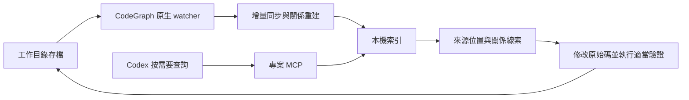

# CodeGraph 原生 watcher 與 MCP 導入計畫

更新：2026-11-20。狀態：目前工作目錄索引、受限原生 watcher 與專案 MCP 接入完成；已直接在這個 chat 呼叫 CodeGraph 成功，不需要額外尋找 Restart 按鈕。

## 目標與執行方式

讓 Codex 能查詢目前工作目錄的程式關係，並由 CodeGraph 原生 watcher 在存檔後更新索引。日常開發不需要每改一個檔案就手動重建；Codex 在理解跨檔案流程、修改共享契約或判斷影響範圍時查詢圖譜。

沿用使用者指定的 `colbymchenry/codegraph`，固定 v1.6.3。隔離來源副本驗證持續更新後，已建立 live worktree 索引並設定專案 MCP。使用上游原生 watcher／daemon；本專案啟動器只處理作業系統資源、檔案與網路限制，不代理 MCP 訊息或實作監看器。

watcher 更新的是索引，原始碼仍由開發者或 Codex 修改。CodeGraph 的查詢是導航與修改影響線索；編譯、測試與實際原始碼仍負責確認行為。Eventa／IPC 的跨程序執行關係不能由「沒有找到呼叫端」推斷不存在。



## 已有證據與限制

已完成的凍結快照試跑索引了 2,476 檔，其中 497 個 Vue 檔；工具耗時 16.5 秒，cgroup 記憶體峰值 948.55 MiB，索引約 115.82 MiB。在一核 CPU、2 GiB 記憶體限制下，前／中／後共 90 次健康與靜態頁取樣皆回傳 200。七項 CLI 檢查完成，已確認 workspace 呼叫解析與 Vue template 引用。

這些數字是一次選定範圍的測量，不是整個 monorepo、持續監看或營運負載的保證。證據見 [verification.json](/home/aimax/webnavior/codegraph-pilot.local/verification.json) 與 [pilot-result.json](/home/aimax/webnavior/codegraph-pilot.local/pilot-result.json)。

已知解析限制保留為驗收案例：Eventa 的 `invokeNativeAudio` 只確認 main／preload 對共享契約的 import，尚未確認跨程序 request→handler 執行鏈；`callers`／explore 的結果可能包含 import 或 type reference；JSON import attributes 的一處 re-export 出現解析警告，但 strict status 仍成功。不能把退出碼零當成所有檔案與所有語意都已正確解析。

### 原生 watcher 隔離驗證結果

另以新的選定範圍來源副本及兩個隔離 Git worktree，完成 17 項功能檢查。變更僅寫入 `/tmp/cg-watch-20261119-5ldbb6yb`；測試 harness 操作上游 CLI／MCP，沒有另實作 watcher。完整結果與命令見 [watcher verification.json](/home/aimax/webnavior/codegraph-pilot.local/watcher-20261119-r1/verification.json)。

- 新增未追蹤檔、刪除、改函式名稱與呼叫端、搬移並更新 workspace export，以及 Vue script setup／template 元件引用均能更新。舊定義與舊引用有核對移除。
- 35 次持久化索引 hash 觀測，均先等待資料庫反映變更再執行後續查詢；中位數 0.502 秒、p95 1.004 秒，最慢為 20 檔批次的 2.261 秒。輪詢間隔 250 ms，這些數字是觀測值。自動同步案例未以手動 sync 補救。
- 601.21 秒編輯／閒置循環完成 20 次更新；兩個原生 MCP 連線共用 daemon，關閉其中一個後另一個仍可更新。停止後離線改檔，再連線的第一次工具查詢已取得新版；隔離 checkout 會更新自己的索引，另一個 worktree 保持不變。
- 同步期間持續寫入 15 個版本，兩組 status／node 查詢捕捉到 modified／stale 提示，停止寫入後收斂到最後版本。這不構成全專案一致快照保證。
- 一核 CPU、MemoryMax 2 GiB、無 swap、nice19／idle IO 下，主測試記憶體中位數約 402 MiB、整組峰值 1001.81 MiB；已核對 daemon／worker 屬於同一受限 cgroup。網路僅允許 AF_UNIX，來源副本與證據目錄以外唯讀。

同步與解析有效性必須分開：暫時不完整的 TypeScript 已寫入最新 hash，`files.errors` 卻有 `parse_error`，而 MCP status 仍顯示零變更。修復語法後定義能恢復；不能僅靠 status 判定解析成功。另已實測新連線的 `CODEGRAPH_NO_WATCH=1` 不會停止既有共享 daemon 的 watcher；獨立的 `--no-watch` 直接模式及釋放 writer 後手動 sync 控制案例通過。

服務共 372 個取樣點、1,116 次 HTTP probe，其中 1,114 次為 200。台北 21:54:16 一個取樣點的兩個 API probe 無法連線，前後兩秒取樣均成功，靜態頁仍為 200；同時另一份 r4 啟用紀錄與 API PID 更換可見，證據保留於 `concurrent-service-change.json`。本次沒有部署或重啟 API，未達連續三次停止門檻；但這個同時變更使本輪不能宣稱零中斷或完成因果隔離。收尾三端點皆 200，測試 units／bundle 程序／daemon pidfile／socket 均無殘留。

以上為 11 月 19 日隔離階段紀錄；當時尚未建立原專案索引或設定。11 月 20 日接入結果如下。強制 OOM、營運高峰、訂單、音訊與模型品質仍不在本輪驗收範圍。

### 2026-11-20 Live 接入結果

目前工作目錄完成 2,468 檔索引，與上游 `scanDirectory` 的候選清單完全一致；本輪初始化 wall time 18.298 秒，受限 slice 峰值 955.12 MiB。六項 live 檢查通過：初始化、實際範圍與 Git hooks 未變、原生 MCP 與來源唯讀、雙連線共用、未 import 的臨時模組新增／刪除自動同步，以及既有 listener 程序身分不變。臨時模組已刪除，圖譜中的定義也已消失；兩次在後續查詢前觀測到持久化 hash 的時間皆約 0.502 秒。

前／中／後共 35 個取樣點、105 次 HTTP probe 全為 200；可辨識 API listener PID／starttime 前後一致，收尾三端點亦為 200。沒有部署、重啟服務或保留產品來源變更。本輪確認的是當時既有服務，不是所有可能的 Vite／tsx 啟動設定；未另外啟動開發伺服器或執行營運負載驗收。

Codex CLI 已確認 trusted project 的 MCP 設定可見。再用指定本專案 cwd 的 ephemeral Codex runtime，直接從專案設定載入六個工具，完成 `codegraph_status`、`codegraph_node(readPbJourney)`、`codegraph_callers(readPbJourney)` 呼叫；沒有執行模型 turn 或建立持久側欄 chat。一般不帶 thread 的 app-server 工具清單讀取使用者設定層，不能拿它的空結果判定 project MCP 失敗，也不能據此把啟動 cwd 固定到另一個 worktree。

後續確認：這個既有 chat 已取得 CodeGraph 工具，直接呼叫 `mcp__codegraph__codegraph_status` 成功，當次狀態為 2,448 檔、零待同步變更；不需要額外按 Restart。這是後續時間點的索引狀態，不覆蓋初次建立時的 2,468 檔測量。沒有重啟整個 Codex app 或其他 chat。完整證據見 [live verification.json](/home/aimax/webnavior/codegraph-pilot.local/live-20261120-r1/verification.json)；原生查詢、Codex 實際呼叫、資源與服務取樣皆保留在同目錄。

仍有一處既知 JSON import-attributes 解析警告，見 `parse-warnings.json`。狀態已同步不等於語法、型別或跨程序語意均正確；本次沒有為了工具改寫產品程式。未跑產品測試／全專案 typecheck，已執行實際 CLI／MCP 整合檢查與啟動器語法檢查。

## 索引範圍與程序所有權

首輪 live 範圍沿用試跑的 Kiosk、Desktop、Order Menu、Order Menu Server、Server 與共用 packages，從 worktree 根目錄保留跨 workspace 路徑。保留測試與套件 exports／tsconfig 等解析所需設定；其他 app、引擎與外掛待有查詢需求及負載證據後擴大。

使用上游既有的 `codegraph.json` 排除機制與既有 `.gitignore`。明確排除索引本身、工具發行檔、依賴、建置輸出、模型、現場或本機測試紀錄與暫存資料。`include` 是上游用來重新納入被忽略來源的設定，不能當作只掃白名單目錄的開關；正式範圍必須以實際 indexed files 清單驗證。

每個 worktree 使用自己的索引。同一 worktree 的多個 Codex 連線優先沿用 CodeGraph 原生共享 daemon 與 writer lock，避免重複 watcher 或跨分支共用資料庫。資源限制必須涵蓋實際 daemon、worker 與同步程序，不能只限制短命的 MCP 啟動器；多連線的關閉順序也必須先驗證，不能讓一個 chat 結束就誤停另一個 chat 的共享程序。

目前由 `scripts/codegraph/run.py` 建立每次連線的 transient scope，所有 scope 共用 `webnaviorCodegraph.slice`：CPUQuota100%、MemoryHigh1536MiB、MemoryMax2GiB、無 swap、TasksMax128，CLI／daemon／worker 繼承 nice19 與 idle IO。關閉第一個連線後，daemon 留在原 scope 服務其他連線；scope 不會跟著第一個 stdio EOF 被整組終止。slice 只在使用者 runtime 連結，不安裝開機服務。

已安裝的 Bubblewrap 將檔案系統掛載為唯讀，只讓當前 worktree `.codegraph/` 與 `/tmp/webnavior-codegraph-<uid>/` 持久寫入，並隔離對外網路；原生 daemon 的實際 mountinfo 與 cgroup 已核對。私有 `/dev` 提供 detached spawn 所需的 `/dev/null`。MCP 顯式轉交 `DBUS_SESSION_BUS_ADDRESS` 與 `XDG_RUNTIME_DIR` 兩個非機密變數供啟動器連接使用者 systemd bus；工具程序再清空環境，不接收模型金鑰。全域 daemon registry 不在可寫範圍，管理本次程序以 worktree pidfile／slice 為準。

原生 watcher 可由 `serve --no-watch`／`CODEGRAPH_NO_WATCH=1` 關閉。`CODEGRAPH_NO_DAEMON=1` 控制直接／共享服務模式，不能單獨當作關閉 watcher 的依據。這項區分已由安裝版本的 CLI help、watch policy 與 project lifecycle 實作核對；實作時以實際程序與變更是否仍自動同步驗證開關。

## 分階段執行與驗收

| 階段 | 執行內容 | 通過條件 |
| --- | --- | --- |
| A 隔離 watcher 驗證（已執行） | 在新的來源副本啟動原生 MCP／watcher，執行下列檔案變更與重新連線案例 | 不手動 sync 也能取得最新結果；失敗或尚未同步時，開發流程不把舊結果當成最新；關閉後無本次殘留程序 |
| B 持續負載與多連線（隔離驗證已執行） | 一般編輯、批次寫入與閒置取樣；測試兩個 MCP 連線及不同 worktree | 實際 worker／daemon 受同一組限制，無重複 writer、跨 worktree 汙染或持續重建迴圈；關閉一個連線不破壞另一個連線 |
| C Live worktree 索引（已執行） | 合併排除設定，低優先權建立目前工作目錄的索引，再啟動原生 watcher | 清單與新增／刪除同步已確認；現行服務程序未變；其他 Vite／tsx 啟動設定仍需在使用時確認 |
| D 專案 MCP 接入（完成） | 合併專案設定與 AGENTS 查詢規則，在實際 Codex 執行環境驗證 | 六工具可見、三種工具呼叫成功；後續亦在這個既有 chat 直接呼叫成功 |

### 檔案與同步案例

| 案例 | 應檢查的結果 |
| --- | --- |
| 修改函式內容、名稱與呼叫端 | 查詢回傳新版來源與正確引用；舊名稱不殘留為有效定義 |
| 新增未追蹤的來源檔案，再刪除 | 不依賴 git add 才發現；刪除後不回傳不存在的檔案與引用 |
| 搬移檔案並更新 import | 新路徑與新引用生效，舊路徑沒有幽靈關係 |
| Vue script setup 與 template 分別修改 | 原生解析同時反映函式與元件引用的變化 |
| 更動 workspace exports 或 tsconfig 路徑 | 確認上游是否自動重新解析；若需重建，工作流程須明確辨識並執行，不能繼續依賴舊關係 |
| 單次存檔與短時間批次寫入 | 最後版本被收錄，重複事件可合併，索引寫入不反過來觸發無限同步 |
| 編輯到一半暫時語法不完整 | 警告／缺口可辨識；恢復合法語法後能更新，不能默默把舊圖當成當前程式 |
| 同步期間查詢、查詢期間繼續編輯 | 記錄回傳內容與對應來源版本；持續變動時不聲稱已取得全專案一致快照 |
| MCP 停止時改檔，再重新連線 | 重新連線後補齊變更，並驗證第一次實際工具查詢的結果 |
| 在隔離 Git 副本切換分支 | 新分支內容取代舊內容；不同 worktree 的索引互不影響；不操作目前工作目錄的分支或未提交修改 |
| 停止、資源限制或同步失敗後恢復 | 沒有孤兒 watcher／writer lock；恢復時確認追上來源，再使用影響分析 |

## 負載與新鮮度準則

初始沿用一核 CPU、MemoryMax 2 GiB、無 swap、低優先權與 idle IO。量測涵蓋啟動、單檔更新、批次更新與至少十分鐘閒置／編輯循環，保存每次同步耗時、整組程序的 CPU／記憶體、待同步狀態及本機服務 probe。本輪隔離結果如上；live 範圍仍須核對實際程序限制及服務變化，不能直接沿用隔離數字作保證。

一般單檔變更以存檔停止後十秒內可查到新版為初始目標；多檔變更另報收斂時間。超時或持續變動時，先讀取相關檔案的當前內容，不依賴未確認新鮮度的圖譜作刪除、改介面或省略測試的依據。本輪隔離案例符合此目標，十秒仍不是上游或 live 負載下的保證。

不先調高 `CODEGRAPH_SYNTH_MIN_INTERVAL_MS` 來降低負載。安裝版本允許延後 callback／事件等合成關係重建；這類延後不能假設都會出現在一般待同步提示中。若原生預設在限制內無法收斂，保留觀測結果並暫用明確的手動同步流程。

本機服務沿用先前的 `/livez`、`/readyz` 與 Kiosk 靜態頁取樣。相對同時段基線，若連續三次發生非 200／timeout，或延遲同時超過基線 p95 五倍及 100 ms，先停止本次觀測擁有的 CodeGraph 程序，再確認是否恢復。這是停止試驗的條件，不直接把同時發生的服務異常歸因給 CodeGraph。訂單、音訊與模型品質不由這些 probe 代為驗收。

## Codex 日常使用規則

接入後預期流程為：存檔由原生 watcher 自動同步；Codex 在需要結構資訊時呼叫 MCP。存檔本身不保證觸發一次模型工具呼叫，也不會讓 CodeGraph 自動修改其他來源檔案。

專案規則應要求：分析共享介面或跨檔案影響前確認同步狀態；相關檔案持續變動時重新查詢或直接讀取最新內容；辨識 import／reference／call／Vue render 等不同關係；Eventa／IPC 回查契約及 producer／handler；圖譜未找到引用不能作為未使用的證明；測試候選仍依本專案的 scoped validation policy 選擇。

MCP 初始只提供結構查詢與狀態所需工具，狀態工具是否需顯式加入上游 catalog 以實際 tools/list 驗證。保持 MCP 為可選工具，沿用現有權限政策，停用或離線時使用既有搜尋與原始碼查閱。實際 tools/call 成功才算接通，不能只以設定檔存在或 mcp list 有紀錄宣稱完成。

## 已落地設定與操作

| 位置 | 用途 |
| --- | --- |
| `/home/aimax/webnavior/codegraph.json` | 記錄已驗證的索引排除範圍 |
| [gitignore](/home/aimax/webnavior/.gitignore) | 忽略 live 索引與固定版本的本機工具檔案 |
| `/home/aimax/webnavior/.codex/config.toml` | 加入本專案 MCP 的啟動與環境設定 |
| [AGENTS.md](/home/aimax/webnavior/AGENTS.md) | 合併上述查詢、新鮮度與已知解析限制的使用規則 |
| [啟動器](/home/aimax/webnavior/scripts/codegraph/run.py) 與 [slice](/home/aimax/webnavior/scripts/codegraph/webnaviorCodegraph.slice) | 使用既有 v1.6.3 bundle、systemd 與 Bubblewrap；資源與寫入權限限制涵蓋原生 daemon／worker |
| 本計畫與 [交接文件](/home/aimax/webnavior/docs/codex-handoff.md) | 保留驗收結果、操作方式與仍存在的限制 |

所有變更限於開發工具接入；使用上游 watcher、索引與 MCP，不另寫監看器、圖譜引擎或 daemon 協定。初始化與 installer 的副作用須先檢查，尤其是自動修改 AGENTS、權限與 Git sync hooks；正式接入採最小設定合併。產品 app／package 的執行依賴、營運服務與發布流程不屬於這次變更。

本機 CLI 位於 `codegraph-pilot.local/tool-v1.6.3/codegraph-linux-x64`，沿用上方核對的官方 bundle；不是全域安裝。MCP 設定中的啟動器路徑為此 Linux 主機路徑，搬到其他主機時需調整；worktree 索引根目錄則取各自 Codex 專案 runtime 的 cwd，不固定指向本目錄。新的 worktree 須有相同排除設定，並先執行受限初始化。缺少 bundle／systemd／Bubblewrap 時直接失敗，不改用無限制啟動。

在目標 worktree 根目錄操作：

```bash
python3 /home/aimax/webnavior/scripts/codegraph/run.py status
python3 /home/aimax/webnavior/scripts/codegraph/run.py init
```

日常由 Codex 啟動 MCP，原生 watcher 隨 daemon 運行；最後一個連線關閉後，原生預設約五分鐘閒置退出，再連線會啟動並補齊離線變更。索引會保留，但沒有連線且 daemon 已退出時不持續監看。存檔不會自動修改其他原始碼，也不會保證模型每次呼叫工具。

## 停用與回退

先停用本專案 MCP，關閉連線，再依 CodeGraph 原生管理方式停止該 worktree 的共享 daemon，並核對 PID／writer lock／資源單元。不能只加上 `--no-watch` 就假設一個已存在的共享 daemon 已停止監看；要以實際檔案變更與程序狀態驗證。

保留來源與本機索引，不以刪除資料庫代替正常關閉。要改成手動模式時，先確認目前 writer 已釋放，驗證原生 sync／查詢可用後再使用；要恢復自動模式則重新檢查追上來源與 watcher 所有權。回退只處理本次 CodeGraph 設定與其擁有的程序，不重啟現行 API 或網站，也不覆蓋其他人的未提交修改。

停用時在 `.codex/config.toml` 將 `mcp_servers.codegraph.enabled` 設為 `false` 並重新載入 MCP，再執行：

```bash
python3 /home/aimax/webnavior/scripts/codegraph/run.py stop
```

此命令停止本 integration slice 內所有 worktree 的 CodeGraph 連線／daemon，不影響產品服務。手動更新在 writer 已釋放後使用 `run.py sync`；完整重建使用 `run.py index`。重新啟用則恢復 `enabled = true` 並重新載入 MCP，既有索引可沿用。

## 參考

- [CodeGraph v1.6.3 索引與同步](https://github.com/colbymchenry/codegraph/blob/v1.6.3/site/src/content/docs/guides/indexing.md)
- [CodeGraph v1.6.3 索引範圍設定](https://github.com/colbymchenry/codegraph/blob/v1.6.3/site/src/content/docs/getting-started/configuration.md)
- [OpenAI 官方 MCP 設定](https://learn.chatgpt.com/docs/extend/mcp?surface=cli)
- [systemd scope 與 slice](https://www.freedesktop.org/software/systemd/man/latest/systemd-run.html)
- 本機已核對的 v1.6.3 CLI help，以及 bundle 內的 `sync/watch-policy.js`、`mcp/index.js`、`mcp/project-lifecycle.js`、`index.js`。控制開關與同步行為若和文件摘要有差異，以固定版本實作及上述驗收結果判定。
