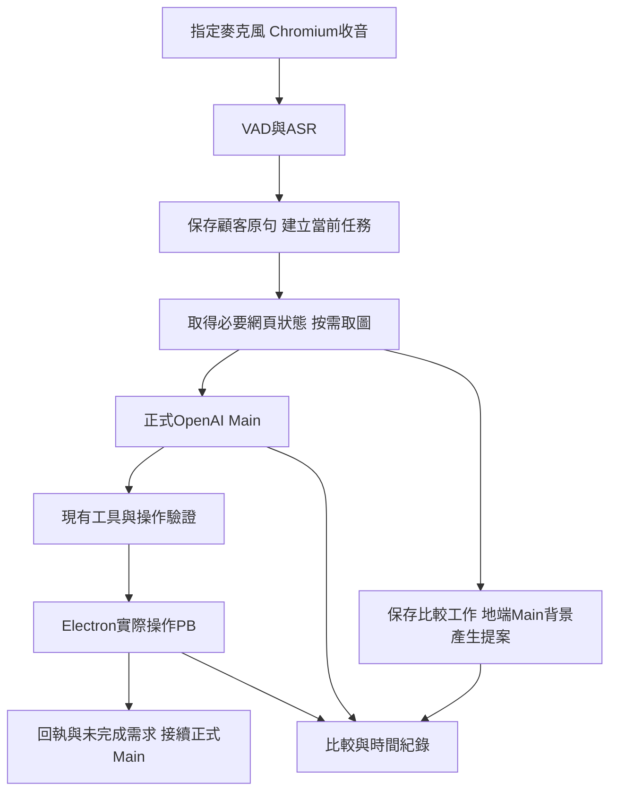

# Kiosk OpenAI 正式操作與地端比較修改規劃

日期：2026-11-20。狀態：規劃，尚未實作或切換正式服務。

正式點餐由 OpenAI Main 負責理解、引導與工具提案；地端 Main 同步產生比較結果，沒有操作或顧客回覆權。保留有實測效益的 System One 導航路徑，讓複合需求直接交給 Main。網頁截圖補充當前畫面，收音則回到指定麥克風與 Chromium 的單一路徑。

修改採分階段驗收。先讓正式流程具備可比較的紀錄與完整訂單測試，再在隔離環境完成模型分工、截圖與速度調整；通過後才分批切換。模型提案正確不等於網站已完成操作。

## 已確認的決策

- OpenAI Main 是正式處理者；地端 Main 是比較來源，不採先完成者取得操作權。
- 地端 Jev 不納入本次模型選型與新路徑。現行 System One 是 OpenAI Decisions，與地端 Jev 分開處理。
- 點餐需要主動引導。介紹後僅說「好」而沒有有效購買問題時，應確認是否要點與必要份數；不能只附和後停止，也不能直接購買。
- 保持 Electron 與既有 PB 原生執行器、Eventa 通訊。網頁截圖與攝影機 sceneFrame 分開。
- 移除 Kiosk 前端陣列處理、Spatial Mask 與嘴型收音門檻；保留裝置生命週期、VAD、ASR及必要的播放回音處理。
- 不恢復已刪除的購物車顧客歸屬推定。task／document 關聯只取消舊任務、舊畫面及失效確認，不識別實際操作者。
- 保留規格、價格、購物車版本、必要資料、寫後核對與送單確認。優化重複工作，不以刪除必要檢查換取速度。

## 實測基準與適用範圍

| 測試 | 已觀察結果 | 可以支持的結論 |
| --- | --- | --- |
| Main 合成題，各32筆 | OpenAI 30/32、地端18/32符合預期首步及參數格式；地端32次均先完成 | 暫不採純速度競賽；不是完整點餐正確率 |
| 歷史原句重建PB狀態，18筆 | 16筆直接符合預期首步；複合改餐的模擬續輪兩次提案正確 | 需保留語境與完整狀態；全部菜單仍未完整驗收 |
| 引導與截圖，40筆 | 原提示文字9/10，其餘三組各10/10符合預期首步 | 支持保留精簡引導及按需圖像；樣本不足以宣稱普遍提升 |
| Electron 原型導航，18筆 | 全部完成；15筆在3秒內出現針對操作的手勢 | 可以量到實際畫面反應，但尚未包含正式Vue／API及收音／ASR |

Electron 原型從辨識文字就緒起算，首次操作手勢中位數如下，每格三筆：

| 操作 | 純文字 | 含圖 |
| --- | ---: | ---: |
| 開始點餐 | 1.34秒 | 1.52秒 |
| 開商品 | 2.92秒 | 3.51秒 |
| 返回菜單 | 2.19秒 | 2.74秒 |

含圖開商品的網頁狀態準備約0.78秒、模型約2.22秒、執行器到首次手勢約0.54秒，截圖準備本身約40毫秒。各階段為分別統計的中位數，不應直接相加當作同一筆。

完整回執與開始動作分開計算：含圖開商品視窗首次可見約4.16秒；返回菜單可見約4.05秒，工具回執約5.57秒。Start換文件造成首次目標影格缺值，另用DOM確認上界，不冒稱精確首影格。

實測原始資料位於本機 `pb-test.local/model-routing-evaluation-20261120-r1/`，其中 `report.json`、`historical-openai-report.json`、`vision/report.json`、`electron-latency/report.json` 分開記錄各次範圍。這些數字不能合併成整體點餐成功率。

## 目標流程

System One 的既有導航快速路徑在前兩階段保留；後續只用於經驗收確實較快的獨立導航。複合加餐、改口、規格與不明指涉交給 Main，避免先分類再重新理解同一句。背景對話過濾獨立遵守裝置設定，不因調整操作分類而默默停用。

## 階段一 正式流程量測與測試集

1. 將目前原型的時間分段接到正式 Kiosk，不更換模型設定，先取得同一版本的正式基準。
2. 沿用既有 taskId、utteranceId、toolCallId、operationId 與 document 關聯串接紀錄，不建立顧客身分判斷。
3. 分別記錄語音結束、VAD結束、ASR完成、狀態就緒、截圖就緒、模型開始／完整工具參數、操作派送、首次操作畫面、目標畫面與回執完成。
4. 各程序用單調時鐘量持續時間；跨程序以關聯ID與明確的傳送／收到邊界連接，不直接相減不同設備的時鐘。缺失的畫面時間明確記缺值，不填0。
5. 沿用 `execution.steps` 與 desktop diagnostics 擴充首次可見時間；不要為計時另加業務查詢或一輪模型。
6. 把歷史案例清單與合成案例整理成正式fixtures。每題保存來源、前文、當前問題、菜單／規格、購物車、版本、預期最後狀態與禁止副作用。
7. 歷史缺快照時標記部分重建；原模型的答案與實際錯誤結果不能直接當標準答案。舊Menu案例需先做PB適配。
8. 同次接待及同源改寫放在同一資料分組，再切開開發、驗證與保留測試。保留測試不反覆拿來調prompt。

驗收：正式Vue→API→模型→原生執行器的同一需求可追蹤；完整任務測試先在隔離PB測試站執行，不能只比較模型文字或第一個工具名稱。

## 階段二 正式與比較模型分工

### 設定與路由

- 管理介面將正式模型、比較模型、備援模型分開表示。比較來源不是失敗時可自動接手的備援。
- 正式chat alias使用OpenAI；地端使用獨立的比較alias。移除這次正式chat chain中地端優先的設定，不以gateway fallback冒充比較功能。
- 第一版不自動將地端升為寫入處理者。OpenAI失敗沿用有限重試與失敗處理；已派送而結果不明的操作先讀回，不改由另一個模型重做。

### 比較工作的生命週期

- 在本輪正式模型輸入組好後，凍結標準化的語句、對話、狀態、工具與可用圖片。正式請求立即開始；比較工作另外保存並排程，正式流程不等地端答案。
- 共用語意輸入及工具定義。供應商專用的加密推理項目／response IDs不跨供應商重播；另存語意輸入hash與各自wire body hash，不宣稱兩者bytes完全相同。
- 地端需先驗證同圖輸入能力。不支援圖片時明記 unsupported，可另跑文字比較，但不能悄悄去圖後算成與OpenAI相同條件的成績。
- 第一版比較每輪提案。後續輪取得正式操作的真實回執，清楚標示是已發生的共同情境，不能聲稱地端獨立跑完自己的訂單流程。
- 比較工作有獨立併發與逾時限制，保存 pending／running／completed／failed／timed_out／cancelled／skipped／unsupported 狀態。繁忙或失敗不能拖住正式Main，也不能把缺少答案算成正確。
- 顧客新需求或頁面切換取消正式舊任務；已開始的比較推論可在獨立時限內收尾保存，但無顧客回覆、工具派送或更新當前問題的權限。
- 服務關閉時停止接新比較工作，保存未完成狀態。重新啟動僅依凍結輸入恢復符合版本條件的推論，不重播任何網站操作。

### 紀錄

每輪記錄：任務／輪次、模型角色與版本、prompt／工具／狀態hash、標準化輸入、回覆與工具參數、格式檢查、時間／token用量、正式工具實際結果與後續更正。

比較資料保存需有保留期限與查詢權限；訓練匯出使用去識別副本。電話、載具及統編不要散落到新的比較文字欄位；照片不新增人臉或整個桌面擷取。原始網站操作資料繼續由既有邊界管理。

驗收：地端逾時、離線、排隊及晚到回覆均不延後正式操作；任何比較提案都無法進入工具派送。兩模型結果及缺值狀態可用同一需求比對。

## 階段三 主動引導與網頁截圖

### 引導規則

- 介紹後單說「好」，而沒有有效購買確認：詢問是否要點及必要份數。
- 已明確問「要來一份嗎」後回答同意：只承接該問題指定效果，不重問相同問題。
- 已明說品名、份數及必要規格：直接處理，不再為引導而多問一次。
- 查價不買、同句改口／撤回、多項需求均讀完整原句；不拿畫面預設一份代替授權。
- 沒有餐點介紹或待答問題的普通附和，不強制推銷或啟動新推薦。

### 擷取與新鮮度

- 在桌面bridge新增明確的PB畫面擷取能力，由目前擁有ServiceSurface的Main執行 `webContents.capturePage`；不讓模型指定任意視窗或來源。
- 中立契約攜帶 taskId、documentKey／revision、observationId、capture時間、尺寸與影像。擷取前後確認同一文件；不符合就丟棄，不把舊圖帶到新操作。
- 畫面改變時與必要狀態讀取並行準備；收到需求時只有對應目前文件的圖可用。模型執行期間若使用者換頁或改選，沿用現有任務失效處理。
- 第一期在商品指涉、彈窗或必要畫面判讀時附圖；明確導航優先走既有快速狀態。模型理解需求仍需一次正式請求，不先額外呼叫另一個VLM看圖。
- 限定單張PB viewport、限制bytes與尺寸；超限／擷取失敗時記錄並回到可用文字狀態，需要時釐清，不能拿過期圖補值。沿用Electron影像編碼，不新增影像服務。
- 攝影機sceneFrame用途不變。發票／電話／載具輸入頁預設使用結構化狀態，不整頁擷取已填的識別欄位。

驗收：實際Electron畫面＋相同文字狀態的成對測試，覆蓋「這個來兩份」「這個多少錢」「好」、公告遮擋、頁面換掉後舊圖晚到。價格、規格與寫入結果仍以工具資料為準。

## 階段四 System One與重複等待

- 先利用正式trace區分System One直接完成、轉交Main、回答當前問題及背景過濾，計算各自時間與結果；不把所有判定都叫Jev。
- 維持現有 `browserFastPath` 導航的 `includeCatalog:false` 路徑。複合操作與規格不先走多輪分類；不以字面關鍵字取代語意。
- 有效問題只解析一次。已消耗的答案與成功回執，不再經第二個模型重新授權。
- 開商品的Host狀態與native executor目前會各讀一次catalog。先記錄相同文件／商品／版本的讀取，再將可共用的事實放回正確擁有者，不能讓舊資料跨文件或取代必要的派送前驗證。
- 返回菜單時，若搜尋已空且完整可見條件已核實，省去對搜尋框的重複操作；仍保留購物車未變及實際頁面確認。
- 完整工具參數合法後才派送，不等最後說明文字；不得在串流JSON尚未完成時操作。

驗收：比較同版本的查詢次數、首次實際畫面及完成時間；確認複合需求沒有漏做、已完成步驟沒有重做。

## 階段五 Prompt整理與簡化收音

Prompt：保留服務目標、語意授權、當前問題與流程規則；特殊店家的顆數、加料與限制移回商品資料。共用與階段prompt去除重複，案例留在測試集。每批修改單獨跑相同fixtures，不一次大幅刪改。

收音：固定指定裝置→Chromium→VAD→ASR。Kiosk移除陣列探測、動態Spatial處理與嘴型收音條件，移除對應設定入口；接待在場偵測若仍保留，不得因此切斷音訊。裝置斷線、重連、結束舊track與持續收音狀態仍需可觀測。

新麥克風型號及硬體DSP尚未確認；AEC／NS／AGC的固定組合在現場驗證後決定，不假設全部關閉就會穩定。必測：靜音後再說話、進點餐頁持續說話、系統播放語音時插話、長時間運作與裝置重連。Linux合成輸入不能代替Windows實體麥克風驗收。

## 主要修改位置

下列為分階段預計修改點；實作前再確認最新caller／測試。未列的新依賴不在本規劃中，沿用現有Eventa、Valibot、Redis、資料庫與Playwright。

| 邊界 | 現有或預計檔案 | 修改責任 |
| --- | --- | --- |
| 模型設定 | `apps/server/src/schemas/webnavior-ai.ts`、對應新增migration | 分開正式／比較／備援來源 |
| 設定服務 | `apps/server/src/services/domain/webnavior-ai-control/index.ts`、`runtime.ts`及其tests | 驗證角色、產生獨立runtime alias，禁止比較來源自動取得正式權限 |
| 設定API／契約 | `apps/server/src/routes/admin/webnavior-ai/index.ts`及其tests、`apps/server/src/services/adapters/config-kv.ts` | 公開明確設定與驗證後套用 |
| 管理UI | `apps/stage-web/src/composables/useWebnaviorAiControl.ts`、`components/Webnavior/AiCapabilityCards.vue`、`chatFallbackSettings.vue`及其browser tests | 顯示正式與比較分工，沿用Composition API與既有元件 |
| 比較工作 | 預計 `apps/server/src/services/domain/kiosk-model-comparison/index.ts`及tests、`apps/server/src/schemas/kiosk.ts`及migration | 擁有推論排程、狀態保存、逾時與重啟生命週期；不是單純pass-through wrapper |
| Main接點 | `apps/server/src/routes/kiosk/index.ts`及其tests、`apps/server/src/app.ts`及DI啟動／關閉接點 | 組好本輪輸入後接比較服務、接收網頁影像、保持route組裝清楚 |
| 多模態gateway | `apps/server/src/services/domain/llm-router/responses.ts`與tests | 保留現有input_image轉換與供應商推理隔離；只有發現缺口才修改 |
| Main資料傳遞 | `apps/stage-kiosk/src/services/kiosk-device.ts`、`composables/useKioskInteractionRecording.ts`及相關tests | 同一需求攜帶圖像觀測／trace，正式回覆不等比較工作 |
| 桌面契約 | `packages/stage-shared/src/kioskDesktop.ts`、`interactiveService.ts`及tests | 集中Eventa擷取契約與執行時間欄位，維持中立型別 |
| Electron擷取／診斷 | `apps/stage-kiosk-desktop/src/main/surface.ts`、`index.ts`、`diagnostics.ts`、`src/preload/index.ts`及tests | 驗證來源與文件後擷取PB viewport，沿用診斷生命週期 |
| 網頁情境與派送 | `apps/stage-kiosk/src/services/browserCartTask.ts`、`browserFastPath.ts`與tests、`packages/stage-shared/src/browserConversation.ts` | 維持新鮮事實與當前問題，不恢復顧客歸屬gate |
| 原生等待 | `packages/stage-ui/src/services/pbBrowserService.ts`、`pbControls.ts`、`pbOperation.ts`、`pbPresentation.ts`與相應tests | 量首次畫面、減少可證明重複的讀取／操作，保留驗證 |
| System One | `apps/server/src/services/domain/kiosk-interaction-decision/`及相關route tests | 導航與Main分流、有問答時只解析一次；不評地端Jev |
| Prompt | `apps/server/src/routes/kiosk/index.ts`、`services/domain/browser-ordering/skills/`及tests | 精簡共用規則、保留引導，移出店家特殊規格 |
| 收音 | `apps/stage-kiosk/src/composables/useKioskMicrophone.ts`、`useArrayMicrophone.ts`、`components/KioskMicrophoneSettings.vue`、`KioskScene.vue`及現有音訊browser tests | 移除陣列與嘴型收音分支，保持裝置管理；確認無caller後才刪檔 |
| 正式評測 | 預計 `test-sites/pb-order-lab/evaluation/cases.json`、`case.schema.json`、`scripts/evaluateKiosk.mjs` | 保存可版本化完整案例，重用現有隔離站與Electron執行器 |
| 文件與文案 | 各受影響README、`packages/i18n`對應文案、`docs/codex-handoff.md` | 同步操作員可見行為與部署／包版要求 |

比較服務的資料庫結構與DI接點在實作時依既有組裝方式收斂，不擴充通用gateway來擁有Kiosk的訂單或顧客流程。第一階段不新增通用queue套件、影像套件或另一套訂單狀態機。

## 驗收與發布順序

1. 先用小型完整任務集打通runner，再擴充經複核的獨立案例；不為湊數將同案改寫當獨立現場樣本。
2. 完整案例涵蓋單／多品項、份數／顆數、必選／可選規格、部分換餐、漏餐、更正／撤回、普通附和／有效回答、導航／公告、統編前導零與跨句、購物車核對及模擬送單。
3. 評分以最後購物車／規格／金額／送單狀態及禁止副作用為準，容許等效工具路徑。模型提案、實際執行、ASR三種成績分開。
4. 隔離固定任務集的完整正確率目標先訂95%以上，關鍵重複／未授權操作案例要求觀察0筆錯誤；這是驗收目標，不是目前已達成的現場正確率。
5. 先優化辨識文字就緒→首次實際動作的p90至3秒內；正式接入後每個代表操作至少重複30次並區分冷／暖狀態。顧客說完→首次實際動作亦以3秒為現場目標，另含VAD／ASR實測，不拿中間指標冒充達標。
6. 每次驗收同時保留首次操作手勢、實際目標畫面與完整回執時間。更快的手勢不能掩蓋錯誤或未完成的訂單。
7. 完成針對性tests、受影響package types／lint及必要build。文件階段不跑root typecheck；實作跨套件契約時仍先做各受影響套件驗證。
8. 隔離環境通過後，按量測→模型與比較→截圖／引導→分流與速度→prompt→收音分批發布，不將所有變更綁成一包。

## 回復方式與實作前待確認事項

模型路由、比較功能、截圖、System One路由與收音設定各自保存上一個明確版本，可單獨回復；比較逾時不影響正式服務，截圖失敗不阻塞有充分文字狀態的操作。回復設定不等於授權觀察模型自動操作。

新增桌面擷取契約或修改preload需要新EXE，不能只更新網頁；先確認正式桌面包的契約配對，再發布對應前端。音訊及其他靜態前端修改依實際包內容判定，不能一概說要或不用換EXE。

目前待現場提供／驗證的是新麥克風型號、硬體DSP及Windows環境。比較工作保留期限、背景併發／逾時與影像大小上限，在階段一流量與實際payload基準完成後固定成可驗證的設定；不把未知值寫成已確定的效能保證。
