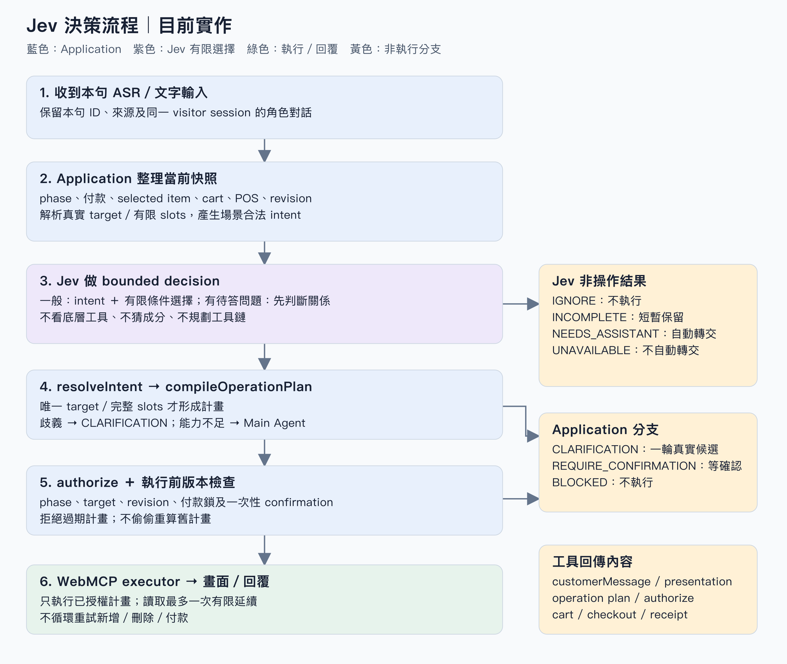
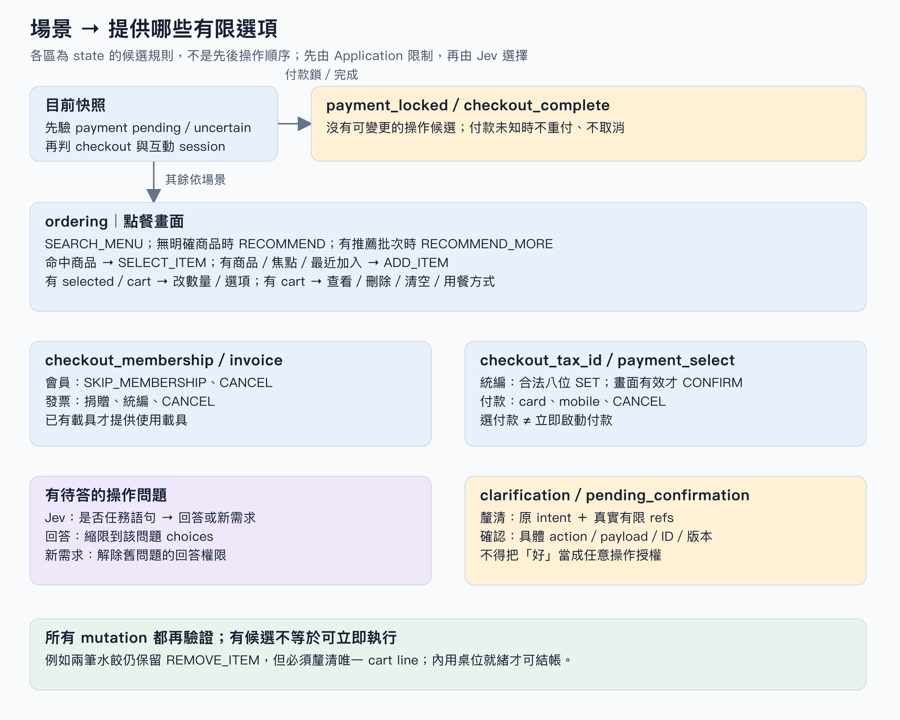
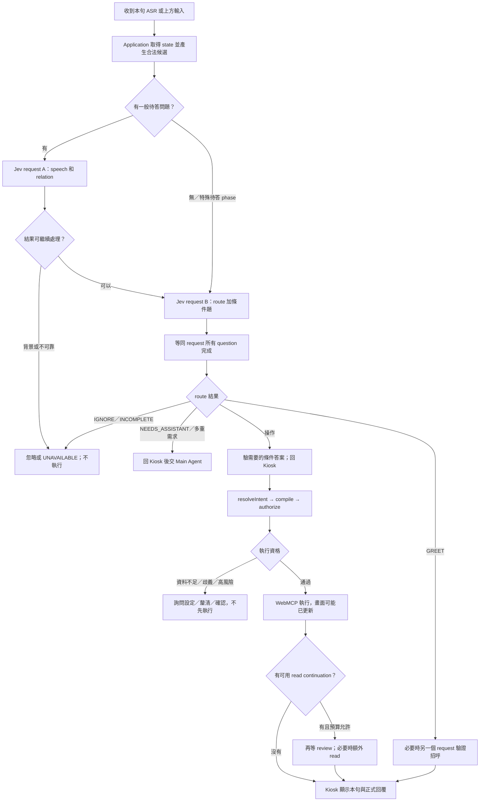
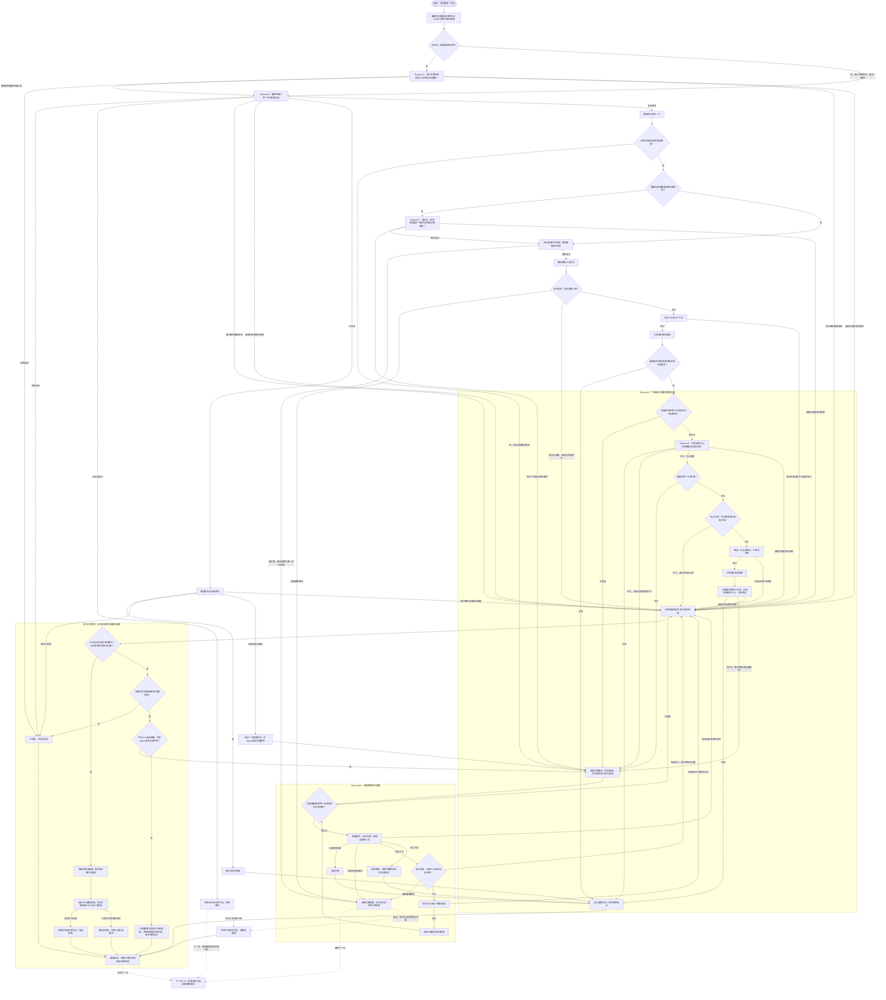
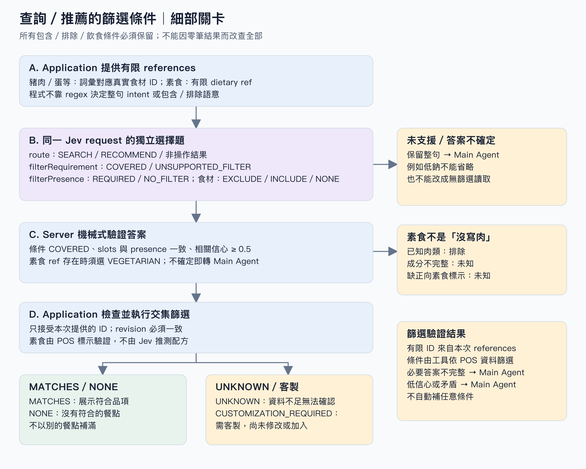
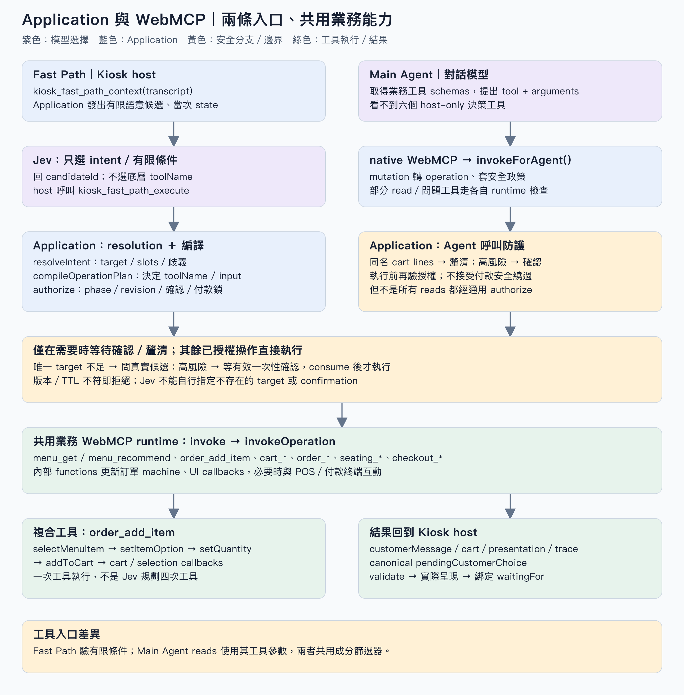

# Kiosk / Jev 決策流程與工具實作說明

整理日期：2026-10-02；第 5 節與第 9 節於 2026-10-03 對照程式更新。
依目前本機整體實作整理；第 5 節區分分段改造前的流程與已接入的新流程。
第 11 節於 2026-10-06 補入人工語意回放結果。
本文件不代表部署或上線驗收狀態。

本文說明 ASR 文字如何經過場景整理、有限語意選擇、目標解析、操作授權與
WebMCP 執行，以及 Fast Path / Main Agent 各自使用的介面。條件與數值為本版
實作設定，不代表不可調整的規格。

## 1. 實際情境與資料傳遞

### 1.1 執行位置

| 執行位置 | 這裡實際持有／執行什麼 |
|---|---|
| Kiosk host 前端 | 收 ASR／上方輸入、保留本句 ID、呼叫 WebMCP adapter、POST 決策 API、呈現回覆、必要時送 Main Agent |
| Order Menu 前端 | 訂單 machine、selected draft、cart、checkout controller、POS 菜單；WebMCP runtime 在這裡，候選與操作皆讀這份當前 state |
| Server → Jev | Server 組有限選擇題與對話 context，向 Jev `/v1/systemone` 發 request，驗答案後回 Kiosk host；這一步還沒有加入或刪除餐點 |

因此 `interaction-decisions` 的 response 是「路由決策」，不是工具執行收據。
真正操作的結果來自後面的 WebMCP。WebMCP 工具名稱也不是每個都有一個同名
HTTP URL；不要只看 Network 裡有沒有 `menu_get` 請求來判斷有沒有執行。

### 1.2 查詢篩選例：『找不要豬肉的便當』

以下展開選中 SEARCH_MENU 時的程式路徑。JSON 為必要欄位示例，非原始請求紀錄。

起點：點餐畫面，沒有正在付款，也沒有待確認／待釐清操作。POS 是目前七道菜。

| 步驟 | 誰執行 | 實際動作／資料 | 此時已發生的效果 |
|---|---|---|---|
| 1 | Kiosk host | 收到本句，呼叫 `kiosk_fast_path_context({transcript})` | 尚未查詢展示、尚未改 cart |
| 2 | Order Menu runtime | 名稱解析未命中特定商品；命中 category=便當、ingredient ref=pork；提供 SEARCH_MENU／RECOMMEND 等當前合法候選 | 保存當次 context；不靠「不要」regex 選 intent |
| 3 | Kiosk host → Server | POST `/api/kiosk/interaction-decisions`，帶 transcript、candidates、decisionState | 只是問決策 |
| 4 | Server → Jev | 先問 route，選查詢後依序問 coverage、presence、pork polarity；逐題回傳進度 | Jev 不查 POS、不知道哪些餐點含豬肉 |
| 5 | Server | 若 SEARCH、COVERED、REQUIRED、EXCLUDE 都有效，回 FAST_ACTION + filter=pork | 仍沒有操作畫面 |
| 6 | Kiosk host | 呼叫 `kiosk_fast_path_execute`，帶 candidateId 與 ingredientFilters | 開始 Application resolution |
| 7 | Order Menu runtime | category target → SEARCH_MENU plan → `menu_get({category:'便當',excludeIngredients:['pork']})`；驗當前 revision／phase | 確認不是 stale plan 才執行 |
| 8 | 業務工具 | 讀真實成分，先取便當，再排除豬肉；更新 presentation callback | 顯示椒麻雞便當、泰式酸辣魚便當；cart 不變 |
| 9 | Kiosk host | 顯示工具 customerMessage，記錄 user / assistant 與 trace | 本輪完成，不必再經 Main Agent |

關鍵傳遞資料：

```json
{
  "transcript": "找不要豬肉的便當",
  "decisionState": {
    "phase": "ordering",
    "paymentState": "idle",
    "ingredientReferences": [{ "id": "pork", "label": "豬肉" }],
    "references": [{ "refId": "category:%E4%BE%BF%E7%95%B6", "label": "便當分類" }]
  }
}
```

```json
{
  "kind": "FAST_ACTION",
  "actionId": "intent:search-menu",
  "ingredientFilters": { "excludeIngredients": ["pork"], "includeIngredients": [] }
}
```

```json
{
  "candidateId": "intent:search-menu",
  "ingredientFilters": { "excludeIngredients": ["pork"], "includeIngredients": [] }
}
```

這三份分別是 decision request 節錄、可接受的 decision response、host 對
`kiosk_fast_path_execute` 的參數。Application 最後才產生底層 `menu_get` 參數。

### 1.3 零筆結果例：『有素食嗎？』

Application 提供 vegetarian ref，Jev 選語意／條件；
Server 回 `dietary:'vegetarian'`，**不是 Jev 自己列出素食商品 IDs**。

Application 收到後，把素食政策轉為排除已知肉類並要求正向 POS vegetarian
標示。當前七道都含已知肉類／海鮮，因此沒有符合品項。

實際結果要求：`items:[]`、`availability:'NONE'`，清除舊篩選 presentation，
回答沒有符合；不呼叫無條件推薦、不留下上次的肉類餐點冒充結果。
若換成資料不足的商品才可能 UNKNOWN；不把 UNKNOWN 說成沒有。

### 1.4 付款操作例：付款畫面說『信用卡』

以下展開付款方式選擇、確認與終端啟動的不同階段。

起點必須是 `phase=checkout_payment_select`、`paymentState=idle`，且 card 為
允許方式。畫面上的問題也必須已呈現並有效，才能讓短回答承接它。

1. 若有待答付款問題，Jev 先判任務語句及 ANSWER，再從 card / mobile / cancel
   等有限選項選 `intent:select-payment:card`；沒有問題時用當前付款 phase 做判斷。
2. `resolveIntent` 得到 SELECT_PAYMENT(method=card)；編譯成
   `checkout_select_payment({method:'card'})`。
3. authorize 回 REQUIRE_CONFIRMATION。此時**只是生成計畫與付款確認問題**，
   沒有刷卡、沒有啟動終端、沒有呼叫 POS 送單。
4. 使用者同意後，下一句只在該 confirmation ID 的確認／取消選項中選擇。
   Application 驗 phase、payload、revision、TTL、未 consumed；成功就 consume。
5. 現在才真正執行 `checkout_select_payment`；由終端回 pending／authorized／
   rejected／uncertain，不由 LLM 宣稱成功。
6. verified paymentId 才能接 POS 送單；pending／uncertain 期間禁止再付或取消。

此流程包含「選中付款 intent」「等待確認」「已啟動終端」「收到終端結果」
及「POS 接單結果」等不同狀態。

### 1.5 目標釐清例：『水餃不要了』但有兩筆水餃

依目前程式的預期路徑：Jev 可選 REMOVE_ITEM；Application 發現兩筆真實
cart refs，回具體釐清問題，**此時不會呼叫 cart_remove_item**。

下一句『第二筆』若可唯一對應當時候選，Application 可直接得到
resolvedCandidateId，host 不一定再問 Jev；再驗 revision，才執行唯一 lineId 的
`cart_remove_item`。若無法唯一對應，改用畫面；不讓 Main Agent 自己猜第一筆。
唯一釐清答案可由 Application 直接對應，不必每句都再次呼叫 Jev。


## 2. 整體流程與責任邊界



| 邊界 | 負責事項 | 不應負責事項 |
|---|---|---|
| deriveDecisionContext | 真實快照、phase、POS references、合法 intents、有限 slots | 判斷整句購買／修改／背景語意 |
| Jev / System One | 本句語意選擇；必要時有限目標／條件選擇 | 工具名稱、成分推測、付款狀態推測、工具鏈規劃 |
| resolveIntent | 目標存在／唯一、slots 完整、形成 domain plan；釐清或交 Agent | 再建立整套 regex 意圖分類器 |
| compileOperationPlan | 將 domain plan 確定映射為 WebMCP operation | 重新理解使用者需求 |
| authorize | revision、phase、target、付款鎖、確認資格 | 接收 transcript 再猜意圖或呼叫 LLM |
| executor | 執行已授權 operation | 偷偷換目標、放寬篩選、重新規劃 |
| Main Agent | 超出有限能力的比較、解釋、複合需求 | 繞過 POS／付款／確認安全規則 |

例如「我要兩份水餃不要辣」是 ADD_ITEM，數量與辣度是 slots；不是三個獨立
意圖。「水餃改成兩份」才是修改既有 target。

### Jev 的結果，不等於已執行

| 結果 | 現在的用途 |
|---|---|
| FAST_ACTION | 選中有限 candidate；還要經瀏覽器 resolution／授權，不能直接視為成功 |
| IGNORE | 非操作／背景話語，不執行、不轉 Main Agent |
| INCOMPLETE | 真正未講完，短暫保留；不是完整但目標模糊 |
| NEEDS_ASSISTANT | 已判為需要主要助手，前端自動送 messages，不必再按一次 |
| MULTI_ACTION | Jev 選項；Server 轉成 NEEDS_ASSISTANT，保留整句 |
| FOLLOW_UP_ACTIVE | 補充正在由 Main Agent 處理的需求，由 controller 決定中斷／等待 |
| UNAVAILABLE | 未可靠判斷、答案異常／例外等；目前不自動送 Main Agent，以免送入背景音 |
| COMPLETE | 只出現在執行後的有限讀取 review，表示本次要求已完成 |

CLARIFICATION 主要由 Application 建立，問題只引用真實有限 refs，不讓 Jev
自由造題。REQUIRE_CONFIRMATION / BLOCKED 也是 Application 的授權結果。

## 3. Jev 實際取得哪些上下文？

一般 route request 包含：

- 本次 transcript，與近期 user / assistant 角色標記對話分開。
- 同一 visitor session 的近期已完成文字，最多 12 則、4,000 字元。
- 尚未過期的操作問題及其有限 choices／回答效果。
- 明確 phase、paymentState、checkout 摘要、allowedPaymentMethods。
- POS 提供的用餐方式與標籤。
- 真實商品、category、selected item、cart line／桌位 references。
- 互動焦點、已解析 constraints、本句有限 ingredient／dietary references。
- 正在處理的 activeRequest；讀取 review 時再提供已取得結果與準備的回覆。

舊模型的判斷不是狀態真相；完整歷史與原始音影像不是全部丟給 Jev。
revision 與授權由 Application 維護，不能依歷史對話推斷仍有效。

注意：有待答問題時，前兩次 gate 的 context 刻意較小，並非每次 Jev 呼叫
都取得上述完整上下文。第一題只有本句與當前操作問題；第二題還有問題目的
及回答效果；最後 route 才使用完整整理後 state。

## 4. 場景如何限制候選？



此圖為不同 state 的候選分類，不代表點餐一定依序經過所有區塊。

| phase / 狀況 | 目前提供的操作候選與條件 |
|---|---|
| ordering | SEARCH_MENU；未命中明確商品時 RECOMMEND；有效推薦批次可 RECOMMEND_MORE |
| 命中商品 | SELECT_ITEM；可新增目標存在時 ADD_ITEM |
| 有 selected 或 cart | SET_QUANTITY、SET_OPTION；最後仍須唯一 target |
| 有 cart | VIEW_CART、REMOVE_ITEM、CLEAR_CART、POS 提供且尚未選中的用餐方式 |
| 用餐方式已選 | 可 START_CHECKOUT；內用還需人數／桌位就緒 |
| 內用 | 有合法人數 slot 才 SET_PARTY_SIZE；未就緒時提供真實桌位組合；分桌須明確同意 |
| checkout_membership | SKIP_MEMBERSHIP、CANCEL_CHECKOUT |
| checkout_invoice | 捐贈、REQUEST_TAX_ID、CANCEL；已有載具才提供使用載具 |
| checkout_tax_id | 本句合法八位統編才 SET_TAX_ID；畫面有有效統編才 CONFIRM_TAX_ID；CANCEL |
| checkout_payment_select | SELECT_PAYMENT(card/mobile)、CANCEL；選方式先進入付款授權確認 |
| payment_locked | 沒有可變更候選；pending / uncertain 禁止重付與取消 |
| checkout_complete | 沒有上述變更候選 |
| clarification | 原 intent 不變，只提供當時真實候選 target，另有 IGNORE |
| pending_confirmation | 只提供確認／取消該 confirmation ID，另有 IGNORE |

目前一般 route 還會加 IGNORE、INCOMPLETE、MULTI_ACTION、NEEDS_ASSISTANT，
所以「沒有操作候選」不表示沒有任何語意選項。

候選已不再是全部商品 × SEARCH / SELECT / ADD。Server 若收到超出預算的候選
會回 UNAVAILABLE，不偷偷 top-N 截斷；目前預設上限仍是 253，**不是通常實際
候選數，也不是少量候選的驗收標準**。每次實際候選數記錄於 trace。

商品名稱／alias 優先於 category；購物車兩筆同名餐點仍可提供 REMOVE_ITEM
意圖，但 resolveIntent 必須回 CLARIFICATION，不能直接刪第一筆。

## 5. Jev 問題依賴、等待點與分段決策

### 5.1 三種不同的計量單位

- Kiosk → AIRI：一次 `POST /api/kiosk/interaction-decisions`。
- AIRI → Jev：一次 `invoke(state, questions)`，可能含多道 question。
- 模型 forward：依本次提供的 LocalJev 部署確認，每道 question 各做一次。

目前 `modelCalls` 計的是 AIRI 呼叫 Jev 的次數，不是 question 或 forward 次數。
`durationMs` 計的是一次 Jev exchange 的總等待時間，不是某一道題的純模型時間。
部署回傳的 `usage.forward_passes` 為 process 累積值；若有其他並行請求，不能直接
用兩次累積值的差當成本句的 forward 數。question 數可從本句 trace 的 exchanges
直接計算；失敗 request 是否完成全部 forward，沒有可靠收據時應標為未知。

### 5.2 分段改造前：每道 question 何時問、答案用在哪裡

| question | 目前觸發條件 | 選項／用途 | 哪些結果真正需要它 |
|---|---|---|---|
| `speech` | 有有效的一般待答問題；不是 clarification、configuration、confirmation 或 read review | TASK_SPEECH／GREET／BACKGROUND，判斷對店員說話或背景 | 待答問題的語句資格；背景可提前終止 |
| `relation` | 與 speech 同時問 | ANSWER／NEW_REQUEST，是否承接舊問題 | 短回答的問題關聯及舊問題權限；不能自行選操作 |
| `route` | gate 通過後或沒有一般待答問題；application 已解析的特殊 target 回答可略過 Jev | 合法操作意圖或 IGNORE／INCOMPLETE／NEEDS_ASSISTANT 等；特殊 phase 只給有限答案 | 所有需要模型判斷的路由 |
| `filterRequirement` | 候選中存在 SEARCH_MENU／RECOMMEND／RECOMMEND_MORE，且不是特殊 follow-up 或 review | COVERED／UNSUPPORTED_FILTER，是否能完整處理條件 | 最後選中的查詢／推薦 |
| `filterPresence` | 同上 | REQUIRED／NO_FILTER，本句是否新增或修改條件 | 查詢／推薦的條件完整性核對 |
| `dietary` | 上述篩選題開啟，且有 vegetarian reference | VEGETARIAN／UNSUPPORTED | 帶素食條件的查詢／推薦 |
| `unavailable:<id>` | 上述篩選題開啟，且有資料不能驗證的條件 reference | REQUIRED／MENTION_ONLY | 查詢／推薦是否需要不支援的資料 |
| `ingredient:<id>` | ordering phase 有食材 references；迴圈目前在 filterChoices 條件之外 | EXCLUDE／INCLUDE／NONE | 查詢／推薦的包含／排除條件 |
| `greeting` | speech 或 route 選到 GREET | GREET／IGNORE／REQUEST，確認招呼對象與目的 | 招呼回應，不授權訂單操作 |
| review 的 `route` | 已完成查詢有有限延續，且既有呼叫預算允許 | COMPLETE／NEEDS_ASSISTANT／有限後續 read | 是否已足夠、是否多做一次查詢；不能重試 mutation |

因此即使 route 最後選「進入結帳」，同 request 的食材／篩選題仍已問完。
即使 review 不開啟 filterChoices，ordering 的 ingredient 迴圈仍可能附帶額外題目。
這兩個都是「先問了，但最後的結果未必需要」；不是 Jev 正在挑底層 WebMCP tool。
通用 post-route speech qualification 已移除；上述 speech、relation、greeting
仍是不同目的的現有題目。

### 5.3 分段改造前的決策樹與兩個等待點



一般 request 的題數可描述成 `1 + 2F + D + U + I`：route 一題，篩選開啟
時 F=1 加兩題，素食 D 題，不支援條件 U 題，食材 I 題。普通待答 gate 另加兩題；
招呼驗證另加一題。這是本機送出的題數，不是宣稱 provider 的實測耗時。

例如候選允許搜尋、無食材 references 的「我要結帳」：目前主 request 可有三題；
若前面還有有效「要結帳嗎？」問題，兩個 Jev request 合計可有五題。
特殊 clarification 的 application-resolved target 分支未在圖中展開，可不經 Jev。

第一個等待點是 Server：目前決策 API `await decideInteraction()` 後才回 JSON。
只在 Server 內拆成多個 Jev request，不會讓 Kiosk 提早收到中間結果。
第二個等待點是 Kiosk：WebMCP 已更新畫面後，普通對話泡泡仍可能等
`runFastPath()` 的 read review 完成才寫入。執行收據與正式回覆不是同一時刻。

### 5.4 已接入的分段流程

2026-10-05 補充：商品 target 選擇與釐清上限為五個，分類超出上限直接交接，
不將 top-N 視為完整候選。商品證據區分 exact／possible／none／overflow；
possible 僅為真實菜單片段匹配，不能直接新增訂單。既有條件題在此情境改為
商品查詢／食材條件／兩者都有／無法確認，未確認的兩者需求完整交接。
商品查詢不再執行食材極性題。最後核對提供原句、角色上下文、待檢查理解與
實際結果，選 SATISFIED／DEVIATED／UNCERTAIN；SATISFIED 通過信心門檻才
映射成 Application COMPLETE。偏離、不確定或核對失敗不自動重跑，保留已執行
read receipt，拒絕的理解不成為 Main Agent 的強制條件。結果預覽至多五項並
標示總筆數與是否僅為預覽，畫面仍保留完整結果；不是截斷商品選擇題。
原有最多一次額外查詢、最後核對與付款安全限制不變。

以下流程已接入 Server、Kiosk 與 Order Menu。第一版保留各題既有意義與安全門檻，按依賴移動題目，
不一起合併题目或重新發明 intent。一般待答問題仍保留 speech＋relation。
前段 gate 通過不等於有效操作需求：正式顧客泡泡要等 route 確認後才顯示。
實際 ASR 與上方 ASR 測試輸入走同一路徑，不把後者當成一般文字聊天。

實際 API 採 `segmented:true` 開始，然後以一次性 `continuationId` 接續；每個
Jev question 都獨立呼叫，答案回前端後才繼續下一題。Server 保管原本的
state／候選／歷史，不接受前端改答案。接續期限 15 秒，限原裝置與訪客；
新需求、過期或程序重啟會使舊接續失效。執行前仍由瀏覽器核對當前 revision。
篩選題只在 route 選中查詢／推薦後才問，背景或結帳不再順便問成分。
整句含接續／補查最多 24 道題，達上限不繼續猜；這不是正常每句的題數。

查詢的真實回覆會先顯示，再進行 Request D；最多補查一次，最後只有「完成」
或「交 Main Agent」。Main Agent 上限為四輪／16 次工具呼叫／模型等待 60 秒，
工具依序執行；拒絕、逾時或達上限不能宣稱全部完成。這些限額不會取消已被
外部系統接受的付款。`ok:false` 顯示未完成；執行中斷而結果不明則顯示待核對，
不自動重試原操作。

驗證分成三種，不互相替代：單元與 authenticated API 測試、Chrome 畫面回歸、
人工語句對遠端 Jev 重播。2026-10-03 的三筆分段真實重播中，查菜單和信用卡
通過；「走走走去那邊」被 Jev 判為 INCOMPLETE 而非 IGNORE，沒有執行工具。
此失敗案例保留原斷言，不能宣稱模型語意驗收全通過或可直接上線。

#### 白話整合圖：從這裡開始，依需求往下走

圖的獨立起點是「開始：收到顧客一句話」。為避免回接線把起點排到圖中央，
所有下一句先接到同一個「下一句入口」；該入口代表下一次從起點重新開始，
不是自動重送上一句。箭頭表示本次處理，虛線表示等待顧客、逾時等事件。



#### 圖中問題的實際例子

- 「無法確定顧客意思」：Jev 回了答案，但無法可靠區分顧客在答「要結帳嗎？」
  還是在附和旁人。它和連線失敗不同，也不等於已確定是背景音。
- 「已送出但不確定成功」：刷卡請求送出後斷線，或 POS 可能接單但沒有回覆。
  尚未呼叫工具的 Jev 逾時不屬於這種情況。
- 「支付服務／POS 的正式結果」：用同一付款／訂單編號查成功、失敗或處理中；
  是實際處理系統的回覆，不是 LLM 猜測。查不到才請店員協助，不能直接重送。
- 「補查資料」：顧客要求「有賣什麼，也推薦幾樣」，第一步查完菜單後再取得
  推薦。只問「有水餃嗎」，查到並回答就能結束，不必每次再問 Jev 是否足夠。

#### 程式名稱對照，只供開發查閱

| 白話步驟 | 程式名稱／資料 |
|---|---|
| 目前畫面與訂單狀況／正在等回答的問題 | state／pending question context |
| 找出要操作的餐點，確認資料是否齊全 | resolveIntent |
| 轉成實際工具指令 | compileOperationPlan |
| 程式檢查現在能不能執行 | authorize；不是每次再請顧客確認 |
| 原指令因相關畫面或訂單狀況改變而失效 | stale plan／revision mismatch |
| 工具實際執行的結果紀錄 | operation receipt |
| 補查一次必要資料，不修改訂單 | additional read |

Request D 只處理原需求，不主動加購或擴大需求。補查最多一次；補查後只能
結束、最後一次有限判斷或交 Agent，不能再繞回補查。不因工具呼叫成功或查到
非空結果就宣稱顧客所有要求已完成。需要 Jev 最後判斷時仍受次數／時間限制；
已呈現的成功結果不因下一步失敗消失，只說明剩餘要求未完成。

Agent 可以理解開放式問題，但不能自己創造付款／清空授權。工具選項及一次性
顧客確認由程式持有並驗證。同一任務每次處理都耗用原時間／回合限制，不歸零。
工具成功後可繼續理解結果，不因 Agent 還在思考而隱藏已成功的操作。

尚不知付款／送單是否成功不等於確定失敗；查結果使用原付款／訂單／操作編號，
不能換編號重送。查詢逾時後一般對話可以恢復，但影響該訂單的操作仍禁止，
直到查到支付服務／POS 的正式結果或店員核對。取消 LLM 請求不會取消已啟動的
支付或訂單。Main Agent 自己失敗時不再「交回 Main Agent」無限重啟；原指令
已失效或操作被禁止，也不能交給 Agent 繞過。已確認有效需求但 Jev 連線失敗時
才可能安全交接；還沒確定是對店員說話的語句不能藉連線失敗直接送 Agent。

「不需要篩選語意」由已選 domain operation 的能力決定，不靠 regex 猜本句是否
包含「不要」。SEARCH_MENU／RECOMMEND 第一版仍保留 coverage 檢查，即使沒命中
食材字典，也不能推論沒有未知要求。只有真實存在的有限 refs 才產生逐條件題。
Main Agent 保留整句、角色歷程、最新 state 與已執行收據；不把部分猜測變成權限。
圖中的 Main Agent、Request D 與失敗處理分區都是同一次需求，不是獨立任務。
所有「回到接收狀態」都只結束本次處理或進入有期限的等待，不自動重新送出原句。
異常回收必須保留仍有效的待答 context、成功收據及未核對的外部操作 ID。

### 5.5 每一步究竟能提早做什麼

| 拿到的階段結果 | 可以立即做 | 必須繼續等 |
|---|---|---|
| 明確背景 | 結束，不改畫面、不寫成點餐對話 | 無 |
| 已判斷是否對店員說話，但還沒確定要做什麼 | 維持收音狀態；診斷只放測試面板 | 不新增正式顧客泡泡，也不能選菜、改購物車或付款 |
| 已確定顧客的有效需求 | 顯示一次顧客語句，必要時一個低干擾等待提示 | 不宣稱已執行；仍需該操作的完整資料與程式檢查 |
| 已選進入結帳、查看購物車或修改設定 | 程式依目前狀況找出對象並檢查能否執行 | 餐點不唯一、缺資料、需要確認或狀況已改變時不能直接執行 |
| 已選查詢／推薦 | 顯示本句／正在查詢 | 條件完整前不呈現未篩選商品 |
| 篩選條件已齊全並通過檢查 | 查真實菜單並呈現結果 | 不讓 Jev／Agent 發明商品與條件 |
| WebMCP 已成功執行 | 顯示實際工具回覆／畫面變化，不等可選的後續完成判斷 | 未完成事項不能說已完成；失敗不能說成功 |
| 開始付款、清空整車或確認統編 | 呈現這次操作的具體內容，請顧客確認 | 檢查這次確認仍有效、內容一致且沒用過，才做高風險操作 |
| 付款處理中或尚不知成功與否 | 禁止重付與取消；仍可回答允許的資訊問題 | 不因 ASR 補句解除限制 |

普通的「進入結帳流程」不同於「開始付款」，不能把兩者的等待條件混在一起。
顧客語句只顯示一次；診斷中的「正在判斷」不是店員新提問，不放入 Jev 對話歷程。
正式泡泡出現後不因逾時而偷偷移除，也不讓等待提示永久轉動。ASR 未完成片段
不加入正式對話。真正的文字聊天可在送出時顯示泡泡，但上方 ASR 測試輸入不是
此例外，仍遵循語音的背景／未完成判斷。

#### 等待 context 的共同生命週期

| 等待類型 | 下一句 | 取消／逾時／state 改變 |
|---|---|---|
| INCOMPLETE | 重新解析；相關才使用短暫 context，不拼接字串；新意圖／衝突丟棄片段 | 約 3 秒逾時或場景失效就丟棄，安靜回到接收狀態 |
| 必要設定補答 | 同一 session 保留原 ADD_ITEM 與已知 slots；下一句在相同真實選項中解析，僅更新內部回答 ID | 閒置／繼續點餐不清 plan；30 秒回答 ticket 過期只拒絕舊答案；取消、新需求、新訂單／session 結束或相關 revision 失效才撤銷 |
| target clarification | 同一 session 保留原 intent 與真實 target 集合；下一句發出新的 15 秒回答 ticket，最多一輪 | 閒置不清需求；舊／過期答案拒絕而不清有效需求；無法唯一解析就請觸控；取消、session reset 或相關 phase／revision 改變撤銷 |
| 高風險 confirmation | 對應唯一 confirmationId，驗 payload、phase、revision、TTL、未 consumed | 拒絕／取消／逾時／相關 state 失效就撤銷；過期「好」不沿用授權 |
| 一般操作問題 | 已實際呈現的相同問題可承接；原 30 秒 ticket 過期時下一句更新內部問題 ID，不重問 | 閒置／繼續不清問題；未呈現 offer 仍有 30 秒期限；取消、新需求、session reset 或 context 失效撤銷；不清 cart 或取消付款 |
| Agent 開放式問題 | 經共同入口辨識後，帶原任務 context 續交 Agent，或處理新需求 | 不保留無限執行權；context 有期限，state 失效時舊操作 plan 不能沿用 |

背景話語不算一次 clarification 回答、不取消原有效問題；回到收音不等於清空
所有待答 context。明確新需求才替換相應舊問題。普通已回答的資訊問題不建立
額外待答操作，避免客人問完價格卻被迫回答份數。

#### 新語句與舊任務同時到來

每句走共同入口，帶當前 active task 與 phase；不是每句都立即中斷前一輪。
背景／未完成語句不打斷正在執行的有效任務；相關補充只在安全的規劃階段
終止舊 LLM 等待，保留收據後續作。已開始的 mutation／付款不能被新 ASR
任意打斷或重跑。若必須等在途工具結束，後續語句排入有限、有期限的隊列，
結束後重讀 state；隊列逾時也有可見未完成出口，不永久阻擋。
touch、新句、換客或取消導致舊 decision 作廢時，晚到 response 不顯示、不執行；
換客只回收原 session 的權限與工作，不把未核對的付款效果當成沒有發生。

### 5.6 前後端交接、關聯與量測

若要讓 Kiosk 使用階段結果，第一版可採分段 API：先回階段 A／B 結果，只有需要
時 Kiosk 再請求下一階段。不是在原 API 內連續 await、最後才回一次 JSON。
另一種作法是串流，但第一版不必同時引入兩種傳遞模式。

每段須綁定同一 device、visitor session、utterance ID、decision ID、原 snapshot／
相關 revisions 與 expiry。下一階段沿用該次已驗證決策，不重新自由選 route；
不能只憑前端傳來的 candidateId 就當成已完成前段驗證。中間結果必須明示
是否仍待條件檢查，不能把 provisional route 偽裝成可執行 FAST_ACTION。
重新取得 state 時若 relevant revision 已改變，舊 plan 失效；不可悄悄改寫後執行。

後來的新 ASR、Main Agent 中斷、touch 修改、換客、超時都會影響關聯與有效性。
過期 response 不能覆蓋新畫面或重複加入；已有成功收據的操作不能因後段失敗
重試。已進行的實際付款不因取消語意判斷 request 而取消。

應分開量測：

1. 首次可見回饋：本句被確認接收／顯示；不冒充已執行。
2. 首次實際動作：WebMCP 確實改畫面或 state；不計 spinner。
3. 首個真實結果：查詢／操作的收據已呈現，不被 optional review 阻擋。
4. 全需求完成：包括必要條件與後續處理。
5. Kiosk API 次數、Jev request 次數、question 數、可確認的 forward 數及分段耗時。

總時間可能因網路往返增加；首次回饋或首次動作仍可能提早。兩者都要量測，
不能只用「response 比較快」代表整個需求更快。

### 5.7 門檻與實作驗證範圍

| 判斷 | 目前主要檢查；分段第一版不改 |
|---|---|
| 操作問題 speech gate | TASK_SPEECH confidence ≥ 0.6 才可靠；可靠 BACKGROUND → IGNORE |
| ANSWER relation | speech 未可靠時，ANSWER confidence ≥ 0.8 可獨立建立回答資格；其餘只准安全延後 |
| 一般 requiresHighConfidence candidate | 有數值且低於 0.5 不執行；已確認任務語句時可交 Agent，否則 UNAVAILABLE |
| greeting / 特殊 phase NEW_REQUEST | 需要數值 confidence ≥ 0.6 |
| 篩選 coverage / polarity / dietary / presence | 需要的題目須有數值且 ≥ 0.5，並通過一致性檢查 |

confidence 門檻不是已校準正確率；分段也不能靠降低門檻換取速度。
驗證包括：相同 snapshot 的結帳入口、背景、帶否定食材的查詢、素食零結果、
必要選項補答、歧義 target、付款確認／pending、觸控改 revision、ASR 新句、
後段失敗、回傳亂序與已執行 read 的 review。先比對分段前後語意和實際效果，
再比較四種延遲指標。各題合併或 gate 取消應是後續獨立實驗，不和 request 拆分混做。

## 6. 成分／素食篩選的細部條件



Application 先做有限詞彙 reference mapping，不在這裡決定整句 intent 或
「不要」的語意。Jev 只選有限槽位。

| 題目 | 提供時機 | 選項 / 後續檢查 |
|---|---|---|
| route | 每次一般判斷 | 合法 intent 及非操作結果 |
| filterRequirement | 非 review / follow-up，且 route 已選中 SEARCH / RECOMMEND / MORE | COVERED 或 UNSUPPORTED_FILTER；read 成功必須 COVERED |
| filterPresence | 同上 | REQUIRED 或 NO_FILTER；必須與實際解析出的 filter 是否存在一致 |
| ingredient:ID | ordering 中本句提及的有限食材 | EXCLUDE / INCLUDE / NONE；不得生成其他 ID |
| dietary | 本句提供 vegetarian ref | VEGETARIAN / UNSUPPORTED；一般素食不等於全素／過敏安全 |
| unavailable:ID | 本句提及尚無資料支援的營養、過敏安全或嚴格飲食主題 | REQUIRED / MENTION_ONLY；要求該條件則交 Main Agent，不執行只符合部分條件的 read |

這些題目目前在同一次 invoke 發出，並非每題各一次 HTTP。
只要符合發題條件，即使語句是「推薦吃什麼」，也會收到 coverage 與 presence。
任何必要答案未通過門檻或一致性檢查，read 路徑會回 NEEDS_ASSISTANT。

Application 的 unavailable-condition references 只表示字面上提及的有限主題，
不直接判定使用者要求。例如品名中的「糖」不等於要求低糖；是否為要求仍由
Jev 在有限選項中判斷。這份主題詞彙不是所有飲食要求的窮舉，coverage 題與
Main Agent 接手仍保留。接手時傳原始需求及這些 references，不能把缺資料
解讀成已驗證符合。

篩選執行：include、exclude、dietary、category 等相交，不做「找不到就鬆綁」。
查詢不會自動執行客製，也不會自動加入購物車。

| 結果 | 顧客可見意義 |
|---|---|
| MATCHES | 有已驗證符合條件的品項 |
| NONE | 目前沒有符合的餐點，不能補上不符合的餐點 |
| UNKNOWN | 缺成分／完整性／必要飲食標示，不能確認是否有符合 |
| CUSTOMIZATION_REQUIRED | 沒有可直接符合的餐點；有品項需要客製，尚未套用 |

素食要求需完整成分及 POS 正向 vegetarian 標示；已知肉類直接排除。沒有寫肉
不自動等於素食。一般「不要豬肉」則以完整實際成分判斷，不要求新增「不含
豬肉」標籤。當前七道餐點都有已知肉類／海鮮，因此素食結果是 NONE，不是
UNKNOWN。資料不足的品項不冒充已確認符合。

## 7. 釐清、確認、版本與執行後延續

- INCOMPLETE：約 3 秒短暫保留，下句重新解析，不盲目串接 ASR 文字。
- CLARIFICATION：同一 session 保留原 intent、真實 refs、相關 revisions；每句
  回答 ticket 的 TTL 為 15 秒，閒置不丟棄原需求；
  最多一輪。回覆仍不唯一則改用螢幕，不自動送 Agent。
- 操作問題：綁 purpose、choices、phase、revision；未呈現 offer／回答 ticket
  TTL 30 秒，已呈現問題不因閒置丟棄，下一句更新內部 ID；不是回答完價格
  就假設顧客仍欠系統一個訂購答案。
- Confirmation：具體 ID、action、payload、相關 revision、expiry（目前 15 秒）、
  consumedAt；有效確認接受後立即 consume，不能重用。
- CLEAR_CART、CONFIRM_TAX_ID、SELECT_PAYMENT 需要額外確認。CANCEL_CHECKOUT
  若已進付款、已有載具或統編，需要確認；剛進會員流程未填資料可直接取消。
- pending / uncertain payment 禁止取消、再付。授權後執行前 revision 改變即拒絕。
- 讀取延續由瀏覽器發出有限 continuation；最多一次 review ＋ 額外 read，不做
  任意循環。空結果不發推薦 continuation。推薦最多三個品項，換一批保留條件
  及已推薦 IDs；批次有效期兩分鐘，不能回收舊品項充數。
- Main Agent 正在 thinking 時，相關補充可由 controller 中斷後合併需求重啟；
  starting／非 thinking 階段先等待，不任意中斷已執行副作用。


## 8. Application 在 WebMCP 工具層實際做什麼？

Application 不是只在送 Jev 前整理一份 state。Order Menu 瀏覽器內的 runtime
本身就是 WebMCP 工具的實作端：維護訂單狀態、處理確認／釐清、操作畫面、
執行 POS／付款流程並回傳結果。Kiosk host 透過 WebMCP adapter 呼叫它。

因此要分清楚三種東西：**語意選項、host 內部工具、底層業務工具**。
Jev 選前者，不直接選後兩者。



### 8.1 三層介面，以及誰看得到

| 層級 | 例子 | 使用者／模型角色 |
|---|---|---|
| 語意選項 | SEARCH_MENU、ADD_ITEM、SET_QUANTITY；candidate ID 如 `intent:search-menu` | Jev 的有限選擇題；不是 WebMCP tool 名稱 |
| Host 內部 WebMCP | `kiosk_fast_path_context`、`kiosk_fast_path_execute` | Kiosk host 使用，不提供 Main Agent；Jev 不選這些工具 |
| 業務 WebMCP | `menu_get`、`order_add_item`、`cart_set_line_quantity`、`checkout_start` | Fast Path 由程式編譯決定；Main Agent 可看到工具 schema 並提出呼叫 |

Main Agent 工具清單會排除七個 host-only 工具。這是正常執行介面的分界，
不是宣稱瀏覽器工具名稱本身是資安隔離機制。

### 8.2 Host-only 工具的實際工作

| 工具 | Application 內部行為 |
|---|---|
| `kiosk_fast_path_context({transcript})` | 讀取當前 state；內用時更新桌位；移除舊 read continuation；驗 pending confirmation／clarification；否則 deriveDecisionContext。保留當次 issued context／候選，回傳有限語意候選與 state。不是把底層工具清單送給 Jev |
| `kiosk_fast_path_execute({candidateId, ingredientFilters?})` | 驗候選是當次發出的且未過期；驗有限食材／飲食 ID；resolveIntent → compileOperationPlan → authorize。可能只回釐清／確認問題，未必真正呼叫業務工具 |
| `kiosk_fast_path_continue({candidateId})` | 消耗一次性的 read continuation；驗 ID、TTL、當前授權，再執行預先編譯好的 read。不能任意指定下一個 tool |
| `kiosk_interaction_state()` | 提供 Main Agent 所需的非敏感場景摘要；不建立或消耗 Fast Path 候選 |
| `kiosk_agent_task({action, taskId, expectedMenuRevision?, constraints?})` | host 在 Main Agent 接手前綁定有限篩選條件與 menu revision；搜尋／推薦／展示不可遺漏條件。五分鐘到期；END 只解除相同 taskId 的記錄；菜單改變拒絕舊 task |
| `kiosk_question_validate({questionId})` | 顯示問題前，確認 offered question 仍符合 phase／revision／TTL |
| `kiosk_dialogue_presented({content, questionId?})` | host 回報已實際呈現；只有匹配且仍有效的 question 才轉為 waitingFor，避免未顯示的問題取得授權作用 |

`context` / `execute` 不是 LLM 的兩次工具規劃：是 host 固定工作流程。
Fast Path 送往 `/interaction-decisions` 的是上述語意資料；轉 Main Agent 才使用
`/visitor-sessions/:id/messages` 的對話／業務工具介面。

### 8.3 Domain intent → 底層 WebMCP 映射

以下為 `compileOperationPlan(plan)` 的映射。Jev 接收語意選項，不接收此映射表。

| Domain intent | 工具 | Application 決定的 target／參數／效果 |
|---|---|---|
| SEARCH_MENU | `menu_get` / `menu_recommend` | 指定商品 query、category、多個真實 queries、明確食材／飲食條件仍精確查詢並帶完整 filters；泛問販售內容／看全部則每批最多三項推薦，有有效批次時 `more:true`，保留原條件且不重複 |
| RECOMMEND / recommend-more candidate | `menu_recommend` | 已解析 needs／filters；換批 `more:true`，保留批次條件與 seen IDs |
| SCROLL_MENU | `menu_scroll` | UP／DOWN 有限方向；每次移動一個可見畫面高度。只在點餐 phase 操作，不選商品、不修改訂單或換推薦批次；依瀏覽器實際位置回報 MOVED／BOUNDARY／UNAVAILABLE |
| SHOW_RECOMMENDATIONS | `menu_show_recommendations` | 只顯示目前已知 itemIds，不重新發明推薦 |
| SELECT_ITEM | `menu_select_item` | 已解析 itemId，設為 selected draft，不加入購物車 |
| SET_QUANTITY | `menu_set_quantity` 或 `cart_set_line_quantity` | target 是 selected 或 cart 決定分流；cart 帶唯一 lineId |
| SET_OPTION | `menu_set_item_option` 或 `cart_set_line_option` | 由 target 決定；groupId / valueId 必須存在於該商品 |
| ADD_ITEM | `cart_add_item` 或 `order_add_item` | selected target 且計畫 quantity 等於 selectedQuantity，走已設定 draft 加入；其餘用已解析 itemId／options／quantity 一次加入 |
| VIEW_CART | `cart_get` | 預設展示訂單／POS 用餐方式；不取代進行中的結帳畫面 |
| REMOVE_ITEM | `cart_remove_item` | 已解析唯一 cart lineId，不能自選第一筆同名商品 |
| CLEAR_CART | `cart_clear` | confirmedByUser 由已授權計畫帶入；高風險確認完成前不執行 |
| SET_FULFILLMENT | `order_set_fulfillment` | 只能使用 POS 提供的 mode；內用進人數／桌位，自取釋放未付款 hold |
| SET_PARTY_SIZE | `order_set_party_size` | 1–20 人；修改會釋放原 hold，重新選桌 |
| RESERVE_TABLES | `seating_reserve` | 真實 choiceId、seating revision；分桌必須 splitApproved |
| START_CHECKOUT | `checkout_start` | 進會員步驟，不啟動付款、不直接送 POS |
| SKIP_MEMBERSHIP | `checkout_skip_membership` | 略過會員，不假稱已掃描 |
| CHOOSE_INVOICE | `checkout_choose_invoice` | 已解析 carrier / donation；carrier 要真實已掃描資料 |
| REQUEST_TAX_ID | `checkout_request_tax_id` | 開啟統編輸入畫面 |
| SET_TAX_ID | `checkout_set_tax_id` | 八位統編先顯示，不自動確認 |
| CONFIRM_TAX_ID | `checkout_confirm_tax_id` | 一次性確認通過才確認畫面統編 |
| SELECT_PAYMENT | `checkout_select_payment` | 先取得具體付款方式確認；確認後才呼叫此工具啟動終端，不宣稱成功 |
| CANCEL_CHECKOUT | `checkout_cancel` | 未填資料可直接取消；較高風險狀態需確認；付款 pending / uncertain 禁止 |
| DEFER_QUESTION | `order_defer_question` | 綁當前 questionId，保留訂單，不執行該問題原本的操作 |

額外業務工具 `seating_get` 可供 Agent 讀人數／桌位；`order_ask_question` 只接受
purpose，由 Application 建題。它們不是目前 compileOperationPlan 的一般
語意映射項目。Agent 業務工具清單與 Jev 語意候選是不同介面。

`menu_recommend` 另接受單品基本價格上限 `maxPrice`；這不是整筆訂單預算。
`strategy` 只提供目前 POS／店家資料有效支持的 POPULAR、NEW_ARRIVAL、
CHEF_SPECIAL。排序依有效 rank，資料不存在或過期不以菜單順序冒充熱銷。
換批保留預算與策略；改變其中任一項須開始新推薦。

### 8.4 複合工具背後真正執行哪些 functions？

以 `order_add_item` 為例，目前不是向模型請求一串子工具，而是在同一次工具
執行的 runtime 裡依序呼叫訂單 machine：

```text
先驗 itemId、required options、group/value 與 quantity
→ announce 選取動作 + onMenuSelection(itemId)
→ machine.selectMenuItem(itemId)
→ onSelectionChange(selection)
→ 每個已指定 option：announce → machine.setItemOption(...) → onSelectionChange
→ quantity 有指定：announce → machine.setQuantity(...) → onSelectionChange
→ announce 加入購物車
→ machine.addToCart()
→ onCartChange(cart) + onMenuSelection(undefined)
→ 回傳 item / line / cart / customerMessage / nextStep
```

這與 `menu_select_item → menu_set_item_option → menu_set_quantity → cart_add_item`
有相近效果，但**目前實作不是內部發出四次 WebMCP 呼叫**。Jev 不需要知道
這些 functions。Main Agent 看到一次工具結果；UI／trace 可以顯示中間活動，
不等於 LLM 每一步都再次決策。

`cart_add_item` 則使用目前 selection，呼叫 machine.addToCart，再更新 cart／
selection UI。`cart_set_line_option` 可在修改後與相同設定的另一筆合併數量；
回傳保留的 line，而不是讓模型自己刪除重加。

### 8.5 畫面、問題與下一步由誰更新？

業務工具透過 `onAction` / `announce`、`onMenuSelection`、`onSelectionChange`、
`onCartChange`、推薦／review／checkout callbacks 操作畫面與狀態。
不是 Jev 回一段文字，就假設畫面已改成功。

runtime 的 `invoke()` wrapper 也會依工具結果產生 canonical 的
`pendingCustomerChoice`。加入、改購物車、改用餐方式、結帳步驟等，可能建立
下一個合法問題；lookup 的資訊回答不會擅自建立「你還欠我幾份」的問題。
問題先是 offered，經 host 驗證與實際呈現後才成為 waitingFor。

「下一步效果」來自 Application / POS / 工具收據，讓 Jev 知道「對」是在同意
進入會員步驟，還是在確認付款；不由模型根據畫面文字自由猜測。

付款終端 verified paymentId 之後才走 `confirmPaidOrder()` →
machine.setPaymentId → machine.confirmOrder → POS submission / receipt callbacks。
這是既定付款流程，不是 Jev 隨機選到另一個「送單工具」。

### 8.6 Main Agent 也會經過 Application，但路徑不完全相同

native WebMCP 註冊時：host-only 工具走 `invoke()`；業務工具走
`invokeForAgent()`。後者把工具呼叫轉為 operation 來檢查 phase／target／安全
資格；需要確認則回 pending record，執行前再次 authorize；同名 cart lines
有歧義可建立釐清，而不是接受模型猜的 line。

必須如實指出差異：目前 `menu_get`、`cart_get`、`seating_get`、
`order_ask_question`、`order_defer_question` 走各自 runtime 邏輯，**沒有全部
經通用 authorize()**；不是所有 Agent 工具都經 Fast Path 的 domain resolver。
尤其 Main Agent 的 `menu_get` 可直接提出 filter 參數：雖然共用成分篩選器，
卻沒有自動套用Jev 的 coverage／presence 判斷。因此這條路徑依 Main Agent 提交的參數執行，
共用成分篩選器不會自動補回未提交的原句條件。


### 8.7 工具能力範圍

- Domain plan 目前主要使用 ADD_ITEM；缺少必要 option 時回 NEEDS_ASSISTANT，
  executor 不自行補選。PREPARE_ITEM_CONFIGURATION / ADD_CONFIGURED_ITEM
  並非本版已有的獨立 plan kinds。
- OperationPlan 主要持有一個 toolName / input；多步效果可在業務工具內部完成，
  不提供通用的任意 tool-sequence planner。
- 工具結果可以同時包含狀態變更、畫面 presentation、customerMessage 與下一個問題。
- 合法 intent 的編譯映射、Main Agent 工具清單、Jev 候選，是三種不同介面。

## 9. 執行紀錄與狀態辨識

| 紀錄內容 | 表示的資訊 |
|---|---|
| transcript、utterance ID、來源 | 本次收到的語句及其事件關聯 |
| phase、snapshot、revision、candidates | 判斷當時的場景與可選範圍 |
| Jev 題目與原始答案／confidence | 模型的有限選擇結果 |
| modelCalls、exchanges、durationMs、reason | Jev request 次數（不是 forward 數）、每輪完整題目／答案／總耗時及拒絕原因；後續失敗不抹除已完成的 exchanges |
| domain plan、OperationPlan | 已解析意圖／目標／slots 與底層工具參數 |
| authorize、pending clarification / confirmation | 可執行、等待釐清、等待確認或被拒絕 |
| tool receipt、畫面呈現、更新後 state | 實際執行結果，不等同模型回覆文字 |
| Main Agent request 與後續結果 | 是否已轉交、執行中、完成或失敗 |

對話、決策與操作收據分開記錄。過去模型選擇不是目前 state 的事實；
NEEDS_ASSISTANT 只表示轉交路由，不等同 Main Agent 已完成需求。

### 9.1 「其他推薦」卻重顯上一批（2026-10-07，已診斷未修正）

顧客trace的本句是「還有其他推薦嗎？」。歷史中有上一批推薦，references也
保留剛展示三項，候選包含`intent:recommend-more`；因此並非這份紀錄的
上下文或推薦批次消失。Jev卻選`intent:recommend`，confidence.942；
recommend probability.9454、recommend-more.0182。後兩題是COVERED／NO_FILTER，
只驗食材條件，不覆核新一輪與續批效果。Main Agent未介入此FAST_ACTION。

現有compiler對recommend沒有附more，tool將它視為新一輪，不沿用seenIds；
recommend-more才編成`menu_recommend({more:true})`排除已推薦商品。
僅在本機用紀錄中的三個有限答案、人工菜單與真實decision/runtime重播，
前後都得到dish-0/1/2，重現「不得重複」斷言失敗。客戶附件與識別碼沒有傳provider。
此trace沒有tool receipt；機制以本機回放確認，沒有宣稱讀到現場DOM或操作回執。

可重現已知失敗（opt-in，不影響預設測試）：

```sh
KIOSK_RECOMMENDATION_DIAGNOSIS=1 pnpm -F @proj-airi/order-menu exec vitest run src/recommendationFlow.test.ts -t 'replaying the reported high-confidence route'
```

新增人工live「還有沒有其他推薦」無購物車簡化fixture這次通過，不能推論
顧客場景沒有問題或已修好；模型誤選依措辭／state而異。14個原批次測試通過，
證明續批、保留條件與耗盡不循環的既有契約；不是現場全流程驗收。
本次只有診斷測試／紀錄，正式候選、prompt、模型、門檻與工具未改。
高confidence不能修補錯誤效果；後續修正須另獲授權，不以新增同模型review輪次
或句型硬改route視為已解決。

## 10. 程式對照與圖片原始檔

- Application：`apps/order-menu/src/kiosk-intents.ts`。
- Runtime / pending session / executor：`apps/order-menu/src/webmcp.ts`。
- 成分交集：`apps/order-menu/src/domain/composition.ts`。
- POS 成分契約：`apps/order-menu-server/src/domain/composition.ts`。
- Jev 題目／判斷：`apps/server/src/services/domain/kiosk-interaction-decision/index.ts`。
- 對話整理：該目錄 `context.ts`。
- Fast Path 接入：`apps/stage-kiosk/src/services/kiosk-fast-path.ts`。
- Main Agent 自動轉交／並行語句 controller：`apps/stage-kiosk/src/components/KioskScene.vue`。
- 真實重播：`apps/order-menu/src/ingredientReplay.test.ts`、`recommendationReplay.test.ts`。

四張圖同時提供 PNG 與同名 SVG，位於本文件旁的 `assets/`，供討論簡報引用。

## 11. 人工語意 prompt 對照（2026-10-06）

經使用者授權，向 `https://openjev.aikcitri.qzz.io/v1/systemone` 傳送新編寫的
人工對話與五項模擬菜單。Provider 回報 `openjev/Qwen/Qwen3.5-4B`。
沒有傳送附件中的顧客對話、識別碼或 runtime 紀錄，也沒有修改線上設定。

測試位於 `apps/order-menu/src/semanticReplay.test.ts`：使用真實 Menu runtime
提供候選與狀態，再跨公開 `decideInteraction` 介面。基準凍結附件 21cd22d2
中不含顧客資料的通用指令文字，以及原 SEARCH_MENU／ADD_ITEM 候選描述。
26 案例涵蓋獨立／加購後／待結帳查詢、品名別名加購、分類與數量、修改、移除、
查看、內用、隔句人數、同意與拒絕結帳、推薦同意與拒絕、背景話語及未完成語句。
18 案例作開發比較，8 個句式作保留驗證；看到結果後沒有改寫草案或預期答案。

| 版本 | 開發案例符合預期 | 保留案例符合預期 | 合計 |
|---|---:|---:|---:|
| 凍結基準 | 10/18 | 5/8 | 15/26 |
| 只改查詢／新增候選描述 | 10/18 | 5/8 | 15/26 |
| 只改精簡基底指令 | 10/18 | 5/8 | 15/26 |
| 同時改指令與兩項描述 | 9/18 | 4/8 | 13/26 |

這是單輪固定語料的「符合指定有限效果」結果，不是模型整體準確率或泛化保證。
轉交 Main Agent 只算未取得本測試預期的直接查詢效果，不代表後續 Agent 一定答錯。
每版整組非分段回放約 130 秒；它不等於正式 Kiosk 分段 HTTP 的端到端延遲。

重要發現：

- 無歷史「有牛肉麵嗎？」在基準被選成 ADD_ITEM，confidence 0.8199；只改
  候選後仍選 ADD_ITEM、0.7823，只改指令後為 0.8794。提高門檻不能保證語意正確。
  補跑基準模擬執行再次得到 0.8199，從 ordering 進入 configuration，cart 仍為 0。
  因缺訂購數量，這次並非直接加入餐點，但已誤開訂購設定流程。
- 精簡指令讓「我想吃牛肉麵」通過，卻讓原本通過的推薦拒絕「不用」回傳
  UNAVAILABLE。組合版另外使原本通過的「來碗牛肉麵」被拒絕；總分相同不代表無退步。
- 組合版部分查詢路由已正確選 SEARCH_MENU，卻在後續返回 UNCERTAIN_FILTER。
  補跑加購後查詢，得到 NO_FILTER confidence 0.6213，卻同時得到 beef=INCLUDE、
  confidence 0.2644；程式按低信心食材答案攔截。這是兩個語意判讀不一致，不是
  菜單沒有牛肉麵或舊問題強制擋住。應分開檢視路由與條件驗證，不把全部失敗
  都視為同一個 prompt 問題。

**未採用任何草案。** 正式候選、基底指令、信心門檻、決策結構、上下文保留、
WebMCP tools 與付款確認流程均未因本次實驗修改；未重啟服務、更新 persisted policy
或建立 commit。後續應先隔離路由／條件判讀的能力及契約問題，再決定模型或路由改造，
不以增加句子特例或降低門檻換取這組語料的表面通過。

本機驗證：90 個 fixture／Menu／pending-question／seating 測試通過；普通執行時
26 個真實 provider 案例略過。Order Menu 套件 typecheck 與新增測試的 ESLint 通過，
未跑根目錄／全專案 typecheck。真實 provider 的失敗斷言刻意保留，不能宣稱已修好。

## 12. 獨立 Turn Classifier PoC（2026-10-06）

使用者要求驗證 encoder 第一線分類，而非直接替換 Jev。實驗完全位於
`test_prompt/turnClassifierPoc/`，不引入正式 Kiosk／Menu runtime；分類、target
resolution、domain planning、validation／authorize 與 WebMCP 執行仍分開。
未修改 `deriveDecisionContext`、`resolveIntent`、正式 prompt、門檻或保存設定。

400 句人工合成語料每類 50 句，240 train／80 validation／80 held-out；例句與
錯誤家族涵蓋之前討論，但未傳送顧客紀錄或其他 thread 原文。先固定八類的重疊
優先序：取消／修改／reference 與短回答需 contextual；複合／未完成／試探為
UNCERTAIN。DIRECT_ACTION 只是語句型態，不是 ADD_ITEM 或執行授權。

為公平對照，Jev 也作八類單句分類，不拿既有完整 domain decision 的成功率
直接比較。80 個保留案例回報 `openjev/Qwen/Qwen3.5-4B`，47/80 符合標註，
Macro F1 0.5742、平均 HTTP latency 1682.19 ms、P95 2062.54 ms。
這不是正式 Kiosk 準確率。原始 confidence ECE 0.1768；後續用獨立80句 validation
擬合 posterior temperature，保留測試 ECE0.1243，分類選擇不變。
高信心複合需求仍可能被簡化為 DIRECT_ACTION，因此 referral 不是執行成功。

使用者確認 MiniLM＋head／similarity／SetFit 後，在獨立 Python3.13 環境完成
固定 revision encoder 的本地訓練／量測：frozen58/80、similarity54/80、SetFit59/80。
AppleM4/16GiB，CPU單執行緒推論約8ms，fresh-process imports＋載入約3.35–3.85s，
進程 peak RSS 約1171–1214MiB，float32模型權重448.81MiB；不是同一種記憶體指標。
校準只用 validation，沒有看 test 調資料或訓練設定。SetFit .70混合類別錯誤率
27.5%、投影平均1000ms（全Jev41.25%／1682ms），但仍有兩個複合需求誤送domain；
.95接受11句零分類錯誤，只有4contextual＋7非執行，domain覆蓋0。未採用門檻或模型。
第一階段已完成分類 benchmark，但不能證明完整 resolver 或 Main Agent 流程更穩定。
未新增正式依賴或常駐服務。完整契約、逐句結果、reliability與限制見
[PoC 報告](../../test_prompt/turnClassifierPoc/report.md)。

### 12.1 獨立 resolver challenge（2026-10-07）

新40句合成fixture，重用凍結模型／validation校準，不重訓、不整合正式路由。
測試透過Menu真實runtime與Server finite決策interface運行，而非oracle resolver。
Jev Qwen3.5-4B回放40句、55次HTTP、0provider failure，平均語意判斷5292ms；
任務較第一階段八類分類完整，數字不能直接混比。兩encoder均29/40分類符合標註。
`r23`預期多筆水餃但實際合併一筆，原始紀錄保留，domain audit排除此例。
其餘39句19個效果契約match；不表示需求回答完整或正式營運準確率。

Guard實測保住stale revision／獨立付款confirmation；query＋55秒idle後「一位」
可延續。但「總共一個人而已」未產生party-size候選，是slot parser不足，不是
waitingFor清除。另以forced wrong-intent診斷證實合法target／quantity無法阻止
價格詢問被誤加或複合需求只執行其中一部分。沒有修正式程式或新增句型特判。

保守唯讀旁路也被**否決**：SetFit .70接受3/39，projection平均4852ms，
但「水餃裡面會加花生嗎」只得到「我找到水餃」，成分未知、需求沒回答；
.80仍通過、.90／.95覆蓋0。有限reference未命中不是需求已完整解析的證據。
effect match的投影增加來自這個不完整回答，不能說品質改善／Main Agent下降。
下一階段如要續作，應獨立驗證具體effect與整句需求覆蓋contract，不把target／
authority塞回classifier；現有正式流程、prompt、門檻、工具與設定全部不動。
回放、audit、限制及可重現指令見上列PoC報告第二階段與README。

### 12.2 獨立具體效果／整句需求覆蓋驗證（2026-10-07）

新32個合成操作假設在推論前固定，刻意包含同句的正確／錯誤effect；不是
classifier預測或正式流量。重用真實resolver／compiler／guard，classifier
不參與商品、slot、plan或授權。六個review outcome僅是實驗診斷，不新增
顧客選項／正式route／WebMCP工具。檢查通過也不能替代revision或付款confirmation。

Jev Qwen3.5-4B實測29次HTTP、0failure，固定.60門檻：14個可支持假設保留13個，
18個不可放行假設仍誤放行9個（另3個由Application preflight先擋下）。
「水餃一份賣多少呢」同時將SEARCH判完整(.9793)及ADD判完整(.9679)；
複合需求只處理一部分也能超過.95。提高門檻不能根治這批錯誤。
四個成分／辣度／熱量未知問題正確退回，但不能據此宣稱泛化安全。

額外review HTTP平均5270ms／P95為6848ms，沒有量前段決策或完整Kiosk latency。
因此**否決新增同模型approval layer作正式放行關卡**，不改prompt、模型或
threshold追逐本批結果。測試不執行工具／訂單／付款；詳見
[PoC報告第三階段](../../test_prompt/turnClassifierPoc/report.md)。
後續如續驗證，可比較先獨立提取需求、再核對effect的邊界，避免先呈現操作
假設再要求模型背書；這只是待驗證方向，不是已證實改善或正式整合授權。

### 12.3 候選盲化的需求拆解（2026-10-07）

已另測26句／32個操作假設，包含24句新措辭及2句已知回歸。先讓4B在不知道
商品ID、菜單、候選或plan的情況下，分別判第一需求、第二需求、需求數量、
資訊範圍與reference依賴，再由程式比對真正resolver的效果；不產生商品或slot。

57次實際HTTP（26拆解＋31上一版matched review），0provider failure。
拆解全部26個profile欄位矛盾、完整符合0/26，可用覆蓋0；24句重複第一／第二
效果，第二欄沒有一次選NONE；5句多需求全被判ONE。零誤放行是全部退回的
結果，**不能說分層比較穩定**。同批上一版review仍誤放行9/19個不支持假設。

拆解平均4181ms／P95為4532ms，matched review平均2494ms／P95為3292ms；
不和前一批不同措辭／負載的5270ms直接比較。本階段否決這個五題獨立拆解
實作，不否決整個classifier分層方向。沒有降門檻、同類效果去重或調prompt
追逐結果；ADD＋ADD本來就可能是兩個不同餐點需求。

公開[lookski core.py](https://github.com/lookski/openjev/blob/main/openjev/core.py)
會把instructions放進prompt，並逐題對同一state回答，不把前題答案回填給後題。
這說明多道finite choice不是一次共同的結構化需求提取；不代表部署版本已核對，
也不能斷言instructions被忽略或單靠換模型必能解決。正式Kiosk完全不改，
詳見[PoC報告第四階段](../../test_prompt/turnClassifierPoc/report.md)。

## 13. WebMCP／Jev 語意介面檢視（2026-10-09）

本輪只檢查手動輸入後的決策，不評估 ASR。未修改 production code、prompt、
模型或部署設定，也未向 Jev 做 live replay。以下區分可重現的程式行為與
尚待模型回放驗證的誤判風險，不把資訊缺口直接當作模型誤判的已證明原因。

### 13.1 已追查的責任鏈

`currentFastPathContext` → `deriveDecisionContext` → `publicReferences` →
`kiosk_fast_path_context` → Server `interactionDecisionSchema` →
`createDecisionState`／route criteria → `/v1/systemone` →
`resolveIntent` → `compileOperationPlan` → `authorize` → 業務工具。

| 語意效果 | 實際工具／狀態 | 目前介面結論 |
|---|---|---|
| 查詢／推薦 | `menu_get`、`menu_recommend`、`menu_show_recommendations` | 不改 cart，但查詢全菜單會編譯為最多三項推薦；需要把商品查詢、全菜單展示與推薦批次的產品契約固定 |
| 選取 | `menu_select_item` | 建立 selected draft，數量重設為 1，選項回到該商品預設；不是純粹查看 |
| 新增 | `order_add_item`／`cart_add_item` | 最後寫入 cart，清除 selected draft；Jev 不選底層工具 |
| 修改數量／規格 | `menu_set_*`／`cart_set_line_*` | 前者改未加入 draft，後者改已加入 line；domain ref 決定實際工具 |
| 移除／清空 | `cart_remove_item`／`cart_clear` | 單筆與全單不同；全單需一次性確認 |
| 用餐方式／桌位 | `order_set_fulfillment`、`order_set_party_size`、`seating_reserve` | 與餐點數量分開；切換方式／人數可能釋放桌位，候選描述已提及 |
| 結帳／發票 | `checkout_start`、會員與發票工具 | phase 限制與工具分工存在；進入結帳不等於付款或 POS 送單 |
| 付款／取消 | `checkout_select_payment`／`checkout_cancel` | 付款選擇經確認後啟動終端；pending／uncertain 鎖定。需補完整確認語意摘要 |

### 13.2 可重現的候選與目標缺口

**A. 展示對象可供新增，卻不一定可供查看。**

`kiosk-intents.ts` 以 `presentationItemIds` 建立 focus refs，但 SELECT_ITEM
候選只在 `itemRefs.length` 非零時加入，沒有包含 focus refs。
單一展示水餃、沒有 selected、輸入「看第一個」時，有 item ref 與 ADD_ITEM，
卻沒有 SELECT_ITEM。這不是調 confidence 或 fine-tune 能補出的候選。
多項展示的 ordinal 也未在一般 resolveIntent 路徑解析；目前 deterministic
ordinal resolution 只用於已建立的 clarification。

建議先定義展示與 selected 的查看／重選契約，再讓合法查看意圖保留到
target resolution，不應以本句有無正式品名作為唯一候選條件。

**B. 同名 cart line 的份數／規格未進入 references。**

`deriveDecisionContext` 只產生「購物車第1筆水餃」「購物車第2筆水餃」；
未帶 quantity、option labels。`interactionState` 也只保留名稱、
matchingCartLines、最近加入名稱；HTTP schema 沒有結構化 line 規格欄位。
「十五顆那份不要了」即使規格存在於 cart，仍對兩筆進入 CLARIFICATION；
澄清候選沿用同樣缺少規格的 labels，模型無法只靠本輪 state 分辨哪筆十五顆。
歷史對話可能補線索，但不是完整當前 cart 的可靠替代品。

建議提供非敏感的 draft／cart facts：每回合 ordinal、品名、目前份數、
規格 labels、是否最近加入。保留真實 IDs 在 browser，不需向 Jev 揭露。
`matchingCartLines` 是「名稱匹配到的筆數」，不是 cart 總筆數；無名稱的
規格指稱可以回 0，欄位語意應明示。

**C. 明確否定／更正的商品仍被當作並列目標。**

「不是水餃，是牛肉麵，一份」會把水餃與牛肉麵都放入 itemIds；
即使 Jev 正確選 ADD_ITEM，resolution 仍要求從兩者澄清。
literal name matching 只證明商品被提到，未表示該商品是肯定訂購目標。
目前 route 沒有回傳這類目標關係，單純 fine-tune route label 無法修復。

建議明訂更正語意如何傳到 domain resolution；用成對案例驗證否定、
更正與多品項新增，不可把有兩個名字直接等同兩個訂購對象。

### 13.3 已確認的資訊／契約差異，仍需回放評估影響

**D. SELECT_ITEM 的「查看」描述帶有 draft 重設效果。**

Jev 預設提示把「看水餃」歸 SELECT_ITEM；工具呼叫 machine.selectMenuItem，
會將 quantity 設為 1 並重建預設 options。即使重新選同一商品，也沒有保留
先前 draft 設定。候選描述沒有明示覆蓋既有 draft。
需討論「查看」是否應建立／重設 draft；若保留此政策，應在資訊與回放中
清楚區分查看、新選取與替換未加入餐點，不直接假設現有行為必須更改。

**E. 未指定份數的政策在不同路徑不同。**

`order_add_item` schema 描述省略 quantity 為 1，執行亦如此；但 Fast Path
對正式品名 ADD_ITEM 缺 quantity 時回 CONFIGURATION 問幾份。
對 selected draft 的 ADD_ITEM 則繼承 draft quantity。
這三者可以是刻意政策，但應明訂；否則相同需求經 Main Agent 或 Fast Path
會出現不同完成輪數，也會影響回放的預期結果。

**F. 待確認 state 缺少確認 payload 的語意。**

普通付款選擇有 card／mobile，確認階段卻只提供「確認 SELECT_PAYMENT 操作」
和 `pendingAction: SELECT_PAYMENT`；沒有結構化付款方式，也沒有該次
`confirmationMessage` 作為 waitingFor。統編確認同樣只帶 action。
使用者「信用卡對，確認」「不是信用卡，要行動支付」可能需要從近期對話
重建正在確認什麼。browser 的 one-use record 綁定完整 slots 能防篡改，
但不會補足 Jev 的語意理解。

建議把同一確認紀錄的顧客可讀效果摘要傳入 Jev，例如付款方式、統編、
清空範圍；不傳終端／訂單授權 IDs。驗證同意、拒絕、重述、改選與新需求。

**G. 商品來源資訊未完整穿過模型介面。**

browser 的 `referenceOrigins` 有 utterance／continuation／category／
presentation／selection／cart，但一般 context 回傳沒有此欄位。
模型靠 ordinal prefix、部分 labels 與對話理解來源；`ITEM_1` 本身不能區分
本句明示與上一片段承接。catalogEvidence 可補本句 name／alias 線索，
卻不完整取代來源與 freshness。應以最小 facts 保留必要來源，並驗證
新商品是否能覆蓋舊焦點，不把完整 browser context 全量傳給模型。

### 13.4 驗證與建議順序

臨時 test-only reproduction 共四案：展示商品缺 SELECT_ITEM；同名 line
缺規格；品名新增缺份數與 selected 繼承份數的差異；否定更正仍保留兩個 target。
全部以正常 production import、Vitest 公開函式呼叫確認，沒有 mocks 或
新增 production exports。臨時測試於完成後移除。

執行 `pnpm -F @proj-airi/order-menu exec vitest run src/semanticAudit.test.ts src/kiosk-intents.test.ts`：
2 files／42 tests 通過（4 個 audit reproduction + 38 個既有測試）。
這表示目前行為可重現，不表示缺口已修復或 Jev 正確率已提高。
未執行 full-project typecheck、實機付款、Jev live replay。

優先討論 A／B／F 的候選與資訊補足，以及 C／D／E 的产品契約。
契約固定後才建立 baseline、prompt 對照與 fine-tune 對照；歷史 0.001
案例仍需原始 payload／候選／回傳才能歸因，不從本輪 static audit 推断原因。
